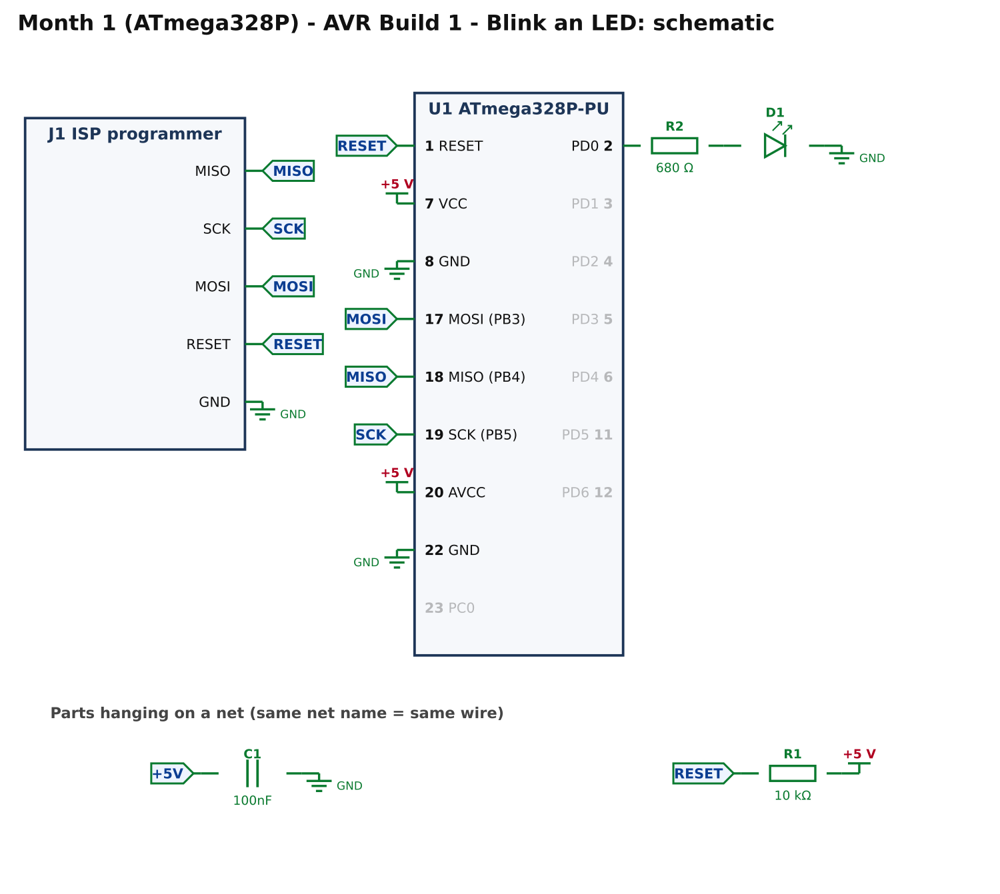
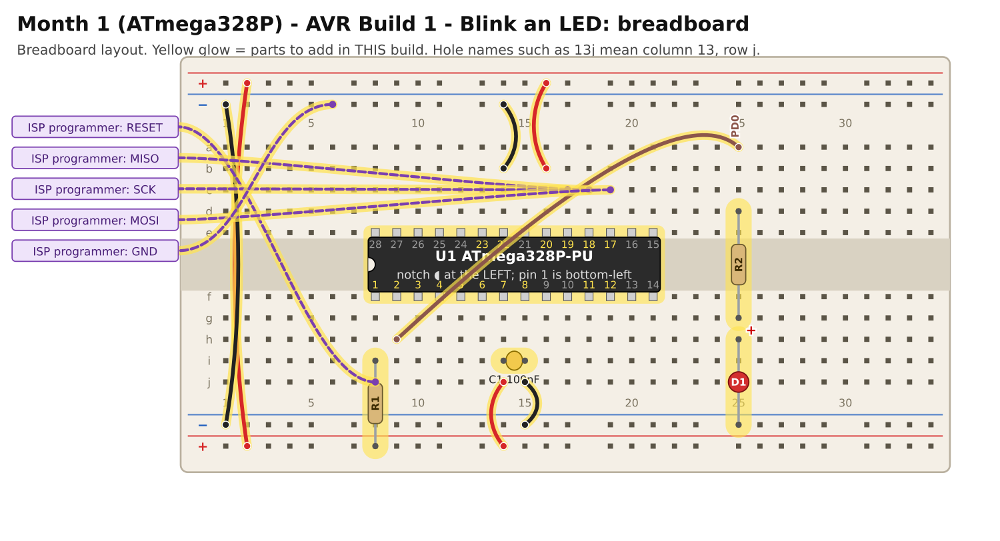

# Month 1 · AVR Build 1 – Blink an LED

[← Month 1](README.md) · [Next: AVR Build 2 →](avr-2-button.md)

**Goal:** make one LED blink once a second on an ATmega328P, programmed in plain C with a USBasp or an Uno R3 as programmer.
This proves the chip, the programmer and the software all work.

**Status:** logic tested in simulation · compile and bench test pending

**Before you start:** do [AVR software and programmer setup](../start-here/03-avr-setup.md) once. You need VS Code with PlatformIO, and either a USBasp or an Arduino Uno R3 prepared as a programmer.

## 1. What you are building



How to read it: lines are wires. The little arrows with a name (such as **RESET**) are "net flags": every flag with the same name is the same wire.
The ground symbol is the **GND** rail and the **+5 V** bar is the supply rail.

* **Power:** the chip has two supply pins, **VCC (pin 7)** and **AVCC (pin 20)**, and two ground pins, **8** and **22**. **All four** must be connected, even though we are not using the analog part.
* **C1, 100 nF:** a small reservoir next to the chip that smooths out power spikes. Always fit it.
* **R1, 10 kΩ:** holds the RESET pin high so the chip runs. The programmer can still pull it low.
* **R2 + D1:** limits the LED current to about 4 mA. The LED is on **PD0** (chip pin 2).
* **J1:** not a part. It is the five wires from your programmer: MISO, SCK, MOSI, RESET and ground.
* There is **no crystal**: a new ATmega328P uses its own internal oscillator, at 1 MHz.

## 2. Build it



(Sharper [SVG](images/avr-1-breadboard.svg).) Power OFF. Hole names such as **14j** mean *column 14, row j*; see the
[breadboard basics](../start-here/05-electronics-and-breadboard-basics.md#how-the-holes-are-connected).

<!-- placement:avr:1 -->
| Step | Part                       | Where it goes                                                                                                           | Notes                                                                                  |
| ---: | -------------------------- | ----------------------------------------------------------------------------------------------------------------------- | -------------------------------------------------------------------------------------- |
|    1 | U1 ATmega328P-PU           | Pin 1 in hole **8f**, notch to the **left**. Pins 1–14 run along row f (columns 8–21); pins 15–28 run back along row e. | Skinny (300 mil) chip: one row of pins each side of the centre channel (rows e and f). |
|    2 | jumper wire                | top **red** rail (+), near column 2 → bottom **red** rail (+), near column 2                                            | +5 V power (red)                                                                       |
|    3 | jumper wire                | top **blue** rail (−), near column 1 → bottom **blue** rail (−), near column 1                                          | ground (black)                                                                         |
|    4 | jumper wire                | **14j** → bottom **red** rail (+), near column 14                                                                       | +5 V power (red)                                                                       |
|    5 | jumper wire                | **15j** → bottom **blue** rail (−), near column 15                                                                      | ground (black)                                                                         |
|    6 | C1 100nF capacitor         | **14i** and **15i**                                                                                                     | ceramic: either way round; keep the legs short                                         |
|    7 | jumper wire                | **16b** → top **red** rail (+), near column 16                                                                          | +5 V power (red)                                                                       |
|    8 | jumper wire                | **14b** → top **blue** rail (−), near column 14                                                                         | ground (black)                                                                         |
|    9 | R1 10 kΩ resistor          | **8i** and bottom **red** rail (+), near column 8                                                                       | either way round                                                                       |
|   10 | ISP programmer lead: RESET | from ISP programmer **RESET** to **8j**                                                                                 | female-to-male Dupont lead                                                             |
|   11 | ISP programmer lead: MISO  | from ISP programmer **MISO** to **18c**                                                                                 | female-to-male Dupont lead                                                             |
|   12 | ISP programmer lead: SCK   | from ISP programmer **SCK** to **17c**                                                                                  | female-to-male Dupont lead                                                             |
|   13 | ISP programmer lead: MOSI  | from ISP programmer **MOSI** to **19c**                                                                                 | female-to-male Dupont lead                                                             |
|   14 | ISP programmer lead: GND   | from ISP programmer **GND** to top **blue** rail (−), near column 6                                                     | female-to-male Dupont lead                                                             |
|   15 | jumper wire                | **9h** → **25a**                                                                                                        | signal PD0 (any colour)                                                                |
|   16 | R2 680 Ω resistor          | **25d** and **25g**                                                                                                     | either way round                                                                       |
|   17 | D1 red LED                 | **long leg** in **25h**, **short leg** in bottom **blue** rail (−), near column 25                                      | the long leg (+) goes towards the resistor                                             |
<!-- /placement -->

**Which programmer pin goes to each lead:**

| Lead    | Goes to the chip's | USBasp 6-pin header | Arduino Uno R3 (running ArduinoISP) |
| ------- | ------------------ | :-----------------: | :---------------------------------: |
| MISO    | pin 18             |          1          |                 D12                 |
| SCK     | pin 19             |          3          |                 D13                 |
| MOSI    | pin 17             |          4          |                 D11                 |
| RESET   | pin 1              |          5          |                 D10                 |
| GND     | GND rail           |          6          |                 GND                 |
| *(VCC)* | **not connected**  |          2          |       5 V: **not connected**        |

**Do not connect the programmer's power.** The breadboard supply powers the chip. Details are in [the AVR setup page](../start-here/03-avr-setup.md).

The same circuit as a connection list:

<!-- connections:avr:1 -->
| Starts at                  | Then goes through                                           |
| -------------------------- | ----------------------------------------------------------- |
| U1 pin **7** (VCC)         | **+5 V**                                                    |
| U1 pin **20** (AVCC)       | **+5 V**                                                    |
| U1 pin **8** (GND)         | **GND**                                                     |
| U1 pin **22** (GND)        | **GND**                                                     |
| net **+5V**                | C1 100nF → **GND**                                          |
| U1 pin **1** (RESET)       | net **RESET**                                               |
| net **RESET**              | R1 10 kΩ → **+5 V**                                         |
| J1 pin **4** (RESET)       | net **RESET**                                               |
| J1 pin **1** (MISO)        | net **MISO**                                                |
| U1 pin **18** (MISO (PB4)) | net **MISO**                                                |
| J1 pin **2** (SCK)         | net **SCK**                                                 |
| U1 pin **19** (SCK (PB5))  | net **SCK**                                                 |
| J1 pin **3** (MOSI)        | net **MOSI**                                                |
| U1 pin **17** (MOSI (PB3)) | net **MOSI**                                                |
| J1 pin **5** (GND)         | **GND**                                                     |
| U1 pin **2** (PD0)         | R2 680 Ω → D1 LED (long leg towards the resistor) → **GND** |
<!-- /connections -->

## 3. Check before you power it (2 minutes, saves chips)

Chip in, **power off**, multimeter on continuity:

1. **No short:** between the **+5 V** rail and the **GND** rail it must **not** beep.
2. **Chip pins:** pins **7** and **20** beep to the +5 V rail; pins **8** and **22** beep to the GND rail.
3. **Reset pull-up:** pin **1** to the +5 V rail reads about **10 kΩ**.

Switch the breadboard supply on (5 V):

* **Check 4:** meter on DC volts, red probe on pin **7**, black on pin **8**: **4.8 V to 5.2 V**.

Then attach the programmer and test the connection (the *signature* test in [the setup page](../start-here/03-avr-setup.md#check-the-connection-before-anything-else)).
You want `Device signature = 0x1e950f`.

## 4. Program it

1. Make a PlatformIO project for your programmer as in [Step 2 of the setup page](../start-here/03-avr-setup.md#step-2-make-an-avr-project).
2. Put this in `src/main.c`.
3. Press **Build** (✓) then **Upload** (→).

<!-- code:code/avr-1-blink/main.c -->
```c
/*
 * Month 1 (ATmega328P) - Build 1: Blink an LED
 *
 * Chip     : ATmega328P-PU (28-pin PDIP)
 * Compiler : avr-gcc (with avr-libc)
 * Supply   : 5 V
 * Clock    : internal oscillator, 1 MHz (the chip's factory setting: no crystal needed)
 * LED      : PD0 (pin 2) -> 680 ohm -> LED -> GND
 *
 * What it does: LED on for half a second, off for half a second, forever.
 * If you see this, the chip, the programmer and your wiring all work.
 */

#ifndef F_CPU                    /* (the build tool may already have set it) */
#define F_CPU 1000000UL          /* tells _delay_ms() the clock speed: 1 MHz */
#endif

#include <avr/io.h>
#include <util/delay.h>

#define LED  (1 << PD0)          /* a mask with only bit 0 set (port D) */

int main(void)
{
    DDRD |= LED;                 /* DDRD: a 1 bit makes the pin an OUTPUT */

    while (1)
    {
        PORTD |= LED;            /* LED on  (PORTD sets the output level) */
        _delay_ms(500);
        PORTD &= ~LED;           /* LED off */
        _delay_ms(500);
    }
}
```
<!-- /code -->

### From Arduino to this

| In Arduino                | Here                                                         |
| ------------------------- | ------------------------------------------------------------ |
| `pinMode(pin, OUTPUT)`    | `DDRD \|= LED;` a **1** bit in DDRD makes that pin an output |
| `digitalWrite(pin, HIGH)` | `PORTD \|= LED;` sets the bit in PORTD                       |
| `digitalWrite(pin, LOW)`  | `PORTD &= ~LED;` clears it                                   |
| `delay(500)`              | `_delay_ms(500);` which needs `F_CPU`                        |
| `loop()`                  | the `while (1)` loop                                         |

How it works, line by line:

* `#define LED (1 << PD0)` builds a **mask**: the number with only bit 0 set. `|=` sets bits and `&= ~` clears them, so other pins on the port are left alone.
* `F_CPU` is the clock speed. `_delay_ms()` counts clock cycles, so it must know it. If it is wrong, every delay is wrong by the same factor.
* `DDRD` is the **data direction** register; `PORTD` sets output levels.

## 5. Pass check

* [ ] `avrdude` read the signature `0x1e950f`, and the upload ended with the flash verified.
* [ ] The LED is on for half a second, off for half a second, repeating.
* [ ] Ten blinks take about ten seconds on a stopwatch.
* [ ] Unplugging and re-plugging the power starts the blinking again (the program is stored in the chip).

## 6. If it does not work

| What you see                          | Most likely cause                                  | What to do                                                                     |
| ------------------------------------- | -------------------------------------------------- | ------------------------------------------------------------------------------ |
| signature `0x000000` or `0xffffff`    | power or a lead is wrong                           | recheck checks 1 to 4; MISO, MOSI, SCK and RESET each go to the right chip pin |
| upload says "initialization failed"   | programmer not seen, or programming clock too fast | another USB port; the USBasp driver; keep `-B10`                               |
| uploads fine but the LED never lights | LED backwards, or wrong hole                       | long leg to the resistor; the wire from **9h** to **25a**                      |
| LED blinks at the wrong speed         | `F_CPU` does not match the clock                   | keep the chip's factory fuses; `board_build.f_cpu = 1000000L`                  |
| `not in sync` (Uno programmer)        | the Uno's auto-reset                               | 10 µF capacitor, Uno RESET (+) to GND (−)                                      |

## 7. Try this

* Make it blink twice as fast. Which number changes?
* Make it blink three short flashes, a pause, repeat.
* Compare `main.c` with the PIC version of the same build ([PIC Build 1](pic-1-blink.md)) when you reach it: the structure is the same, only the register names differ.

[← Month 1](README.md) · [Next: AVR Build 2 →](avr-2-button.md)
