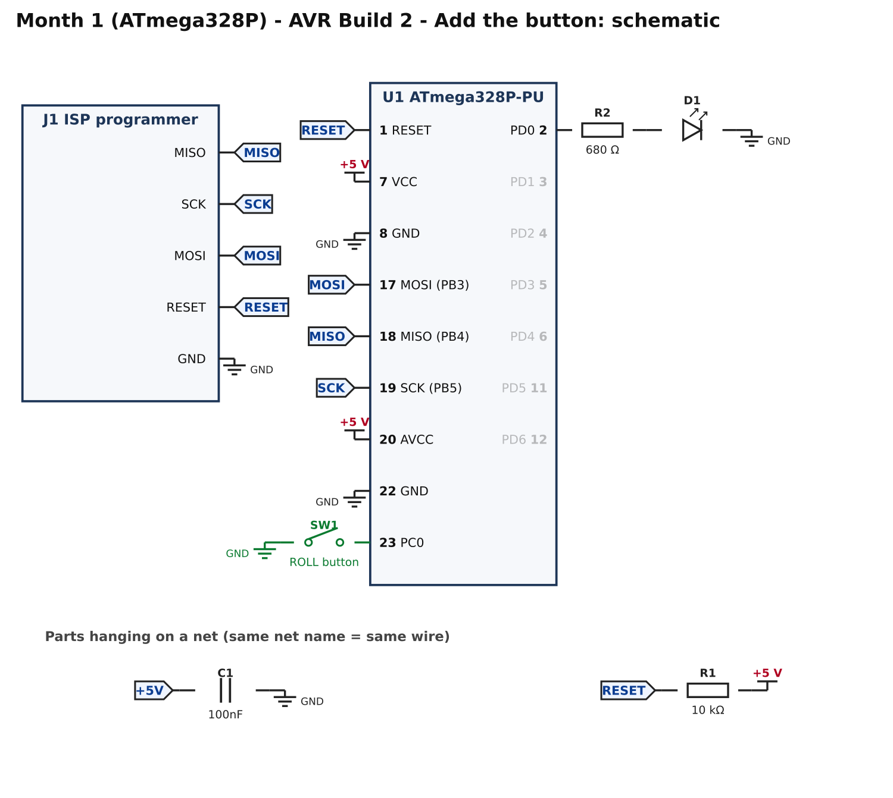
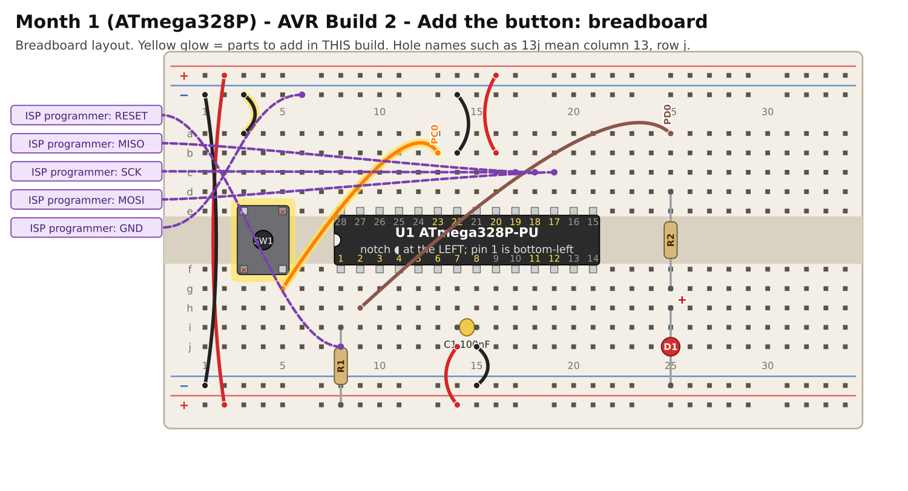

# Month 1 · AVR Build 2 – Add the button

[← AVR Build 1](avr-1-blink.md) · [Month 1](README.md) · [Next: AVR Build 3 →](avr-3-dice.md)

**Goal:** the LED lights only while you hold a button down. This proves you can **read** a pin, not just write to one.

**Status:** logic tested in simulation · compile and bench test pending

**Before you start:** AVR Build 1 must pass. Power OFF. Leave everything from Build 1 in place.

## 1. What you are adding



New in green: the push button **SW1** between pin 23 (**PC0**) and GND.

**Why no resistor?** PC0 is set up with the chip's own **pull-up**, a built-in resistor to +5 V. With the button open, PC0 reads **HIGH (1)**.
Pressing the button connects PC0 to GND, so it reads **LOW (0)**. That is why "pressed" means `0` in the code. This is the same as `INPUT_PULLUP` in Arduino.

## 2. Build it



<!-- placement:avr:2 -->
| Step | Part            | Where it goes                                                 | Notes                                                                                              |
| ---: | --------------- | ------------------------------------------------------------- | -------------------------------------------------------------------------------------------------- |
|    1 | SW1 push button | straddling the centre channel with legs in **3e, 5e, 3f, 5f** | only the diagonal legs (3e and 5f) are wired; keep strips 5e and 3f empty. Works either way round. |
|    2 | jumper wire     | **3a** → top **blue** rail (−), near column 3                 | ground (black)                                                                                     |
|    3 | jumper wire     | **5g** → **13b**                                              | signal PC0 (any colour)                                                                            |
<!-- /placement -->

A 4-legged push button has two pairs of legs joined inside. Wiring only the two **diagonal** legs (as above) means it works whichever way round it sits.
The other two legs must not touch anything.

Connections, as a list:

<!-- connections:avr:2 -->
| Starts at           | Then goes through    |
| ------------------- | -------------------- |
| U1 pin **23** (PC0) | SW1 button → **GND** |
<!-- /connections -->

## 3. Check before you power it

1. With power off and the button **not** pressed: pin 23 to GND must **not** beep.
2. Press and hold the button: pin 23 to GND **beeps**.
3. +5 V rail to GND rail: still no short.

## 4. Program it

Replace `src/main.c` with this, then **Build** and **Upload**:

<!-- code:code/avr-2-button/main.c -->
```c
/*
 * Month 1 (ATmega328P) - Build 2: A button controls the LED
 *
 * Chip     : ATmega328P-PU (28-pin PDIP)
 * Compiler : avr-gcc (with avr-libc)
 * Supply   : 5 V
 * Clock    : internal oscillator, 1 MHz (factory setting)
 * LED      : PD0 (pin 2)  -> 680 ohm -> LED -> GND
 * Button   : PC0 (pin 23) -> button -> GND
 *
 * What it does: the LED is on while you hold the button down.
 * The chip's own pull-up resistor holds PC0 HIGH until the button connects it
 * to GND, so a pressed button reads as 0 (LOW).
 */

#ifndef F_CPU
#define F_CPU 1000000UL
#endif

#include <avr/io.h>
#include <util/delay.h>

#define LED     (1 << PD0)       /* port D, bit 0 */
#define BUTTON  (1 << PC0)       /* port C, bit 0 */

int main(void)
{
    DDRD  |= LED;                /* LED pin: output                        */

    DDRC  &= ~BUTTON;            /* button pin: input (DDR bit = 0)        */
    PORTC |= BUTTON;             /* for an INPUT, PORT bit = 1 turns on the pull-up */

    while (1)
    {
        if ((PINC & BUTTON) == 0)    /* PINC reads the pins: 0 = pressed   */
        {
            PORTD |= LED;
        }
        else
        {
            PORTD &= ~LED;
        }
    }
}
```
<!-- /code -->

How it works:

* `DDRC &= ~BUTTON;` makes PC0 an **input**. `PORTC |= BUTTON;` on an input turns **on the pull-up**. (The same register means "level" for outputs and "pull-up" for inputs.)
* `PINC` *reads* the pins (`PORTD` *writes* them; do not mix them up).
* `(PINC & BUTTON) == 0` is true when the PC0 bit is 0, meaning the button is down.

## 5. Pass check

* [ ] LED off when you are not touching the button.
* [ ] LED on while the button is held, off again when released.
* [ ] A very quick tap still lights it briefly.

## 6. If it does not work

| What you see           | Most likely cause                                | What to do                                                                |
| ---------------------- | ------------------------------------------------ | ------------------------------------------------------------------------- |
| LED is always on       | button wired to the wrong legs, or always closed | the picture shows **3e** and **5f** as the used legs; turn the button 90° |
| LED never responds     | button not reaching pin 23                       | continuity: pin 23 ↔ **13b** ↔ **5g** ↔ button                            |
| LED flickers by itself | pull-up not enabled (floating input)             | check `PORTC \|= BUTTON;` is present                                      |
| LED does the opposite  | logic inverted in your own edit                  | remember pressed = 0                                                      |

## 7. Try this

* Make the LED toggle on each press (on, off, on...) instead of following the button. What problem appears? (Hint: one press is read many times.)

[← AVR Build 1](avr-1-blink.md) · [Month 1](README.md) · [Next: AVR Build 3 →](avr-3-dice.md)
