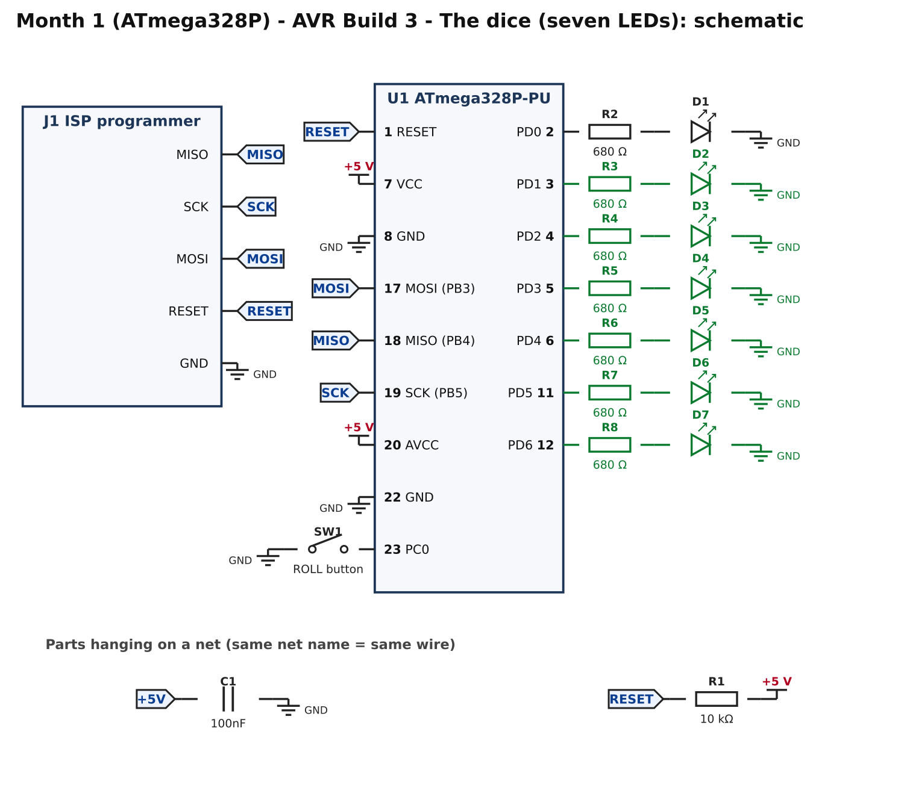
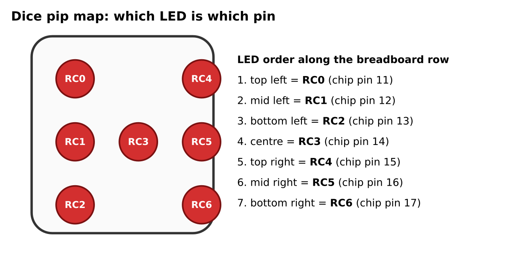
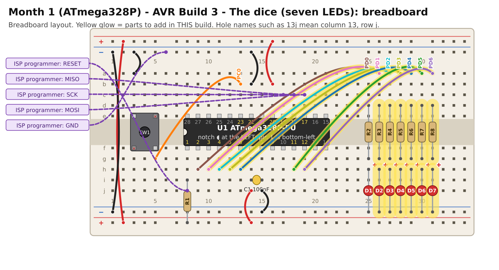

# Month 1 · AVR Build 3 – The dice

[← AVR Build 2](avr-2-button.md) · [Month 1](README.md) · [Next: PIC track →](pic-1-blink.md)

**Goal:** six more LEDs, and a program that "rolls" them to show a number from 1 to 6.

**Status:** logic tested in simulation (all six faces occur; one roll per press) · compile and bench test pending

**Before you start:** AVR Build 2 must pass. Power OFF.

## 1. What you are adding



Six more LEDs, each with its own 680 Ω resistor, on PD1 to PD6. Together with D1 (PD0) they are the seven "pips" of a die:



The pip map shows the PIC pin names; for the ATmega328P the same seven LEDs are on **PD0 to PD6** in the same order
(top left = PD0 ... bottom right = PD6). You can wire the LEDs in a straight row, as the breadboard picture does.
If you would like it to *look* like a die, bend the LED legs out and arrange them using the map.

## 2. Build it



Six identical little "LED units": a wire from the chip pin to the top of a column, a resistor across the centre channel, and an LED to the bottom ground rail.

<!-- placement:avr:3 -->
| Step | Part              | Where it goes                                                                      | Notes                                      |
| ---: | ----------------- | ---------------------------------------------------------------------------------- | ------------------------------------------ |
|    1 | jumper wire       | **10h** → **26a**                                                                  | signal PD1 (any colour)                    |
|    2 | R3 680 Ω resistor | **26d** and **26g**                                                                | either way round                           |
|    3 | D2 red LED        | **long leg** in **26h**, **short leg** in bottom **blue** rail (−), near column 26 | the long leg (+) goes towards the resistor |
|    4 | jumper wire       | **11h** → **27a**                                                                  | signal PD2 (any colour)                    |
|    5 | R4 680 Ω resistor | **27d** and **27g**                                                                | either way round                           |
|    6 | D3 red LED        | **long leg** in **27h**, **short leg** in bottom **blue** rail (−), near column 27 | the long leg (+) goes towards the resistor |
|    7 | jumper wire       | **12h** → **28a**                                                                  | signal PD3 (any colour)                    |
|    8 | R5 680 Ω resistor | **28d** and **28g**                                                                | either way round                           |
|    9 | D4 red LED        | **long leg** in **28h**, **short leg** in bottom **blue** rail (−), near column 28 | the long leg (+) goes towards the resistor |
|   10 | jumper wire       | **13h** → **29a**                                                                  | signal PD4 (any colour)                    |
|   11 | R6 680 Ω resistor | **29d** and **29g**                                                                | either way round                           |
|   12 | D5 red LED        | **long leg** in **29h**, **short leg** in bottom **blue** rail (−), near column 29 | the long leg (+) goes towards the resistor |
|   13 | jumper wire       | **18h** → **30a**                                                                  | signal PD5 (any colour)                    |
|   14 | R7 680 Ω resistor | **30d** and **30g**                                                                | either way round                           |
|   15 | D6 red LED        | **long leg** in **30h**, **short leg** in bottom **blue** rail (−), near column 30 | the long leg (+) goes towards the resistor |
|   16 | jumper wire       | **19h** → **31a**                                                                  | signal PD6 (any colour)                    |
|   17 | R8 680 Ω resistor | **31d** and **31g**                                                                | either way round                           |
|   18 | D7 red LED        | **long leg** in **31h**, **short leg** in bottom **blue** rail (−), near column 31 | the long leg (+) goes towards the resistor |
<!-- /placement -->

Connections, as a list:

<!-- connections:avr:3 -->
| Starts at           | Then goes through                                           |
| ------------------- | ----------------------------------------------------------- |
| U1 pin **3** (PD1)  | R3 680 Ω → D2 LED (long leg towards the resistor) → **GND** |
| U1 pin **4** (PD2)  | R4 680 Ω → D3 LED (long leg towards the resistor) → **GND** |
| U1 pin **5** (PD3)  | R5 680 Ω → D4 LED (long leg towards the resistor) → **GND** |
| U1 pin **6** (PD4)  | R6 680 Ω → D5 LED (long leg towards the resistor) → **GND** |
| U1 pin **11** (PD5) | R7 680 Ω → D6 LED (long leg towards the resistor) → **GND** |
| U1 pin **12** (PD6) | R8 680 Ω → D7 LED (long leg towards the resistor) → **GND** |
<!-- /connections -->

## 3. Check before you power it

1. No short between the +5 V and GND rails.
2. Look along the LED row: every long leg is on the **resistor** side (the picture marks it with a red **+**).
3. Power on: nothing should light yet.

## 4. Program it

<!-- code:code/avr-3-dice/main.c -->
```c
/*
 * Month 1 (ATmega328P) - Build 3: Electronic dice
 *
 * Chip     : ATmega328P-PU (28-pin PDIP)
 * Compiler : avr-gcc (with avr-libc)
 * Supply   : 5 V
 * Clock    : internal oscillator, 1 MHz (factory setting)
 * Button   : PC0 (pin 23) -> button -> GND
 *
 * Seven LEDs ("pips"), each with its own 680 ohm resistor, on PD0..PD6.
 * Think of them laid out like the dots on a real die:
 *
 *        TOP_LEFT   (PD0, pin 2)       TOP_RIGHT    (PD4, pin 6)
 *        MID_LEFT   (PD1, pin 3)   CENTRE (PD3, pin 5)   MID_RIGHT (PD5, pin 11)
 *        BOTTOM_LEFT(PD2, pin 4)       BOTTOM_RIGHT (PD6, pin 12)
 *
 * What it does: the centre LED flashes 3 times to say "ready". Press the
 * button and the dice "rolls" through several faces, then stops on one.
 *
 * Where does the randomness come from? While you wait, the chip counts
 * 0,1,2,3,4,5,0,1,2... thousands of times a second. The instant you press
 * the button is unpredictable, so the count at that instant is too.
 */

#ifndef F_CPU
#define F_CPU 1000000UL
#endif

#include <avr/io.h>
#include <util/delay.h>

#define BUTTON        (1 << PC0)

/* One bit per LED on port D */
#define TOP_LEFT      0x01
#define MID_LEFT      0x02
#define BOTTOM_LEFT   0x04
#define CENTRE        0x08
#define TOP_RIGHT     0x10
#define MID_RIGHT     0x20
#define BOTTOM_RIGHT  0x40

/* Which LEDs are lit for each face. faces[3] is the pattern for a "3". */
const unsigned char faces[7] =
{
    0x00,                                                    /* (unused) */
    CENTRE,                                                  /* 1 */
    TOP_LEFT | BOTTOM_RIGHT,                                 /* 2 */
    TOP_LEFT | CENTRE | BOTTOM_RIGHT,                        /* 3 */
    TOP_LEFT | TOP_RIGHT | BOTTOM_LEFT | BOTTOM_RIGHT,       /* 4 */
    TOP_LEFT | TOP_RIGHT | BOTTOM_LEFT | BOTTOM_RIGHT | CENTRE, /* 5 */
    TOP_LEFT | MID_LEFT | BOTTOM_LEFT |
    TOP_RIGHT | MID_RIGHT | BOTTOM_RIGHT                     /* 6 */
};

unsigned char counter = 0;       /* free-running 0..5 */

void showFace(unsigned char face)
{
    PORTD = faces[face];
}

void readyFlash(void)
{
    unsigned char i;
    for (i = 0; i < 3; i++)
    {
        PORTD = CENTRE;
        _delay_ms(150);
        PORTD = 0x00;
        _delay_ms(150);
    }
}

void rollDice(void)
{
    unsigned char step;

    for (step = 0; step < 15; step++)
    {
        counter++;
        if (counter >= 6) counter = 0;

        showFace(counter + 1);   /* counter is 0..5, faces are 1..6 */

        if (step < 9)       _delay_ms(60);     /* fast at first...      */
        else if (step < 13) _delay_ms(120);    /* ...then slowing down  */
        else                _delay_ms(240);
    }
    /* The last face shown stays lit until the next roll. */
}

int main(void)
{
    DDRD  = 0x7F;                /* PD0..PD6 outputs, PD7 unused input  */
    PORTD = 0x00;

    DDRC  &= ~BUTTON;            /* button pin: input                   */
    PORTC |= BUTTON;             /* with its pull-up on                 */

    readyFlash();
    showFace(1);

    while (1)
    {
        counter++;               /* keep counting while we wait         */
        if (counter >= 6) counter = 0;

        if ((PINC & BUTTON) == 0)
        {
            _delay_ms(30);                   /* wait out contact bounce   */
            if ((PINC & BUTTON) == 0)        /* still pressed? then it is real */
            {
                rollDice();
                while ((PINC & BUTTON) == 0)
                {
                    /* wait here until the button is released */
                }
                _delay_ms(30);
            }
        }
    }
}
```
<!-- /code -->

How it works:

* `DDRD = 0x7F;` makes PD0 to PD6 outputs (the seven LEDs) and leaves PD7 an input.
* `faces[]` is a lookup table: `faces[4]` is the pattern of LEDs that make a "4". `PORTD = faces[face];` lights them all in one go.
* `counter` counts 0 to 5 over and over, thousands of times a second, while you wait. When you press, the count is effectively random.
* `rollDice()` steps through the faces (quick, then slower) and stops. The last face stays lit.
* The 30 ms delays stop contact "bounce" from being counted as extra presses.

## 5. Pass check

* [ ] On power-up the centre LED flashes three times, then shows a **1**.
* [ ] Pressing the button runs the animation and settles on a face about two seconds later.
* [ ] Holding the button does not roll again until you release and press again.
* [ ] After 20 rolls you have seen every number at least once.
* [ ] Each face looks right: 2 is opposite corners, 4 is four corners, 6 is two columns of three.

## 6. If it does not work

| What you see                              | Most likely cause                       | What to do                                                                                             |
| ----------------------------------------- | --------------------------------------- | ------------------------------------------------------------------------------------------------------ |
| One LED never lights                      | LED backwards or a loose resistor       | swap the LED; check both resistor legs and that column's wire                                          |
| Two LEDs light together                   | a wire in the wrong column              | compare with the placement table; each column has exactly one signal wire                              |
| Faces look wrong (a "2" looks like a "3") | LEDs in the wrong order                 | the row order must be: top-left, mid-left, bottom-left, **centre**, top-right, mid-right, bottom-right |
| Rolls twice per press                     | contact bounce on a worn button         | lengthen the two 30 ms delays                                                                          |
| An LED stays dim when it should be off    | that pin is also used by the programmer | only PD0 to PD6 are used for LEDs; **do not** move an LED onto pins 17, 18, 19 or 1                    |

## 7. Try this

* Make the centre LED flash on a six, as a celebration.
* Add a second roll style: hold the button for a "high roll" (always 4, 5 or 6).

## 8. Where next

You have built the same dice on an Arduino chip, in plain C, with the real tools. Next, the same circuit idea on a **PIC**, with Microchip's tools:
[PIC Build 1](pic-1-blink.md). When you move over, keep the LEDs, resistors and button; the PIC pages tell you exactly which wires to move.

[← AVR Build 2](avr-2-button.md) · [Month 1](README.md) · [Next: PIC track →](pic-1-blink.md)
