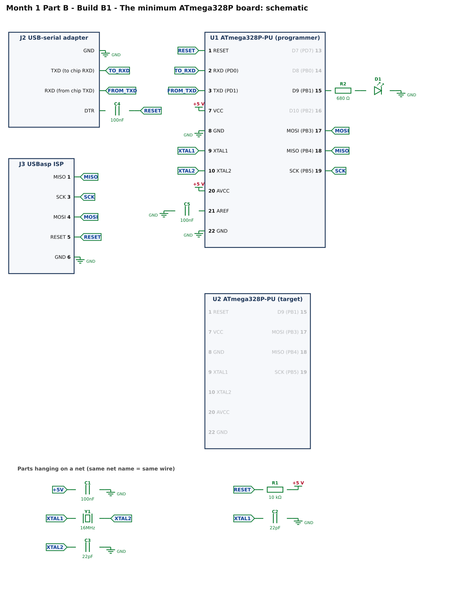
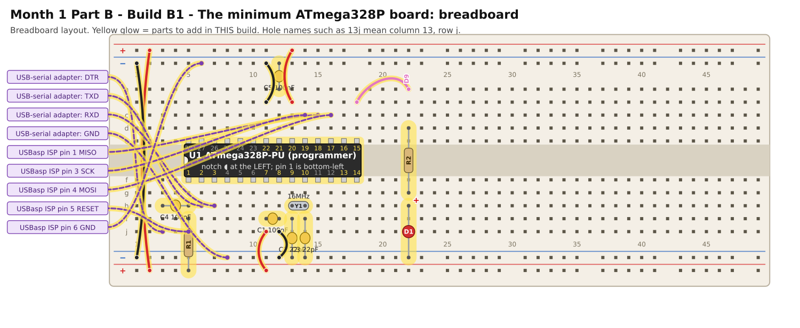

# Month 1 · Part B · Build B1 – The minimum ATmega328P board

[← Part B](README.md) · [Next: Build B2 →](build-b2-programmer.md)

**Goal:** a bare ATmega328P chip running on its own, with a 16 MHz crystal, programmed over USB-serial to blink an LED.

**Status:** wiring machine-checked · uses standard Arduino tools · bench test pending

## 1. What you are building



* **Power:** the chip has two supply pins (VCC pin 7 and AVCC pin 20) and two ground pins (8 and 22). **All four** must be connected. C1 and C5 are 100 nF capacitors that keep the supply steady.
* **R1 (10 kΩ):** holds RESET high.
* **Y1, C2, C3:** the 16 MHz crystal and its two 22 pF capacitors. They give the chip an accurate clock.
* **C4 (100 nF):** connects the USB-serial adapter's **DTR** line to RESET. When the computer wants to load a program it pulses DTR; C4 turns that into a short reset pulse that starts the bootloader.
* **D1 + R2:** an LED on D9 (chip pin 15).
* **J2:** the USB-serial adapter: four leads only (GND, TXD, RXD, DTR). **J3:** the USBasp: used only in this build, to put the first program (the *bootloader*) on the blank chip.

## 2. Build it



Power OFF. **Do not connect the USB-serial adapter's VCC lead.** The adapter's TXD goes to the chip's RXD and the adapter's RXD to the chip's TXD (they cross over).

<!-- placement:1 -->
| Step | Part                          | Where it goes                                                                                                           | Notes                                                                                  |
| ---: | ----------------------------- | ----------------------------------------------------------------------------------------------------------------------- | -------------------------------------------------------------------------------------- |
|    1 | U1 ATmega328P-PU (programmer) | Pin 1 in hole **5f**, notch to the **left**. Pins 1–14 run along row f (columns 5–18); pins 15–28 run back along row e. | Skinny (300 mil) chip: one row of pins each side of the centre channel (rows e and f). |
|    2 | jumper wire                   | top **red** rail (+), near column 2 → bottom **red** rail (+), near column 2                                            | +5 V power (red)                                                                       |
|    3 | jumper wire                   | top **blue** rail (−), near column 1 → bottom **blue** rail (−), near column 1                                          | ground (black)                                                                         |
|    4 | jumper wire                   | **11j** → bottom **red** rail (+), near column 11                                                                       | +5 V power (red)                                                                       |
|    5 | jumper wire                   | **12j** → bottom **blue** rail (−), near column 12                                                                      | ground (black)                                                                         |
|    6 | C1 100nF capacitor            | **11i** and **12i**                                                                                                     | ceramic: either way round; keep the legs short                                         |
|    7 | jumper wire                   | **13b** → top **red** rail (+), near column 13                                                                          | +5 V power (red)                                                                       |
|    8 | jumper wire                   | **11b** → top **blue** rail (−), near column 11                                                                         | ground (black)                                                                         |
|    9 | C5 100nF capacitor            | **12a** and top **blue** rail (−), near column 12                                                                       | ceramic: either way round; keep the legs short                                         |
|   10 | R1 10 kΩ resistor             | **5i** and bottom **red** rail (+), near column 5                                                                       | either way round                                                                       |
|   11 | C4 100nF capacitor            | **3h** and **5h**                                                                                                       | ceramic: either way round; keep the legs short                                         |
|   12 | USB-serial adapter lead: DTR  | from USB-serial adapter **DTR** to **3j**                                                                               | female-to-male Dupont lead                                                             |
|   13 | USB-serial adapter lead: TXD  | from USB-serial adapter **TXD** to **6h**                                                                               | female-to-male Dupont lead                                                             |
|   14 | USB-serial adapter lead: RXD  | from USB-serial adapter **RXD** to **7h**                                                                               | female-to-male Dupont lead                                                             |
|   15 | USB-serial adapter lead: GND  | from USB-serial adapter **GND** to bottom **blue** rail (−), near column 8                                              | female-to-male Dupont lead                                                             |
|   16 | Y1 16MHz crystal              | **13h** and **14h**                                                                                                     | no polarity; the metal can may be left standing up                                     |
|   17 | C2 22pF capacitor             | **13i** and bottom **blue** rail (−), near column 13                                                                    | ceramic: either way round; keep the legs short                                         |
|   18 | C3 22pF capacitor             | **14i** and bottom **blue** rail (−), near column 14                                                                    | ceramic: either way round; keep the legs short                                         |
|   19 | USBasp ISP lead: MISO         | from USBasp ISP pin **1** (MISO) to **15c**                                                                             | female-to-male Dupont lead                                                             |
|   20 | USBasp ISP lead: SCK          | from USBasp ISP pin **3** (SCK) to **14c**                                                                              | female-to-male Dupont lead                                                             |
|   21 | USBasp ISP lead: MOSI         | from USBasp ISP pin **4** (MOSI) to **16c**                                                                             | female-to-male Dupont lead                                                             |
|   22 | USBasp ISP lead: RESET        | from USBasp ISP pin **5** (RESET) to **5j**                                                                             | female-to-male Dupont lead                                                             |
|   23 | USBasp ISP lead: GND          | from USBasp ISP pin **6** (GND) to top **blue** rail (−), near column 6                                                 | female-to-male Dupont lead                                                             |
|   24 | jumper wire                   | **18b** → **22a**                                                                                                       | signal D9 (any colour)                                                                 |
|   25 | R2 680 Ω resistor             | **22d** and **22g**                                                                                                     | either way round                                                                       |
|   26 | D1 red LED                    | **long leg** in **22h**, **short leg** in bottom **blue** rail (−), near column 22                                      | the long leg (+) goes towards the resistor                                             |
<!-- /placement -->

Same circuit as a connection list:

<!-- connections:1 -->
| Starts at                          | Then goes through                                           |
| ---------------------------------- | ----------------------------------------------------------- |
| U1 pin **7** (VCC)                 | **+5 V**                                                    |
| U1 pin **20** (AVCC)               | **+5 V**                                                    |
| U1 pin **8** (GND)                 | **GND**                                                     |
| U1 pin **22** (GND)                | **GND**                                                     |
| U1 pin **21** (AREF)               | C5 100nF → **GND**                                          |
| net **+5V**                        | C1 100nF → **GND**                                          |
| U1 pin **1** (RESET)               | net **RESET**                                               |
| net **RESET**                      | R1 10 kΩ → **+5 V**                                         |
| U1 pin **9** (XTAL1)               | net **XTAL1**                                               |
| U1 pin **10** (XTAL2)              | net **XTAL2**                                               |
| net **XTAL1**                      | net **XTAL2**                                               |
| net **XTAL1**                      | C2 22pF → **GND**                                           |
| net **XTAL2**                      | C3 22pF → **GND**                                           |
| U1 pin **15** (D9 (PB1))           | R2 680 Ω → D1 LED (long leg towards the resistor) → **GND** |
| J2 pin **1** (GND)                 | **GND**                                                     |
| J2 pin **2** (TXD (to chip RXD))   | net **TO_RXD**                                              |
| U1 pin **2** (RXD (PD0))           | net **TO_RXD**                                              |
| J2 pin **3** (RXD (from chip TXD)) | net **FROM_TXD**                                            |
| U1 pin **3** (TXD (PD1))           | net **FROM_TXD**                                            |
| J2 pin **4** (DTR)                 | C4 100nF → net **RESET**                                    |
| J3 pin **1** (MISO)                | net **MISO**                                                |
| J3 pin **3** (SCK)                 | net **SCK**                                                 |
| J3 pin **4** (MOSI)                | net **MOSI**                                                |
| J3 pin **5** (RESET)               | net **RESET**                                               |
| J3 pin **6** (GND)                 | **GND**                                                     |
| U1 pin **17** (MOSI (PB3))         | net **MOSI**                                                |
| U1 pin **18** (MISO (PB4))         | net **MISO**                                                |
| U1 pin **19** (SCK (PB5))          | net **SCK**                                                 |
<!-- /connections -->

## 3. Check before you power it

1. +5 V rail to GND rail: no beep (no short).
2. Pins **7** and **20** each beep to the +5 V rail; pins **8** and **22** each beep to the GND rail.
3. Pin **1** (RESET) to the +5 V rail reads about **10 kΩ**.
4. Power on: pin 7 to pin 8 reads **4.8–5.2 V**.

## 4. Put the first program on the blank chip (the bootloader)

A blank chip from the sample store cannot receive a program over USB-serial yet. It first needs a small program called a **bootloader**,
which then lets you load later programs over the serial lead. This is the "chicken and egg" step, and it needs the USBasp (or an Arduino board used as a programmer).

1. Install the **Arduino IDE**. Plug in the USBasp.
2. **Tools → Board → Arduino AVR Boards → Arduino Uno.**
3. **Tools → Programmer → USBasp.**
4. **Tools → Burn Bootloader.** Wait for **Done burning bootloader.**
5. **Power off, then unplug the five USBasp leads.** You will not need the USBasp again in Part B.

What "Burn Bootloader" really did: it wrote the bootloader **and set the chip's "fuses"**, which are settings stored in the chip. One of them tells it to use the **external crystal**.
From now on, **the chip will not run without its crystal**. That is normal.

## 5. Load the blink sketch over USB-serial

1. Plug in the USB-serial adapter.
2. **Tools → Port** and choose the adapter's port.
3. Open `code/blink-d9/blink-d9.ino`:
4. **Sketch → Upload.**

The sketch, for reference:

<!-- code:code/blink-d9/blink-d9.ino -->
```cpp
/*
 * Month 1 Part B: blink an LED on D9
 *
 * Chip : ATmega328P-PU, 16 MHz crystal, 5 V
 * LED  : D9 (chip pin 15) -> 680 ohm -> LED -> GND
 *
 * D9 is chip pin 15 (port B, bit 1). The Arduino IDE calls it "9".
 * Used twice: on the programmer board in Build B1, and on the target board in Build B3.
 */

const int LED_PIN = 9;

void setup()
{
    pinMode(LED_PIN, OUTPUT);
}

void loop()
{
    digitalWrite(LED_PIN, HIGH);   // LED on
    delay(500);                    // half a second
    digitalWrite(LED_PIN, LOW);    // LED off
    delay(500);
}
```
<!-- /code -->

## 6. Pass check

* [ ] "Burn Bootloader" ended with **Done burning bootloader.**
* [ ] The upload ended with **Done uploading.**
* [ ] The D9 LED blinks: half a second on, half a second off.

## 7. If it does not work

| What you see                                                              | Most likely cause                                     | What to do                                                                                                                  |
| ------------------------------------------------------------------------- | ----------------------------------------------------- | --------------------------------------------------------------------------------------------------------------------------- |
| Burn Bootloader: "initialization failed" or "device signature = 0x000000" | wiring to the chip, or no power                       | check the USBasp signal leads on pins 17, 18, 19 and **1**, and its GND lead; the chip is powered (the checks in section 3) |
| Burn Bootloader: "could not find USB device"                              | USBasp not recognised                                 | another USB port; on Windows a USBasp driver may be needed                                                                  |
| Upload: "not in sync" or "programmer is not responding"                   | TXD and RXD wrong way round, or DTR capacitor missing | swap the **TXD** and **RXD** leads; check C4 is between DTR and pin 1; check the right Port is selected                     |
| Upload works but nothing blinks                                           | LED backwards, or crystal not running                 | long leg to the resistor; check Y1, C2, C3 (the chip needs its crystal after Burn Bootloader)                               |
| Everything worked, then stopped                                           | loose crystal or jumper                               | press the crystal legs firmly into their holes                                                                              |

[← Part B](README.md) · [Next: Build B2 →](build-b2-programmer.md)
