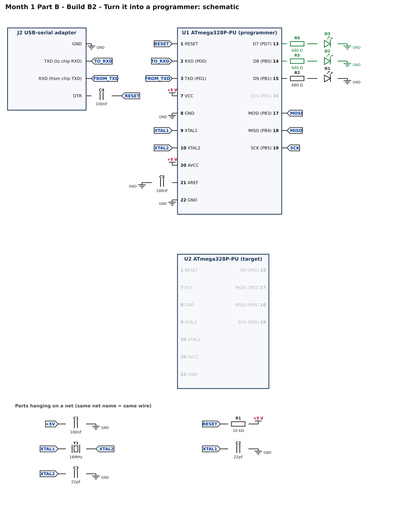
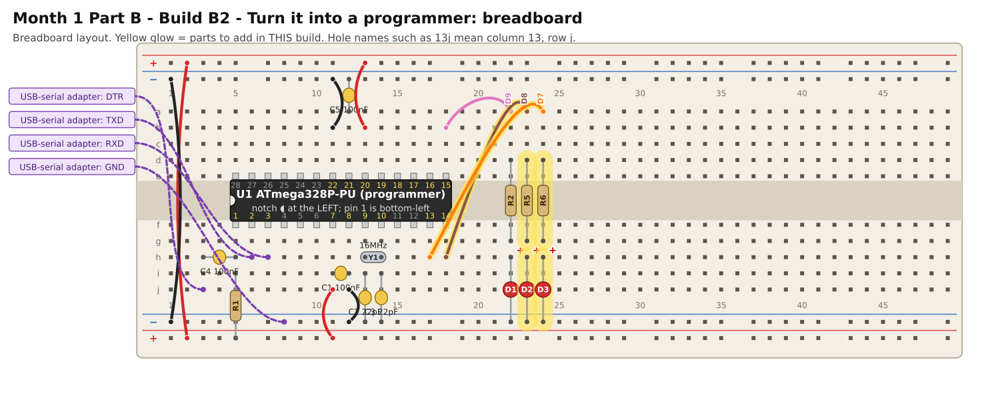

# Month 1 · Part B · Build B2 – Turn it into a programmer

[← Build B1](build-b1-minimum-board.md) · [Part B](README.md) · [Next: Build B3 →](build-b3-program-a-chip.md)

**Goal:** load the **ArduinoISP** program into your chip so that it behaves as a programmer for other AVR chips, with three status lights.

**Status:** wiring machine-checked · uses Arduino's standard ArduinoISP example · bench test pending

**Before you start:** Build B1 must pass, and the USBasp leads must be unplugged. Power OFF.

## 1. What you are adding

Two more LEDs. ArduinoISP uses three, with fixed meanings:

| LED    | Pin              | Means                                                        |
| ------ | ---------------- | ------------------------------------------------------------ |
| **D1** | D9 (chip pin 15) | **heartbeat**: pulses slowly while the programmer is running |
| **D2** | D8 (chip pin 14) | **error**: lights if something goes wrong                    |
| **D3** | D7 (chip pin 13) | **programming**: lights while it is talking to a target chip |

D1 is already in place from Build B1.

## 2. Build it

<!-- placement:2 -->
| Step | Part              | Where it goes                                                                      | Notes                                      |
| ---: | ----------------- | ---------------------------------------------------------------------------------- | ------------------------------------------ |
|    1 | jumper wire       | **18h** → **23a**                                                                  | signal D8 (any colour)                     |
|    2 | R5 680 Ω resistor | **23d** and **23g**                                                                | either way round                           |
|    3 | D2 red LED        | **long leg** in **23h**, **short leg** in bottom **blue** rail (−), near column 23 | the long leg (+) goes towards the resistor |
|    4 | jumper wire       | **17h** → **24a**                                                                  | signal D7 (any colour)                     |
|    5 | R6 680 Ω resistor | **24d** and **24g**                                                                | either way round                           |
|    6 | D3 red LED        | **long leg** in **24h**, **short leg** in bottom **blue** rail (−), near column 24 | the long leg (+) goes towards the resistor |
<!-- /placement -->

Same circuit as a connection list:

<!-- connections:2 -->
| Starts at                | Then goes through                                           |
| ------------------------ | ----------------------------------------------------------- |
| U1 pin **14** (D8 (PB0)) | R5 680 Ω → D2 LED (long leg towards the resistor) → **GND** |
| U1 pin **13** (D7 (PD7)) | R6 680 Ω → D3 LED (long leg towards the resistor) → **GND** |
<!-- /connections -->

## 3. Check before you power it

1. +5 V to GND: no short.
2. Long leg of D2 and D3 towards the resistors.

## 4. Load ArduinoISP

1. USB-serial adapter plugged in. **Tools → Board → Arduino Uno. Tools → Port →** the adapter.
2. **File → Examples → 11.ArduinoISP → ArduinoISP.**
3. **Sketch → Upload.** Wait for **Done uploading.**

You do not need to change anything in the sketch. It is Arduino's standard example, and it already uses the pins in this circuit:
D10 resets the target, D11, D12, D13 are the ISP data and clock lines, and D9, D8, D7 are the three LEDs.

## 5. Pass check

* [ ] The upload finished with **Done uploading.**
* [ ] **D1** (heartbeat) pulses slowly: it fades up and down, not an on/off blink.
* [ ] **D2** (error) and **D3** (programming) are **off**.

To turn the chip back into a plain blinker, upload `blink-d9.ino` again.

## 6. If it does not work

| What you see                      | Most likely cause                    | What to do                                                                   |
| --------------------------------- | ------------------------------------ | ---------------------------------------------------------------------------- |
| Upload fails ("not in sync")      | the same causes as Build B1          | check the serial leads and Port; nothing changed in the circuit but the LEDs |
| D1 blinks on and off, not a pulse | the blink sketch is still loaded     | upload ArduinoISP                                                            |
| D2 (error) on                     | ArduinoISP detected a fault          | usually the sketch needs reloading; re-upload ArduinoISP                     |
| Nothing at all                    | no power, or the crystal has stopped | repeat the Build B1 checks                                                   |

[← Build B1](build-b1-minimum-board.md) · [Part B](README.md) · [Next: Build B3 →](build-b3-program-a-chip.md)
