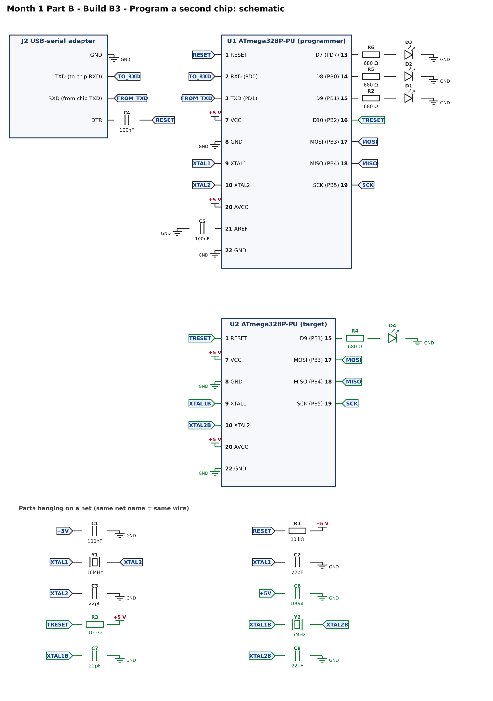
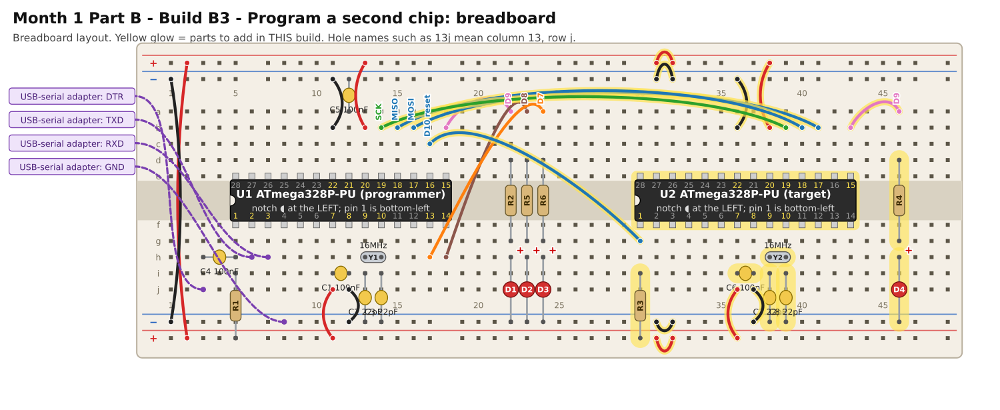

# Month 1 · Part B · Build B3 – Program a second chip

[← Build B2](build-b2-programmer.md) · [Part B](README.md)

**Goal:** your programmer loads a bootloader and the blink sketch into a **second, blank ATmega328P**, with no USBasp involved.

**Status:** wiring machine-checked · uses standard Arduino tools · bench test pending

**Before you start:** Build B2 must pass. Power OFF.

## 1. What you are adding

* **A second, identical minimum board** (U2): power, reset pull-up (R3), crystal (Y2, C7, C8), decoupling (C6) and a test LED (D4 on D9).
* **Four wires** from the programmer to the target. These four wires are the **ISP** connection:

| Programmer pin    | Target pin | Name  | Job                                     |
| ----------------- | ---------- | ----- | --------------------------------------- |
| D10 (chip pin 16) | pin 1      | RESET | tells the target "listen for a program" |
| D11 (chip pin 17) | pin 17     | MOSI  | data from programmer to target          |
| D12 (chip pin 18) | pin 18     | MISO  | data from target to programmer          |
| D13 (chip pin 19) | pin 19     | SCK   | clock                                   |

## 2. Build it

The right-hand half of your power rails needs the four short bridging wires (columns 31 to 32) if your rails have a break in the middle.

<!-- placement:3 -->
| Step | Part                      | Where it goes                                                                                                             | Notes                                                                                  |
| ---: | ------------------------- | ------------------------------------------------------------------------------------------------------------------------- | -------------------------------------------------------------------------------------- |
|    1 | U2 ATmega328P-PU (target) | Pin 1 in hole **30f**, notch to the **left**. Pins 1–14 run along row f (columns 30–43); pins 15–28 run back along row e. | Skinny (300 mil) chip: one row of pins each side of the centre channel (rows e and f). |
|    2 | jumper wire               | top **red** rail (+), near column 31 → top **red** rail (+), near column 32                                               | +5 V power (red)                                                                       |
|    3 | jumper wire               | bottom **red** rail (+), near column 31 → bottom **red** rail (+), near column 32                                         | +5 V power (red)                                                                       |
|    4 | jumper wire               | top **blue** rail (−), near column 31 → top **blue** rail (−), near column 32                                             | ground (black)                                                                         |
|    5 | jumper wire               | bottom **blue** rail (−), near column 31 → bottom **blue** rail (−), near column 32                                       | ground (black)                                                                         |
|    6 | R3 10 kΩ resistor         | **30i** and bottom **red** rail (+), near column 30                                                                       | either way round                                                                       |
|    7 | jumper wire               | **17c** → **30g**                                                                                                         | signal D10 reset (any colour)                                                          |
|    8 | jumper wire               | **36j** → bottom **red** rail (+), near column 36                                                                         | +5 V power (red)                                                                       |
|    9 | jumper wire               | **37j** → bottom **blue** rail (−), near column 37                                                                        | ground (black)                                                                         |
|   10 | C6 100nF capacitor        | **36i** and **37i**                                                                                                       | ceramic: either way round; keep the legs short                                         |
|   11 | jumper wire               | **38b** → top **red** rail (+), near column 38                                                                            | +5 V power (red)                                                                       |
|   12 | jumper wire               | **36b** → top **blue** rail (−), near column 36                                                                           | ground (black)                                                                         |
|   13 | Y2 16MHz crystal          | **38h** and **39h**                                                                                                       | no polarity; the metal can may be left standing up                                     |
|   14 | C7 22pF capacitor         | **38i** and bottom **blue** rail (−), near column 38                                                                      | ceramic: either way round; keep the legs short                                         |
|   15 | C8 22pF capacitor         | **39i** and bottom **blue** rail (−), near column 39                                                                      | ceramic: either way round; keep the legs short                                         |
|   16 | jumper wire               | **16b** → **41b**                                                                                                         | signal MOSI (any colour)                                                               |
|   17 | jumper wire               | **15b** → **40b**                                                                                                         | signal MISO (any colour)                                                               |
|   18 | jumper wire               | **14b** → **39b**                                                                                                         | signal SCK (any colour)                                                                |
|   19 | jumper wire               | **43b** → **46a**                                                                                                         | signal D9 (any colour)                                                                 |
|   20 | R4 680 Ω resistor         | **46d** and **46g**                                                                                                       | either way round                                                                       |
|   21 | D4 red LED                | **long leg** in **46h**, **short leg** in bottom **blue** rail (−), near column 46                                        | the long leg (+) goes towards the resistor                                             |
<!-- /placement -->

Same circuit as a connection list:

<!-- connections:3 -->
| Starts at                  | Then goes through                                           |
| -------------------------- | ----------------------------------------------------------- |
| U1 pin **16** (D10 (PB2))  | net **TRESET**                                              |
| U2 pin **7** (VCC)         | **+5 V**                                                    |
| U2 pin **20** (AVCC)       | **+5 V**                                                    |
| U2 pin **8** (GND)         | **GND**                                                     |
| U2 pin **22** (GND)        | **GND**                                                     |
| net **+5V**                | C6 100nF → **GND**                                          |
| U2 pin **1** (RESET)       | net **TRESET**                                              |
| net **TRESET**             | R3 10 kΩ → **+5 V**                                         |
| U2 pin **9** (XTAL1)       | net **XTAL1B**                                              |
| U2 pin **10** (XTAL2)      | net **XTAL2B**                                              |
| net **XTAL1B**             | Y2 16MHz crystal → net **XTAL2B**                           |
| net **XTAL1B**             | C7 22pF → **GND**                                           |
| net **XTAL2B**             | C8 22pF → **GND**                                           |
| U2 pin **17** (MOSI (PB3)) | net **MOSI**                                                |
| U2 pin **18** (MISO (PB4)) | net **MISO**                                                |
| U2 pin **19** (SCK (PB5))  | net **SCK**                                                 |
| U2 pin **15** (D9 (PB1))   | R4 680 Ω → D4 LED (long leg towards the resistor) → **GND** |
<!-- /connections -->

## 3. Check before you power it

1. +5 V to GND: no short.
2. Target pins **7** and **20** beep to +5 V; pins **8** and **22** beep to GND.
3. The four ISP wires go pin-to-pin (programmer pin 17 to target pin 17 and so on). They are **not** crossed over.
4. Target pin 1 to +5 V reads about **10 kΩ**.

## 4. Program the target

The programmer chip is still running ArduinoISP and is connected to the computer through the USB-serial adapter.

1. **Tools → Board → Arduino Uno.** **Tools → Port →** the USB-serial adapter.
2. **Tools → Programmer → Arduino as ISP.** (Be careful: not "ArduinoISP" or "Arduino ISP"; pick **Arduino as ISP**.)
3. **Tools → Burn Bootloader.** This programs the **target**, not the programmer. **D3** (programming) should light up and flicker while it works. Wait for **Done burning bootloader.**
4. Open `code/blink-d9/blink-d9.ino` from Build B1.
5. **Sketch → Upload Using Programmer.** (This is *not* the same as Upload.) Wait for **Done uploading.**

## 5. Pass check

* [ ] "Burn Bootloader" ended with **Done burning bootloader.**
* [ ] **D3** flickered during programming, and **D2** (error) never lit.
* [ ] The **target's LED (D4)** blinks: half a second on, half a second off.
* [ ] The target keeps blinking after you **unplug the four ISP wires**: it is now a chip programmed by a programmer you built.

## 6. If it does not work

| What you see                                                       | Most likely cause                                                                   | What to do                                                                                                                                                                                                                        |
| ------------------------------------------------------------------ | ----------------------------------------------------------------------------------- | --------------------------------------------------------------------------------------------------------------------------------------------------------------------------------------------------------------------------------- |
| "not in sync" or "programmer is not responding" right at the start | the adapter's DTR pulse resets your programmer chip when the IDE opens the port     | put a **10 µF** electrolytic capacitor between the programmer's **RESET** pin (long leg, **+**) and **GND** (short leg) **while programming the target**; take it off again before uploading sketches to the programmer by serial |
| D2 (error) lights                                                  | the target did not answer                                                           | check the four ISP wires and the target's power; target RESET must have its 10 kΩ pull-up                                                                                                                                         |
| "device signature = 0x000000"                                      | the target is not talking                                                           | wiring is wrong or a wire is loose; check pin 17, 18, 19 and 1 individually with the meter                                                                                                                                        |
| "Done burning" but the LED does not blink                          | the sketch was uploaded with the normal **Upload**, not **Upload Using Programmer** | use **Sketch → Upload Using Programmer**                                                                                                                                                                                          |
| The target's LED blinks too slowly                                 | the crystal is not running                                                          | check Y2, C7, C8                                                                                                                                                                                                                  |

## 7. Try this

* Burn the bootloader a second time and watch D3: that is your programmer at work.
* Look at Arduino's example source for ArduinoISP (File → Examples → 11.ArduinoISP). It is mostly the same SPI conversation you met in Month 2 with I2C.
* Later, an **ATtiny85** can be programmed the same way with the same four wires.

[← Build B2](build-b2-programmer.md) · [Part B](README.md)
