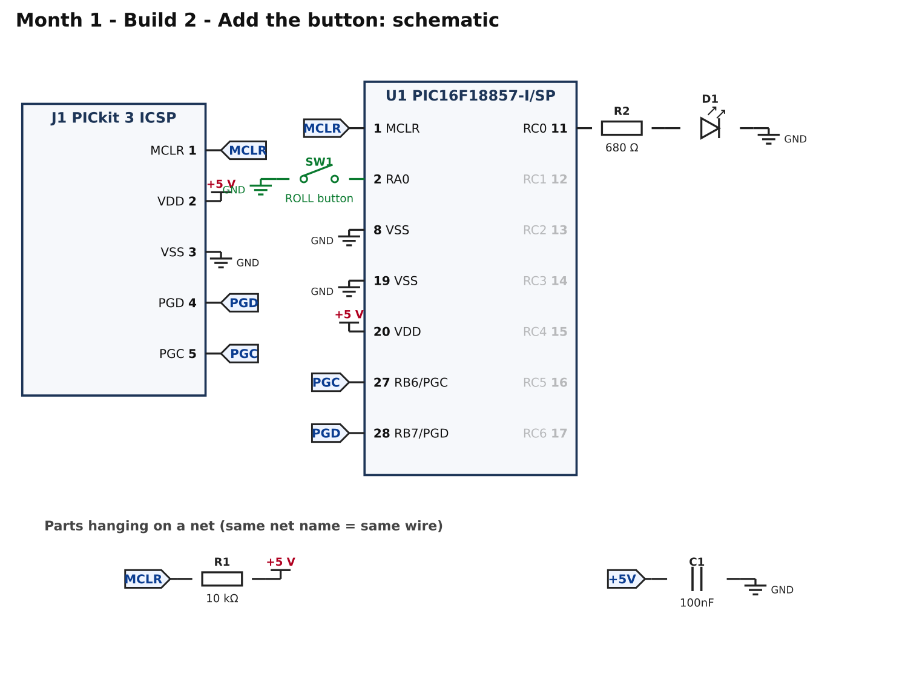
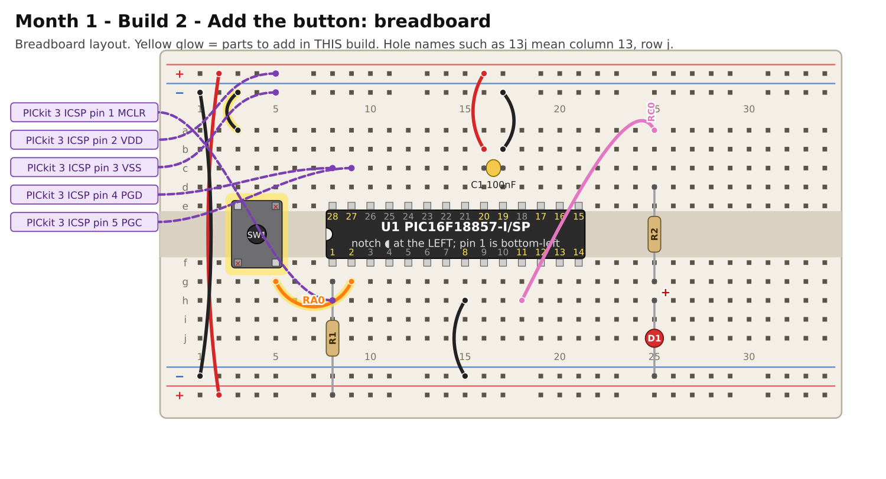

# Month 1 · Build 2 – Add the button

[← Build 1](build-1-blink.md) · [Month 1](README.md) · [Next: Build 3 →](build-3-dice.md)

**Goal:** the LED lights only while you hold a button down. This proves you can **read** a pin, not just write to one.

**Status:** logic tested in simulation · compile and bench test pending

**Before you start:** Build 1 must pass. Power OFF. Leave everything from Build 1 in place.

## 1. What you are adding



New in green: the push button **SW1** between pin 2 (RA0) and GND.

**Why no resistor?** RA0 is set up with the chip's own *weak pull-up*, a built-in resistor to +5 V. With the button open,
RA0 reads **HIGH (1)**. Pressing the button connects RA0 to GND, so it reads **LOW (0)**.
That is why "pressed" means `0` in the code. Most buttons in later months work this way.

## 2. Build it



<!-- placement:2 -->
| Step | Part            | Where it goes                                                 | Notes                                                                                              |
| ---: | --------------- | ------------------------------------------------------------- | -------------------------------------------------------------------------------------------------- |
|    1 | SW1 push button | straddling the centre channel with legs in **3e, 5e, 3f, 5f** | only the diagonal legs (3e and 5f) are wired; keep strips 5e and 3f empty. Works either way round. |
|    2 | jumper wire     | **3a** → top **blue** rail (−), near column 3                 | ground (black)                                                                                     |
|    3 | jumper wire     | **5g** → **9g**                                               | signal RA0 (any colour)                                                                            |
<!-- /placement -->

A 4-legged push button has two pairs of legs joined inside. Wiring only the two **diagonal** legs (as above) means it works
whichever way round it sits. The other two legs must not touch anything.

Connections, as a list:

<!-- connections:2 -->
| Starts at          | Then goes through    |
| ------------------ | -------------------- |
| U1 pin **2** (RA0) | SW1 button → **GND** |
<!-- /connections -->

## 3. Check before you power it

1. With power off and the button **not** pressed: pin 2 to GND must **not** beep.
2. Press and hold the button: pin 2 to GND **beeps**.
3. +5 V rail to GND rail: still no short.

## 4. Program it

Change the code in your project (or make a new project, same settings) to this, then **Clean and Build** and **Make and Program Device**:

<!-- code:code/build-2-button/main.c -->
```c
/*
 * Month 1 - Build 2: A button controls the LED
 *
 * Chip     : PIC16F18857-I/SP (28-pin SPDIP)
 * Compiler : MPLAB XC8
 * Supply   : 5 V
 * Clock    : 1 MHz internal oscillator
 * LED      : RC0 (pin 11) -> 680 ohm -> LED -> GND
 * Button   : RA0 (pin 2)  -> button -> GND
 *
 * What it does: the LED is on while you hold the button down.
 * The chip's own weak pull-up holds RA0 HIGH until the button connects it
 * to GND, so a pressed button reads as 0 (LOW).
 */

#include <xc.h>

#pragma config FEXTOSC  = OFF
#pragma config RSTOSC   = HFINT1
#pragma config CLKOUTEN = OFF
#pragma config CSWEN    = ON
#pragma config FCMEN    = OFF
#pragma config MCLRE    = ON
#pragma config PWRTE    = OFF
#pragma config WDTE     = OFF
#pragma config LVP      = ON
#pragma config CP       = OFF

#define _XTAL_FREQ 1000000UL

#define LED     0x01             /* RC0 */
#define BUTTON  0x01             /* RA0 */

void main(void)
{
    ANSELA = 0x00;               /* ports A and C are digital             */
    ANSELC = 0x00;

    LATC   = 0x00;
    TRISC  = 0xFE;               /* RC0 is an output                      */

    TRISA  = 0xFF;               /* port A: all inputs                    */
    WPUA   = BUTTON;             /* weak pull-up on RA0 only              */

    while (1)
    {
        if ((PORTA & BUTTON) == 0)   /* 0 means the button is pressed     */
        {
            LATC |= LED;
        }
        else
        {
            LATC &= ~LED;
        }
    }
}
```
<!-- /code -->

How it works:

* `TRISA = 0xFF;` makes all of port A inputs. `WPUA = BUTTON;` turns on the weak pull-up for RA0 only.
* `PORTA` *reads* the pins (`LATC` *writes* them; do not mix them up).
* `(PORTA & BUTTON) == 0` is true when the RA0 bit is 0, meaning the button is down.

## 5. Pass check

* [ ] LED off when you are not touching the button.
* [ ] LED on while the button is held, off again when released.
* [ ] A very quick tap still lights it briefly.

## 6. If it does not work

| What you see           | Most likely cause                                | What to do                                                                |
| ---------------------- | ------------------------------------------------ | ------------------------------------------------------------------------- |
| LED is always on       | button wired to the wrong legs, or always closed | the picture shows **3e** and **5f** as the used legs; turn the button 90° |
| LED never responds     | button not reaching pin 2                        | continuity: pin 2 ↔ **9g** ↔ **5g** ↔ button                              |
| LED flickers by itself | pull-up not enabled (floating input)             | check `WPUA = BUTTON;` is present                                         |
| LED does the opposite  | logic inverted in your own edit                  | remember pressed = 0                                                      |

## 7. Try this

* Make the LED toggle on each press (on, off, on...) instead of following the button. What problem appears? (Hint: one press is read many times.)

[← Build 1](build-1-blink.md) · [Month 1](README.md) · [Next: Build 3 →](build-3-dice.md)
