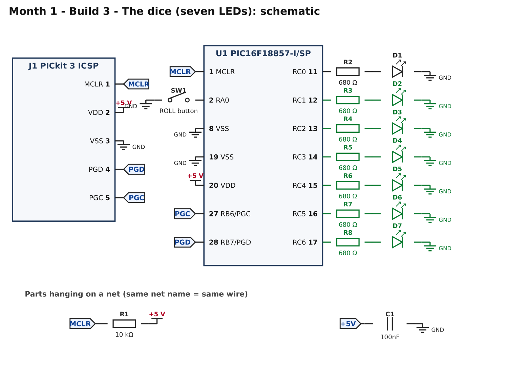
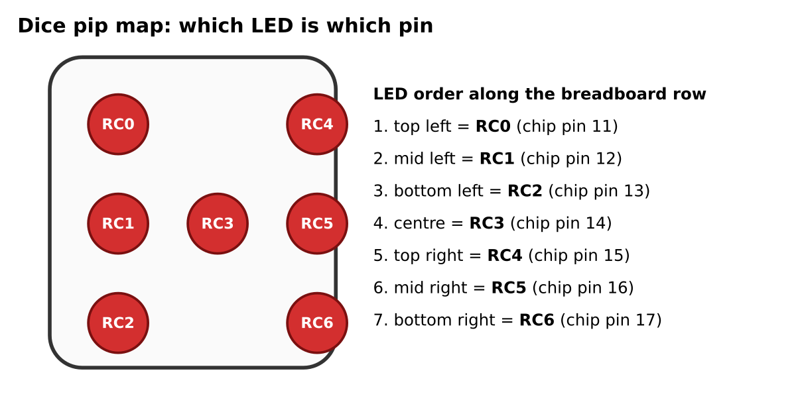
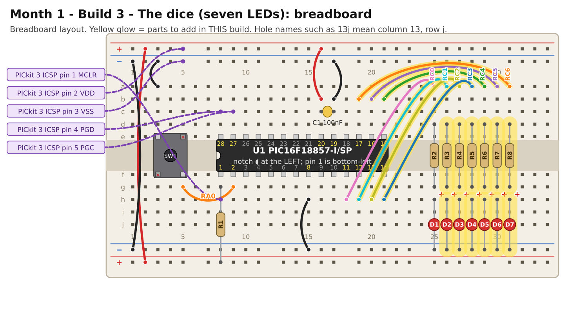

# Month 1 · Build 3 – The dice

[← Build 2](build-2-button.md) · [Month 1](README.md)

**Goal:** six more LEDs, and a program that "rolls" them to show a number from 1 to 6.

**Status:** logic tested in simulation (all six faces occur; one roll per press) · compile and bench test pending

**Before you start:** Build 2 must pass. Power OFF.

## 1. What you are adding



Six more LEDs, each with its own 680 Ω resistor, on RC1 to RC6. Together with D1 (RC0) they are the seven "pips" of a die:



You can wire the LEDs in a straight row, as the breadboard picture does. The program already knows which pin is which pip.
If you would like it to *look* like a die, bend the LED legs out and arrange the seven LEDs using the map above.

## 2. Build it



Six identical little "LED units": a wire from the chip pin to the top of a column, a resistor across the centre channel, and an LED to the bottom ground rail.

<!-- placement:3 -->
| Step | Part              | Where it goes                                                                      | Notes                                      |
| ---: | ----------------- | ---------------------------------------------------------------------------------- | ------------------------------------------ |
|    1 | jumper wire       | **19h** → **26a**                                                                  | signal RC1 (any colour)                    |
|    2 | R3 680 Ω resistor | **26d** and **26g**                                                                | either way round                           |
|    3 | D2 red LED        | **long leg** in **26h**, **short leg** in bottom **blue** rail (−), near column 26 | the long leg (+) goes towards the resistor |
|    4 | jumper wire       | **20h** → **27a**                                                                  | signal RC2 (any colour)                    |
|    5 | R4 680 Ω resistor | **27d** and **27g**                                                                | either way round                           |
|    6 | D3 red LED        | **long leg** in **27h**, **short leg** in bottom **blue** rail (−), near column 27 | the long leg (+) goes towards the resistor |
|    7 | jumper wire       | **21h** → **28a**                                                                  | signal RC3 (any colour)                    |
|    8 | R5 680 Ω resistor | **28d** and **28g**                                                                | either way round                           |
|    9 | D4 red LED        | **long leg** in **28h**, **short leg** in bottom **blue** rail (−), near column 28 | the long leg (+) goes towards the resistor |
|   10 | jumper wire       | **21b** → **29a**                                                                  | signal RC4 (any colour)                    |
|   11 | R6 680 Ω resistor | **29d** and **29g**                                                                | either way round                           |
|   12 | D5 red LED        | **long leg** in **29h**, **short leg** in bottom **blue** rail (−), near column 29 | the long leg (+) goes towards the resistor |
|   13 | jumper wire       | **20b** → **30a**                                                                  | signal RC5 (any colour)                    |
|   14 | R7 680 Ω resistor | **30d** and **30g**                                                                | either way round                           |
|   15 | D6 red LED        | **long leg** in **30h**, **short leg** in bottom **blue** rail (−), near column 30 | the long leg (+) goes towards the resistor |
|   16 | jumper wire       | **19b** → **31a**                                                                  | signal RC6 (any colour)                    |
|   17 | R8 680 Ω resistor | **31d** and **31g**                                                                | either way round                           |
|   18 | D7 red LED        | **long leg** in **31h**, **short leg** in bottom **blue** rail (−), near column 31 | the long leg (+) goes towards the resistor |
<!-- /placement -->

Connections, as a list:

<!-- connections:3 -->
| Starts at           | Then goes through                                           |
| ------------------- | ----------------------------------------------------------- |
| U1 pin **12** (RC1) | R3 680 Ω → D2 LED (long leg towards the resistor) → **GND** |
| U1 pin **13** (RC2) | R4 680 Ω → D3 LED (long leg towards the resistor) → **GND** |
| U1 pin **14** (RC3) | R5 680 Ω → D4 LED (long leg towards the resistor) → **GND** |
| U1 pin **15** (RC4) | R6 680 Ω → D5 LED (long leg towards the resistor) → **GND** |
| U1 pin **16** (RC5) | R7 680 Ω → D6 LED (long leg towards the resistor) → **GND** |
| U1 pin **17** (RC6) | R8 680 Ω → D7 LED (long leg towards the resistor) → **GND** |
<!-- /connections -->

## 3. Check before you power it

1. No short between the +5 V and GND rails.
2. Look along the LED row: every long leg is on the **resistor** side (the picture marks it with a red **+**).
3. Power on: nothing should light yet (the previous build's program may still be running; that is fine).

## 4. Program it

<!-- code:code/build-3-dice/main.c -->
```c
/*
 * Month 1 - Build 3: Electronic dice
 *
 * Chip     : PIC16F18857-I/SP (28-pin SPDIP)
 * Compiler : MPLAB XC8
 * Supply   : 5 V
 * Clock    : 1 MHz internal oscillator
 * Button   : RA0 (pin 2) -> button -> GND
 *
 * Seven LEDs ("pips"), each with its own 680 ohm resistor, on RC0..RC6.
 * Think of them laid out like the dots on a real die:
 *
 *        TOP_LEFT   (RC0, pin 11)      TOP_RIGHT    (RC4, pin 15)
 *        MID_LEFT   (RC1, pin 12)  CENTRE (RC3, pin 14)  MID_RIGHT (RC5, pin 16)
 *        BOTTOM_LEFT(RC2, pin 13)      BOTTOM_RIGHT (RC6, pin 17)
 *
 * What it does: the centre LED flashes 3 times to say "ready". Press the
 * button and the dice "rolls" through several faces, then stops on one.
 *
 * Where does the randomness come from? While you wait, the chip counts
 * 0,1,2,3,4,5,0,1,2... thousands of times a second. The instant you press
 * the button is unpredictable, so the count at that instant is too.
 */

#include <xc.h>

#pragma config FEXTOSC  = OFF
#pragma config RSTOSC   = HFINT1
#pragma config CLKOUTEN = OFF
#pragma config CSWEN    = ON
#pragma config FCMEN    = OFF
#pragma config MCLRE    = ON
#pragma config PWRTE    = OFF
#pragma config WDTE     = OFF
#pragma config LVP      = ON
#pragma config CP       = OFF

#define _XTAL_FREQ 1000000UL

#define BUTTON        0x01       /* RA0 */

/* One bit per LED on port C */
#define TOP_LEFT      0x01
#define MID_LEFT      0x02
#define BOTTOM_LEFT   0x04
#define CENTRE        0x08
#define TOP_RIGHT     0x10
#define MID_RIGHT     0x20
#define BOTTOM_RIGHT  0x40

/* Which LEDs are lit for each face. faces[3] is the pattern for a "3". */
const unsigned char faces[7] =
{
    0x00,                                                    /* (unused) */
    CENTRE,                                                  /* 1 */
    TOP_LEFT | BOTTOM_RIGHT,                                 /* 2 */
    TOP_LEFT | CENTRE | BOTTOM_RIGHT,                        /* 3 */
    TOP_LEFT | TOP_RIGHT | BOTTOM_LEFT | BOTTOM_RIGHT,       /* 4 */
    TOP_LEFT | TOP_RIGHT | BOTTOM_LEFT | BOTTOM_RIGHT | CENTRE, /* 5 */
    TOP_LEFT | MID_LEFT | BOTTOM_LEFT |
    TOP_RIGHT | MID_RIGHT | BOTTOM_RIGHT                     /* 6 */
};

unsigned char counter = 0;       /* free-running 0..5 */

void showFace(unsigned char face)
{
    LATC = faces[face];
}

void readyFlash(void)
{
    unsigned char i;
    for (i = 0; i < 3; i++)
    {
        LATC = CENTRE;
        __delay_ms(150);
        LATC = 0x00;
        __delay_ms(150);
    }
}

void rollDice(void)
{
    unsigned char step;

    for (step = 0; step < 15; step++)
    {
        counter++;
        if (counter >= 6) counter = 0;

        showFace(counter + 1);   /* counter is 0..5, faces are 1..6 */

        if (step < 9)       __delay_ms(60);    /* fast at first...      */
        else if (step < 13) __delay_ms(120);   /* ...then slowing down  */
        else                __delay_ms(240);
    }
    /* The last face shown stays lit until the next roll. */
}

void main(void)
{
    ANSELA = 0x00;
    ANSELC = 0x00;

    LATC   = 0x00;
    TRISC  = 0x80;               /* RC0..RC6 outputs, RC7 unused input */
    TRISA  = 0xFF;
    WPUA   = BUTTON;

    readyFlash();
    showFace(1);

    while (1)
    {
        counter++;               /* keep counting while we wait        */
        if (counter >= 6) counter = 0;

        if ((PORTA & BUTTON) == 0)
        {
            __delay_ms(30);                  /* wait out contact bounce  */
            if ((PORTA & BUTTON) == 0)       /* still pressed? then it is real */
            {
                rollDice();
                while ((PORTA & BUTTON) == 0)
                {
                    /* wait here until the button is released */
                }
                __delay_ms(30);
            }
        }
    }
}
```
<!-- /code -->

How it works:

* `faces[]` is a lookup table: `faces[4]` is the pattern of LEDs that make a "4". Changing a face means editing one line.
* `counter` counts 0 to 5 over and over, thousands of times a second, while you wait. When you press, the count is effectively random.
* `rollDice()` steps through the faces (quick, then slower) and stops. The last face stays lit.
* The 30 ms delays after a press stop contact "bounce" from being counted as extra presses.

## 5. Pass check

* [ ] On power-up the centre LED flashes three times, then shows a **1**.
* [ ] Pressing the button runs the animation and settles on a face, about 2 seconds later.
* [ ] Holding the button does not roll again until you release and press again.
* [ ] After 20 rolls you have seen every number at least once.
* [ ] Each face looks right: 2 is opposite corners, 4 is four corners, 6 is two columns of three.

## 6. If it does not work

| What you see                              | Most likely cause                 | What to do                                                                                             |
| ----------------------------------------- | --------------------------------- | ------------------------------------------------------------------------------------------------------ |
| One LED never lights                      | LED backwards or a loose resistor | swap the LED; check both resistor legs and that column's wire                                          |
| Two LEDs light together                   | a wire in the wrong column        | compare with the placement table; each column has exactly one signal wire                              |
| Faces look wrong (a "2" looks like a "3") | LEDs in the wrong order           | the row order must be: top-left, mid-left, bottom-left, **centre**, top-right, mid-right, bottom-right |
| Rolls twice per press                     | contact bounce on a worn button   | lengthen the two 30 ms delays                                                                          |
| Never shows a 6 or some number            | wiring mistake, not randomness    | run the "lamp test": temporarily set `LATC = 0x7F;` after `readyFlash();` and every LED should light   |

## 7. Try this

* Add a second roll style: hold the button for a "high roll" (always 4, 5 or 6). (Hint: you can read `PORTA` for how long it stays down.)
* Make the centre LED flash on a six, as a celebration.

[← Build 2](build-2-button.md) · [Month 1](README.md)
