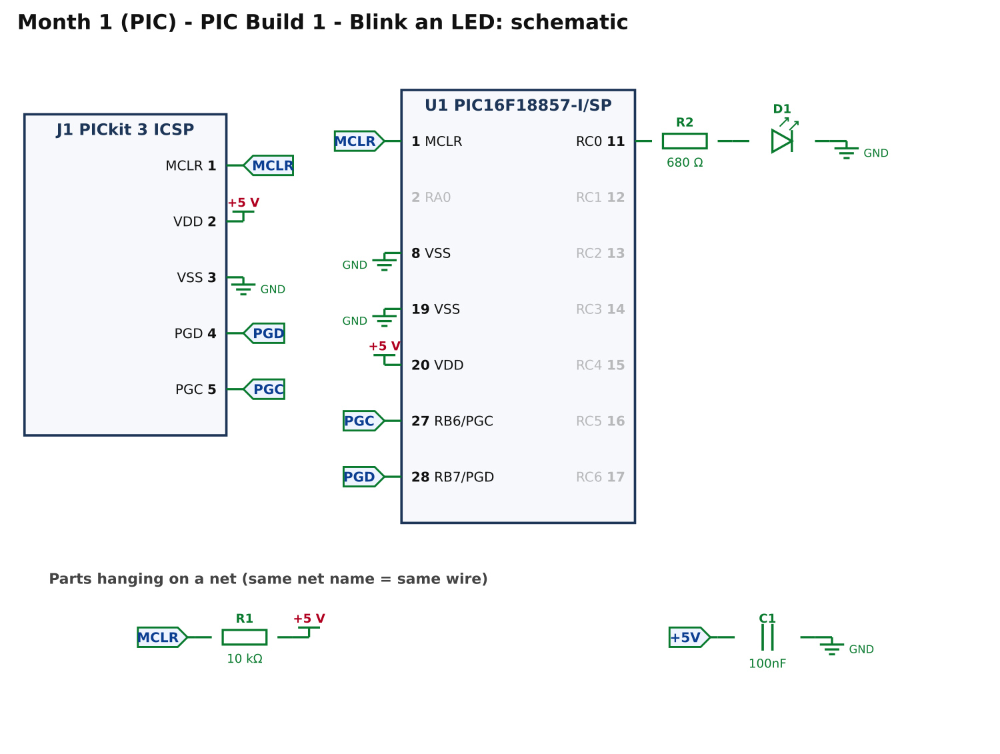
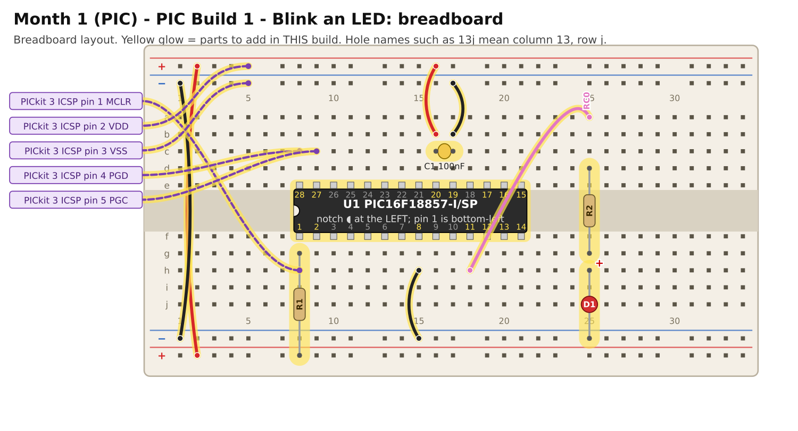

# Month 1 · PIC Build 1 – Blink an LED

[← Month 1](README.md) · [Next: PIC Build 2 →](pic-2-button.md)

**Goal:** make one LED blink once a second. This proves that the chip, the power, the programmer and the
software all work. Almost every problem you will meet later is easier to find because this build works.

**Status:** logic tested in simulation · compile and bench test pending

This is the **PIC track** of Month 1. If you have not done the ATmega328P track yet, you can start with [AVR Build 1](avr-1-blink.md); the two tracks are independent.

## 0. Coming from the AVR track?

You can reuse most of your breadboard. **Power off**, then:

* **Remove:** the ATmega328P, its power wires and capacitor (C1), its RESET resistor (R1), the programmer leads, and the wires that run from the chip to the LED columns.
* **Keep:** the two rail-bridging wires on the left, the LED units (columns 25 to 31: resistor and LED), and the push button with its ground wire.

Then follow the table in step 2 below. Skip any step whose part is already in place.

## 1. What you are building



How to read it: lines are wires. The little arrows with a name (such as **MCLR**) are "net flags":
every flag with the same name is the same wire. The ground symbol (⏚) is the **GND** rail and the
**+5 V** bar is the supply rail.

What each part does:

* **C1, 100 nF**: a small reservoir right next to the chip that smooths out power spikes. Always fit it.
* **R1, 10 kΩ**: holds the reset pin (MCLR) high so the chip runs. The programmer can still pull it low.
* **R2, 680 Ω + D1**: limits the LED current to about 4 mA (5 V minus about 2 V across the LED, divided by 680 Ω).
* **J1**: not a part. It is the five wires from your PICkit 3 programmer.

## 2. Build it



(The picture is also available as a sharper [SVG](images/pic-1-breadboard.svg). Open it in a browser and zoom in.)

**Before you start:** power OFF, PICkit 3 unplugged. Each step below is one thing to plug in.
Hole names such as **16b** mean *column 16, row b*; see the
[breadboard basics](../start-here/05-electronics-and-breadboard-basics.md#how-the-holes-are-connected).

<!-- placement:pic:1 -->
| Step | Part                     | Where it goes                                                                                                           | Notes                                                                                  |
| ---: | ------------------------ | ----------------------------------------------------------------------------------------------------------------------- | -------------------------------------------------------------------------------------- |
|    1 | U1 PIC16F18857-I/SP      | Pin 1 in hole **8f**, notch to the **left**. Pins 1–14 run along row f (columns 8–21); pins 15–28 run back along row e. | Skinny (300 mil) chip: one row of pins each side of the centre channel (rows e and f). |
|    2 | jumper wire              | top **red** rail (+), near column 2 → bottom **red** rail (+), near column 2                                            | +5 V power (red)                                                                       |
|    3 | jumper wire              | top **blue** rail (−), near column 1 → bottom **blue** rail (−), near column 1                                          | ground (black)                                                                         |
|    4 | jumper wire              | **16b** → top **red** rail (+), near column 16                                                                          | +5 V power (red)                                                                       |
|    5 | jumper wire              | **17b** → top **blue** rail (−), near column 17                                                                         | ground (black)                                                                         |
|    6 | jumper wire              | **15h** → bottom **blue** rail (−), near column 15                                                                      | ground (black)                                                                         |
|    7 | C1 100nF capacitor       | **16c** and **17c**                                                                                                     | ceramic: either way round; keep the legs short                                         |
|    8 | R1 10 kΩ resistor        | **8g** and bottom **red** rail (+), near column 8                                                                       | either way round                                                                       |
|    9 | PICkit 3 ICSP lead: MCLR | from PICkit 3 ICSP pin **1** (MCLR) to **8h**                                                                           | female-to-male Dupont lead                                                             |
|   10 | PICkit 3 ICSP lead: VDD  | from PICkit 3 ICSP pin **2** (VDD) to top **red** rail (+), near column 5                                               | female-to-male Dupont lead                                                             |
|   11 | PICkit 3 ICSP lead: VSS  | from PICkit 3 ICSP pin **3** (VSS) to top **blue** rail (−), near column 5                                              | female-to-male Dupont lead                                                             |
|   12 | PICkit 3 ICSP lead: PGD  | from PICkit 3 ICSP pin **4** (PGD) to **8c**                                                                            | female-to-male Dupont lead                                                             |
|   13 | PICkit 3 ICSP lead: PGC  | from PICkit 3 ICSP pin **5** (PGC) to **9c**                                                                            | female-to-male Dupont lead                                                             |
|   14 | jumper wire              | **18h** → **25a**                                                                                                       | signal RC0 (any colour)                                                                |
|   15 | R2 680 Ω resistor        | **25d** and **25g**                                                                                                     | either way round                                                                       |
|   16 | D1 red LED               | **long leg** in **25h**, **short leg** in bottom **blue** rail (−), near column 25                                      | the long leg (+) goes towards the resistor                                             |
<!-- /placement -->

**The PICkit 3 leads:** pin 1 of the PICkit 3 is the one marked with an arrow or triangle on the case.
Use female-to-male Dupont leads. Pin 6 is not used. Leave the leads attached while you work.

**The same circuit, as a connection list** (useful if you prefer reading to looking):

<!-- connections:pic:1 -->
| Starts at               | Then goes through                                           |
| ----------------------- | ----------------------------------------------------------- |
| U1 pin **20** (VDD)     | **+5 V**                                                    |
| U1 pin **8** (VSS)      | **GND**                                                     |
| U1 pin **19** (VSS)     | **GND**                                                     |
| U1 pin **1** (MCLR)     | net **MCLR**                                                |
| net **MCLR**            | R1 10 kΩ → **+5 V**                                         |
| net **+5V**             | C1 100nF → **GND**                                          |
| U1 pin **28** (RB7/PGD) | net **PGD**                                                 |
| U1 pin **27** (RB6/PGC) | net **PGC**                                                 |
| J1 pin **1** (MCLR)     | net **MCLR**                                                |
| J1 pin **2** (VDD)      | **+5 V**                                                    |
| J1 pin **3** (VSS)      | **GND**                                                     |
| J1 pin **4** (PGD)      | net **PGD**                                                 |
| J1 pin **5** (PGC)      | net **PGC**                                                 |
| U1 pin **11** (RC0)     | R2 680 Ω → D1 LED (long leg towards the resistor) → **GND** |
<!-- /connections -->

## 3. Check before you power it (2 minutes, saves chips)

Use the multimeter. Chip in, **power off**:

1. **No short:** set the meter to continuity (beep) or ohms. Between the **+5 V** rail and the **GND** rail it must **not** beep and should read thousands of ohms or more (it may creep upwards as C1 charges).
2. **Chip pins:** pin **20** to the +5 V rail beeps; pins **8** and **19** to the GND rail beep.
3. **Reset pull-up:** pin **1** to the +5 V rail reads about **10 kΩ**.

Now switch the breadboard supply on (jumper set to **5 V**):

* **Check 4:** meter on DC volts, red probe on pin **20**, black on pin **19**: you should read **4.8 V to 5.2 V**.

If any check fails, stop and fix it first. See [Troubleshooting](../start-here/06-troubleshooting.md).

## 4. Program it

1. Follow [Software & programmer setup → Create a project](../start-here/04-pic-setup.md#create-a-project) with device **PIC16F18857**.
2. Replace the contents of `main.c` with the code below (or add the file from `code/pic-1-blink/`).
3. **Clean and Build**, then **Make and Program Device**.

<!-- code:code/pic-1-blink/main.c -->
```c
/*
 * Month 1 - Build 1: Blink an LED
 *
 * Chip     : PIC16F18857-I/SP (28-pin SPDIP)
 * Compiler : MPLAB XC8
 * Supply   : 5 V
 * Clock    : 1 MHz internal oscillator
 * LED      : RC0 (pin 11) -> 680 ohm -> LED -> GND
 *
 * What it does: LED on for half a second, off for half a second, forever.
 * If you see this, the chip, the programmer and your wiring all work.
 */

#include <xc.h>

/* ---- Configuration bits: how the chip starts up -------------------------
 * Leave these alone. If the compiler rejects one, see
 * start-here/03-software-setup.md  ("If a #pragma config line is rejected").
 */
#pragma config FEXTOSC  = OFF    /* no external crystal                   */
#pragma config RSTOSC   = HFINT1 /* start on the internal 1 MHz clock     */
#pragma config CLKOUTEN = OFF
#pragma config CSWEN    = ON
#pragma config FCMEN    = OFF
#pragma config MCLRE    = ON     /* pin 1 is the reset pin                */
#pragma config PWRTE    = OFF
#pragma config WDTE     = OFF    /* watchdog OFF, or the chip keeps resetting */
#pragma config LVP      = ON
#pragma config CP       = OFF

#define _XTAL_FREQ 1000000UL     /* tells __delay_ms() the clock speed    */

#define LED  0x01                /* RC0 */

void main(void)
{
    ANSELC = 0x00;               /* make all of port C digital            */
    LATC   = 0x00;               /* every output starts LOW (LED off)     */
    TRISC  = 0xFE;               /* bit 0 = 0 -> RC0 is an output         */

    while (1)
    {
        LATC |= LED;             /* LED on  */
        __delay_ms(500);
        LATC &= ~LED;            /* LED off */
        __delay_ms(500);
    }
}
```
<!-- /code -->

How it works, line by line:

* `ANSELC = 0x00;` many pins start as *analog*. This makes all of port C *digital*.
* `LATC = 0x00;` sets every port C output to LOW before we use any of them.
* `TRISC = 0xFE;` a **0** bit means output, a **1** means input. `0xFE` is `1111 1110`, so only RC0 is an output.
* `LATC |= LED;` sets just the LED's bit HIGH and leaves the others alone. `LATC &= ~LED;` sets it LOW.
* `__delay_ms(500);` waits half a second. It needs `_XTAL_FREQ` to match the clock (1 MHz here).

## 5. Pass check

* [ ] The LED is on for half a second, off for half a second, repeating.
* [ ] Ten blinks take about ten seconds on a stopwatch (speed is right).
* [ ] Unplugging and re-plugging the power starts the blinking again by itself (the program is stored in the chip).

## 6. If it does not work

| What you see                              | Most likely cause                                      | What to do                                                                                                          |
| ----------------------------------------- | ------------------------------------------------------ | ------------------------------------------------------------------------------------------------------------------- |
| MPLAB cannot find the PICkit 3            | cable, driver or firmware                              | try another USB port/cable; see [setup → PICkit 3 problems](../start-here/04-pic-setup.md#pickit-3-problems)        |
| "Target device not found"                 | power, MCLR or lead problem                            | recheck the 4 checks above; PICkit pin 1 on the correct wire; **PGD and PGC not swapped**; chip the right way round |
| It programs fine but the LED never lights | LED backwards or wrong hole                            | long leg towards the resistor; wire from pin 11 lands in **18h** and **25a**                                        |
| LED lights steadily and does not blink    | a different program still in the chip, or the watchdog | re-program; confirm `WDTE = OFF` is in the code                                                                     |
| Blinks too fast or too slow               | clock setting                                          | the `#pragma config` block must be exactly as shown                                                                 |
| Compiler error on a `#pragma config` line | header name differs on your tool version               | [setup → If a #pragma config line is rejected](../start-here/04-pic-setup.md#if-a-pragma-config-line-is-rejected)   |

## 7. Try this (optional)

* Make it blink twice as fast. Which numbers change?
* Make it blink three short flashes, a pause, repeat.

[← Month 1](README.md) · [Next: PIC Build 2 →](pic-2-button.md)
