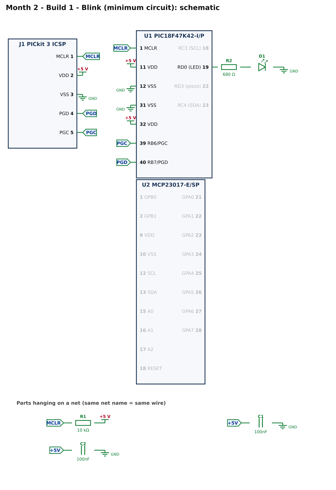
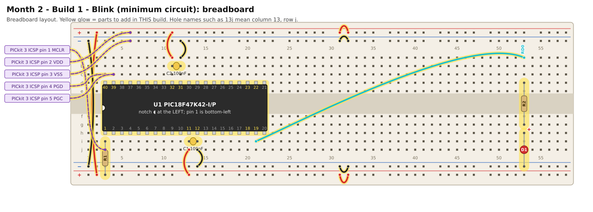

# Month 2 · Build 1 – Blink (minimum circuit)

[← Month 2](README.md) · [Next: Build 2 →](build-2-hello-expander.md)

**Goal:** the new chip, powered correctly, programmed, with one heartbeat LED blinking. No expander yet.

**Status:** logic tested in simulation · compile and bench test pending

## 1. What you are building



* **C1 and C2** (100 nF): one for each pair of power pins (11/12 and 32/31). Fit them as close to the pins as you can.
* **R1** (10 kΩ): holds reset high.
* **R2 + D1**: the heartbeat LED on RD0. In later builds this LED also shows **fault codes**, so keep it.
* **J1**: the five PICkit 3 wires.

## 2. Build it



(Sharper [SVG](images/build-1-breadboard.svg).) Power OFF while you build. New to the hole names (like **13j**)? See
[breadboard basics](../start-here/04-electronics-and-breadboard-basics.md#how-the-holes-are-connected).

<!-- placement:1 -->
| Step | Part                     | Where it goes                                                                                                           | Notes                                                                                                                                                                      |
| ---: | ------------------------ | ----------------------------------------------------------------------------------------------------------------------- | -------------------------------------------------------------------------------------------------------------------------------------------------------------------------- |
|    1 | U1 PIC18F47K42-I/P       | Pin 1 in hole **3h**, notch to the **left**. Pins 1–20 run along row h (columns 3–22); pins 21–40 run back along row d. | This is a **wide (600 mil)** chip: it will not sit in the centre channel like a skinny chip. Put its two rows of pins in rows **d** and **h** so it straddles the channel. |
|    2 | jumper wire              | top **red** rail (+), near column 2 → bottom **red** rail (+), near column 2                                            | +5 V power (red)                                                                                                                                                           |
|    3 | jumper wire              | top **blue** rail (−), near column 1 → bottom **blue** rail (−), near column 1                                          | ground (black)                                                                                                                                                             |
|    4 | jumper wire              | top **red** rail (+), near column 31 → top **red** rail (+), near column 32                                             | +5 V power (red)                                                                                                                                                           |
|    5 | jumper wire              | bottom **red** rail (+), near column 31 → bottom **red** rail (+), near column 32                                       | +5 V power (red)                                                                                                                                                           |
|    6 | jumper wire              | top **blue** rail (−), near column 31 → top **blue** rail (−), near column 32                                           | ground (black)                                                                                                                                                             |
|    7 | jumper wire              | bottom **blue** rail (−), near column 31 → bottom **blue** rail (−), near column 32                                     | ground (black)                                                                                                                                                             |
|    8 | jumper wire              | **13j** → bottom **red** rail (+), near column 13                                                                       | +5 V power (red)                                                                                                                                                           |
|    9 | jumper wire              | **14j** → bottom **blue** rail (−), near column 14                                                                      | ground (black)                                                                                                                                                             |
|   10 | C1 100nF capacitor       | **13i** and **14i**                                                                                                     | ceramic: either way round; keep the legs short                                                                                                                             |
|   11 | jumper wire              | **11a** → top **red** rail (+), near column 11                                                                          | +5 V power (red)                                                                                                                                                           |
|   12 | jumper wire              | **12a** → top **blue** rail (−), near column 12                                                                         | ground (black)                                                                                                                                                             |
|   13 | C2 100nF capacitor       | **11b** and **12b**                                                                                                     | ceramic: either way round; keep the legs short                                                                                                                             |
|   14 | R1 10 kΩ resistor        | **3i** and bottom **red** rail (+), near column 3                                                                       | either way round                                                                                                                                                           |
|   15 | PICkit 3 ICSP lead: MCLR | from PICkit 3 ICSP pin **1** (MCLR) to **3j**                                                                           | female-to-male Dupont lead                                                                                                                                                 |
|   16 | PICkit 3 ICSP lead: VDD  | from PICkit 3 ICSP pin **2** (VDD) to top **red** rail (+), near column 6                                               | female-to-male Dupont lead                                                                                                                                                 |
|   17 | PICkit 3 ICSP lead: VSS  | from PICkit 3 ICSP pin **3** (VSS) to top **blue** rail (−), near column 6                                              | female-to-male Dupont lead                                                                                                                                                 |
|   18 | PICkit 3 ICSP lead: PGD  | from PICkit 3 ICSP pin **4** (PGD) to **3c**                                                                            | female-to-male Dupont lead                                                                                                                                                 |
|   19 | PICkit 3 ICSP lead: PGC  | from PICkit 3 ICSP pin **5** (PGC) to **4c**                                                                            | female-to-male Dupont lead                                                                                                                                                 |
|   20 | jumper wire              | **21i** → **53a**                                                                                                       | signal RD0 (any colour)                                                                                                                                                    |
|   21 | R2 680 Ω resistor        | **53d** and **53g**                                                                                                     | either way round                                                                                                                                                           |
|   22 | D1 red LED               | **long leg** in **53h**, **short leg** in bottom **blue** rail (−), near column 53                                      | the long leg (+) goes towards the resistor                                                                                                                                 |
<!-- /placement -->

**Rails:** many breadboards have a **break in the middle** of the power rails. The four short wires between columns 31 and 32
join the two halves. If your rails are continuous they do no harm. Some boards print the red and blue lines in a different
order from the pictures; what matters is that the rail you call **+5 V** is connected to the supply's 5 V and the rail you call **GND** to its ground,
and that you never mix them up. The two long wires at the left (columns 1 and 2) copy the top rails to the bottom rails.

Same circuit as a connection list:

<!-- connections:1 -->
| Starts at                 | Then goes through                                           |
| ------------------------- | ----------------------------------------------------------- |
| U1 pin **11** (VDD)       | **+5 V**                                                    |
| U1 pin **32** (VDD)       | **+5 V**                                                    |
| U1 pin **12** (VSS)       | **GND**                                                     |
| U1 pin **31** (VSS)       | **GND**                                                     |
| U1 pin **1** (MCLR)       | net **MCLR**                                                |
| net **MCLR**              | R1 10 kΩ → **+5 V**                                         |
| net **+5V**               | C1 100nF → **GND**                                          |
| net **+5V**               | C2 100nF → **GND**                                          |
| U1 pin **40** (RB7/PGD)   | net **PGD**                                                 |
| U1 pin **39** (RB6/PGC)   | net **PGC**                                                 |
| J1 pin **1** (MCLR)       | net **MCLR**                                                |
| J1 pin **2** (VDD)        | **+5 V**                                                    |
| J1 pin **3** (VSS)        | **GND**                                                     |
| J1 pin **4** (PGD)        | net **PGD**                                                 |
| J1 pin **5** (PGC)        | net **PGC**                                                 |
| U1 pin **19** (RD0 (LED)) | R2 680 Ω → D1 LED (long leg towards the resistor) → **GND** |
<!-- /connections -->

## 3. Check before you power it

With the chip in and power **off**:

1. +5 V rail to GND rail: no beep (no short).
2. Pins **11** and **32** each beep to the +5 V rail; pins **12** and **31** each beep to the GND rail.
3. Pin **1** to the +5 V rail reads about **10 kΩ**.

Power on (jumper at **5 V**): measure pin 11 to pin 12: **4.8 V to 5.2 V**.

## 4. Program it

Follow [Software & programmer setup](../start-here/03-software-setup.md#create-a-project) with device **PIC18F47K42**. Then:

<!-- code:code/build-1-blink/main.c -->
```c
/*
 * Month 2 - Build 1: Blink the heartbeat LED
 *
 * Chip     : PIC18F47K42-I/P (40-pin PDIP)
 * Compiler : MPLAB XC8
 * Supply   : 5 V
 * Clock    : 64 MHz internal oscillator
 * LED      : RD0 (pin 19) -> 680 ohm -> LED -> GND
 *
 * What it does: LED on for half a second, off for half a second, forever.
 * If you see this, the chip, the programmer and the minimum circuit all work.
 * Count 10 blinks with a stopwatch: it should take about 10 seconds.
 */

#include <xc.h>

/* ---- Configuration bits: how the chip starts up -------------------------
 * Leave these alone. If the compiler rejects one, see
 * start-here/03-software-setup.md  ("If a #pragma config line is rejected").
 */
#pragma config FEXTOSC  = OFF            /* no external crystal            */
#pragma config RSTOSC   = HFINTOSC_64MHZ /* start on the internal 64 MHz   */
#pragma config CLKOUTEN = OFF
#pragma config CSWEN    = ON
#pragma config FCMEN    = OFF
#pragma config WDTE     = OFF            /* watchdog OFF, or it keeps resetting */
#pragma config LVP      = ON
#pragma config XINST    = OFF

#define _XTAL_FREQ 64000000UL            /* tells __delay_ms() the clock speed */

#define LED  0x01                        /* RD0 */

void main(void)
{
    OSCFRQ = 0x08;               /* make sure the internal clock is 64 MHz */

    ANSELD = 0x00;               /* make all of port D digital             */
    LATD   = 0x00;               /* every output starts LOW (LED off)      */
    TRISD  = 0xFE;               /* bit 0 = 0 -> RD0 is an output          */

    while (1)
    {
        LATD |= LED;             /* LED on  */
        __delay_ms(500);
        LATD &= ~LED;            /* LED off */
        __delay_ms(500);
    }
}
```
<!-- /code -->

New compared with Month 1: this chip runs at **64 MHz**, so `OSCFRQ = 0x08` is set and `_XTAL_FREQ` is 64 000 000. Everything else is the same idea.

## 5. Pass check

* [ ] The LED blinks: half a second on, half a second off.
* [ ] Ten blinks take about ten seconds.

**If MPLAB says the PICkit 3 does not support this device:** stop here and report it. Do not buy anything yet.

## 6. If it does not work

| What you see                  | Most likely cause                    | What to do                                                                                                            |
| ----------------------------- | ------------------------------------ | --------------------------------------------------------------------------------------------------------------------- |
| "Target device not found"     | a power pin missing                  | **all four** of pins 11, 12, 31, 32 must be connected                                                                 |
| Chip gets warm                | a short or the chip is in backwards  | power off at once; check the notch is on the left                                                                     |
| Programs but no blink         | LED backwards, or wire in wrong hole | wire from **21i** goes to **53a**; long leg towards the resistor                                                      |
| Blink is far too slow or fast | clock configuration                  | check the `#pragma config` block; see [setup](../start-here/03-software-setup.md#if-a-pragma-config-line-is-rejected) |

[← Month 2](README.md) · [Next: Build 2 →](build-2-hello-expander.md)
