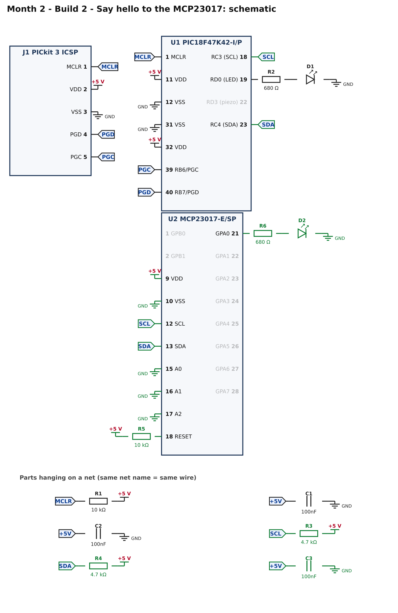
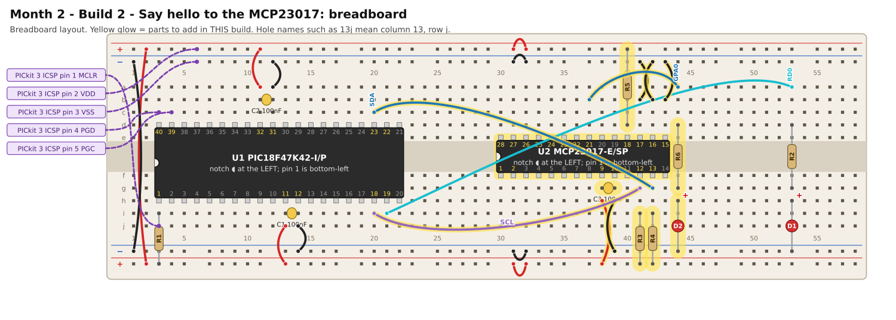

# Month 2 · Build 2 – Say hello to the MCP23017

[← Build 1](build-1-blink.md) · [Month 2](README.md) · [Next: Build 3 →](build-3-led-chase.md)

**Goal:** the PIC talks to the MCP23017 over I2C: it turns one LED on, then **reads the setting back** to prove the
conversation worked. If anything is wrong, the heartbeat LED tells you *what* by blinking a code.

**Status:** I2C protocol, register values and timing tested against a simulated MCP23017 · compile and bench test pending

**Before you start:** Build 1 must pass. Power OFF.

## 1. What is I2C? (3 minutes)

I2C is two wires shared by every chip on the bus:

* **SCL**, the clock. The PIC (the "controller") wiggles it.
* **SDA**, the data. Both sides use it, taking turns.

Both wires are held HIGH by a **pull-up resistor** (R3 and R4, 4.7 kΩ). A chip never pushes a wire HIGH: it either **lets go** (the resistor
pulls it HIGH) or **pulls it LOW**. That is why the code never writes a 1 to the pin, it just switches the pin between *input* (let go) and *output LOW* (pull down).

To write one register in the MCP23017, the PIC sends three bytes:

```text
START | 0x40 | 0x00 | 0xFE | STOP
        │      │      └─ the value to store
        │      └──────── which register (0x00 = IODIRA: 1 = input, 0 = output, for port A)
        └─────────────── the chip's address 0x20, shifted left, plus a 0 meaning "write"
```

After each byte the MCP23017 pulls SDA LOW for one clock: an **ACK** ("got it"). If nobody answers, there is no ACK, and the PIC knows something is wrong.

Reading is the same, then a second START and the address with a 1 on the end (`0x41`), and the chip sends the value back.

The MCP23017's address is **0x20** because its three address pins (A0, A1, A2) are wired to GND. You will see this in the schematic.

## 2. What you are adding



* **U2**: the MCP23017, with its power, its 100 nF capacitor (C3), and address pins A0–A2 to GND.
* **RESET** (pin 18) is held high by **R5**. If this pin floats, the chip behaves randomly.
* **R3, R4**: the I2C pull-ups.
* **R6 + D2**: one LED on GPA0, to show the expander is obeying.

## 3. Build it



The MCP23017 is a *skinny* chip: it goes across the centre channel in rows **e** and **f**, with its notch to the **left**, like the Month 1 chip.

<!-- placement:2 -->
| Step | Part               | Where it goes                                                                                                             | Notes                                                                                  |
| ---: | ------------------ | ------------------------------------------------------------------------------------------------------------------------- | -------------------------------------------------------------------------------------- |
|    1 | U2 MCP23017-E/SP   | Pin 1 in hole **30f**, notch to the **left**. Pins 1–14 run along row f (columns 30–43); pins 15–28 run back along row e. | Skinny (300 mil) chip: one row of pins each side of the centre channel (rows e and f). |
|    2 | jumper wire        | **38h** → bottom **red** rail (+), near column 38                                                                         | +5 V power (red)                                                                       |
|    3 | jumper wire        | **39h** → bottom **blue** rail (−), near column 39                                                                        | ground (black)                                                                         |
|    4 | C3 100nF capacitor | **38g** and **39g**                                                                                                       | ceramic: either way round; keep the legs short                                         |
|    5 | jumper wire        | **20i** → **41g**                                                                                                         | signal SCL (any colour)                                                                |
|    6 | jumper wire        | **20c** → **42g**                                                                                                         | signal SDA (any colour)                                                                |
|    7 | R3 4.7 kΩ resistor | **41i** and bottom **red** rail (+), near column 41                                                                       | either way round                                                                       |
|    8 | R4 4.7 kΩ resistor | **42i** and bottom **red** rail (+), near column 42                                                                       | either way round                                                                       |
|    9 | jumper wire        | **41b** → top **blue** rail (−), near column 41                                                                           | ground (black)                                                                         |
|   10 | jumper wire        | **42b** → top **blue** rail (−), near column 42                                                                           | ground (black)                                                                         |
|   11 | jumper wire        | **43b** → top **blue** rail (−), near column 43                                                                           | ground (black)                                                                         |
|   12 | R5 10 kΩ resistor  | **40d** and top **red** rail (+), near column 40                                                                          | either way round                                                                       |
|   13 | jumper wire        | **37b** → **44a**                                                                                                         | signal GPA0 (any colour)                                                               |
|   14 | R6 680 Ω resistor  | **44d** and **44g**                                                                                                       | either way round                                                                       |
|   15 | D2 red LED         | **long leg** in **44h**, **short leg** in bottom **blue** rail (−), near column 44                                        | the long leg (+) goes towards the resistor                                             |
<!-- /placement -->

Same circuit as a connection list:

<!-- connections:2 -->
| Starts at                 | Then goes through                                           |
| ------------------------- | ----------------------------------------------------------- |
| U1 pin **18** (RC3 (SCL)) | net **SCL**                                                 |
| U1 pin **23** (RC4 (SDA)) | net **SDA**                                                 |
| net **SCL**               | R3 4.7 kΩ → **+5 V**                                        |
| net **SDA**               | R4 4.7 kΩ → **+5 V**                                        |
| U2 pin **12** (SCL)       | net **SCL**                                                 |
| U2 pin **13** (SDA)       | net **SDA**                                                 |
| U2 pin **9** (VDD)        | **+5 V**                                                    |
| U2 pin **10** (VSS)       | **GND**                                                     |
| net **+5V**               | C3 100nF → **GND**                                          |
| U2 pin **15** (A0)        | **GND**                                                     |
| U2 pin **16** (A1)        | **GND**                                                     |
| U2 pin **17** (A2)        | **GND**                                                     |
| U2 pin **18** (RESET)     | R5 10 kΩ → **+5 V**                                         |
| U2 pin **21** (GPA0)      | R6 680 Ω → D2 LED (long leg towards the resistor) → **GND** |
<!-- /connections -->

## 4. Check before you power it

1. +5 V to GND: no short.
2. MCP23017 pin **9** (VDD) beeps to +5 V; pin **10** (VSS) beeps to GND; pins **15, 16, 17** beep to GND.
3. Pin **18** (RESET) to +5 V reads about **10 kΩ**.
4. SCL line: MCP pin **12** to PIC pin **18** beeps. SDA line: MCP pin **13** to PIC pin **23** beeps. They must **not** beep to each other.
5. Power on: MCP pin 9 to pin 10 reads about **5 V**.

## 5. Program it

<!-- code:code/build-2-hello-expander/main.c -->
```c
/*
 * Month 2 - Build 2: Say hello to the MCP23017
 *
 * Chip     : PIC18F47K42-I/P (40-pin PDIP) talking to MCP23017 (I2C address 0x20)
 * Compiler : MPLAB XC8
 * Supply   : 5 V
 * Clock    : 64 MHz internal oscillator
 *
 * What it does:
 *   1. Tells the MCP23017 "make pin GPA0 an output" and "put GPA0 HIGH".
 *      The LED on GPA0 should light.
 *   2. Reads that register back to prove the chip really stored the value.
 *   3. Blinks the heartbeat LED (RD0) once a second if all is well.
 *
 * If something is wrong the heartbeat LED shows a fault code instead:
 *   1 blink, pause, repeat -> the MCP23017 did not answer when written to
 *   2 blinks               -> the MCP23017 did not answer when read from
 *   3 blinks               -> it answered, but read back the wrong value
 */

#include <xc.h>

/* ---- Configuration bits: how the chip starts up -------------------------
 * Leave these alone. If the compiler rejects one, see
 * start-here/03-software-setup.md  ("If a #pragma config line is rejected").
 */
#pragma config FEXTOSC  = OFF            /* no external crystal            */
#pragma config RSTOSC   = HFINTOSC_64MHZ /* start on the internal 64 MHz   */
#pragma config CLKOUTEN = OFF
#pragma config CSWEN    = ON
#pragma config FCMEN    = OFF
#pragma config WDTE     = OFF            /* watchdog OFF, or it keeps resetting */
#pragma config LVP      = ON
#pragma config XINST    = OFF

#define _XTAL_FREQ 64000000UL            /* tells __delay_ms() the clock speed */

/* ---- Pins ---------------------------------------------------------------- */
#define LED        0x01      /* RD0 (pin 19): heartbeat / fault LED, on LATD  */
#define SCL        0x08      /* RC3 (pin 18): I2C clock line, on port C       */
#define SDA        0x10      /* RC4 (pin 23): I2C data line, on port C        */

/* ---- The MCP23017 expander ---------------------------------------------- */
#define MCP_WRITE  0x40      /* address 0x20 (A0=A1=A2=GND), shifted left, + write bit 0 */
#define MCP_READ   0x41      /* the same address with the read bit 1                      */

#define IODIRA     0x00      /* register: 1 = pin is an input, 0 = output (port A) */
#define OLATA      0x14      /* register: the levels to drive on port A outputs    */

/* ---- I2C "by hand" ------------------------------------------------------
 * I2C uses two wires, SCL (clock) and SDA (data). Each wire is pulled HIGH by
 * its 4.7k resistor. A device never drives a wire HIGH: it either lets go (the
 * resistor makes it HIGH) or pulls it LOW. We do that by switching the pin
 * between "input" (let go) and "output, LOW" (pull down). LATC bits for these
 * pins stay at 0 the whole time; we only flip TRISC.
 */
#define I2C_DELAY()  __delay_us(5)   /* about 100 kHz: slow and forgiving */

static void sdaRelease(void)  { TRISC |= SDA;  }    /* let go: line goes HIGH */
static void sdaLow(void)      { TRISC &= ~SDA; }    /* pull the line LOW      */
static void sclRelease(void)  { TRISC |= SCL;  }
static void sclLow(void)      { TRISC &= ~SCL; }
static unsigned char sdaRead(void) { return (PORTC & SDA) ? 1 : 0; }

static void i2cStart(void)           /* START = SDA falls while SCL is HIGH */
{
    sdaRelease(); sclRelease(); I2C_DELAY();
    sdaLow();                   I2C_DELAY();
    sclLow();                   I2C_DELAY();
}

static void i2cStop(void)            /* STOP = SDA rises while SCL is HIGH  */
{
    sdaLow();                   I2C_DELAY();
    sclRelease();               I2C_DELAY();
    sdaRelease();               I2C_DELAY();
}

/* Send one byte, most significant bit first. Returns 1 if the other chip
 * acknowledged ("got it"), 0 if nobody answered. */
static unsigned char i2cWrite(unsigned char data)
{
    unsigned char n, ack;

    for (n = 0; n < 8; n++)
    {
        if (data & 0x80) sdaRelease(); else sdaLow();
        I2C_DELAY();
        sclRelease();           I2C_DELAY();    /* the chip reads the bit now */
        sclLow();               I2C_DELAY();
        data = (unsigned char)(data << 1);
    }

    sdaRelease();                               /* let the chip answer...     */
    I2C_DELAY();
    sclRelease();               I2C_DELAY();
    ack = (sdaRead() == 0);                     /* ...it pulls SDA LOW = ACK  */
    sclLow();                   I2C_DELAY();
    return ack;
}

/* Receive one byte. sendAck = 1 means "send me another", 0 means "that was the last". */
static unsigned char i2cRead(unsigned char sendAck)
{
    unsigned char n, data = 0;

    sdaRelease();
    for (n = 0; n < 8; n++)
    {
        sclRelease();           I2C_DELAY();
        data = (unsigned char)(data << 1);
        if (sdaRead()) data |= 0x01;
        sclLow();               I2C_DELAY();
    }

    if (sendAck) sdaLow(); else sdaRelease();
    I2C_DELAY();
    sclRelease();               I2C_DELAY();
    sclLow();                   I2C_DELAY();
    sdaRelease();
    return data;
}

/* Write one value into one MCP23017 register. Returns 1 if all 3 bytes were acknowledged. */
static unsigned char mcpWrite(unsigned char reg, unsigned char value)
{
    unsigned char ok;

    i2cStart();
    ok  = i2cWrite(MCP_WRITE);   /* "hello MCP23017, I am going to write" */
    ok &= i2cWrite(reg);         /* which register                         */
    ok &= i2cWrite(value);       /* what to put in it                      */
    i2cStop();
    return ok;
}

/* Read one MCP23017 register into *value. Returns 1 if the chip answered. */
static unsigned char mcpRead(unsigned char reg, unsigned char *value)
{
    unsigned char ok;

    i2cStart();
    ok  = i2cWrite(MCP_WRITE);   /* "I am going to tell you a register number" */
    ok &= i2cWrite(reg);
    i2cStart();                  /* a second START: "now I want to read"       */
    ok &= i2cWrite(MCP_READ);
    *value = i2cRead(0);         /* 0 = "that's all I want"                    */
    i2cStop();
    return ok;
}

/* If something is wrong, flash the heartbeat LED 'code' times, pause, repeat, forever. */
static void fault(unsigned char code)
{
    unsigned char n;

    while (1)
    {
        for (n = 0; n < code; n++)
        {
            LATD |= LED;  __delay_ms(200);
            LATD &= ~LED; __delay_ms(200);
        }
        __delay_ms(1000);
    }
}

static void setup(void)
{
    OSCFRQ = 0x08;               /* make sure the internal clock is 64 MHz */

    ANSELC = 0x00;               /* ports C and D are digital              */
    ANSELD = 0x00;
    LATC   = 0x00;               /* SDA and SCL latch bits stay LOW        */
    LATD   = 0x00;
    TRISC  = 0xFF;               /* all of port C inputs = I2C lines released */
    TRISD  = 0xFE;               /* RD0 is an output (the LED)             */
}

void main(void)
{
    unsigned char readBack;

    setup();

    if (!mcpWrite(IODIRA, 0xFE)) fault(1);   /* GPA0 = output, GPA1..7 = inputs */
    if (!mcpWrite(OLATA,  0x01)) fault(1);   /* GPA0 = HIGH -> LED on           */

    if (!mcpRead(IODIRA, &readBack)) fault(2);
    if (readBack != 0xFE)            fault(3);

    while (1)                                /* all good: slow heartbeat */
    {
        LATD ^= LED;
        __delay_ms(500);
    }
}
```
<!-- /code -->

What to read first: skip to `main()` at the bottom. It is only eight lines. The I2C routines above it are the part to read slowly, once.

* `sdaRelease()` / `sdaLow()` flip the pin between "let go" and "pull LOW" by changing **TRISC**, not the output latch.
* `i2cWrite()` sends 8 bits, most significant first, then listens for the ACK. It returns `1` for ACK, `0` for none.
* `mcpWrite(reg, value)` is the three-byte conversation above. `mcpRead(reg, &value)` is the read version.
* `fault(n)` blinks the heartbeat LED *n* times, pauses, and repeats forever.

## 6. Pass check

* [ ] The **GPA0 LED (D2) stays lit**.
* [ ] The **heartbeat LED (D1) blinks once a second** (half a second on, half off).

### Fault codes (the heartbeat LED is talking to you)

| Blinks, pause, repeat | Meaning                                       | Look at                                                                                                              |
| :-------------------: | --------------------------------------------- | -------------------------------------------------------------------------------------------------------------------- |
|         **1**         | the MCP23017 did not answer when *written to* | power to U2 (pins 9, 10), SDA/SCL wires on the right pins, pull-ups R3 and R4, RESET pull-up R5, address pins to GND |
|         **2**         | it did not answer when *read*                 | usually intermittent wiring: wiggle the SDA wire and the chip                                                        |
|         **3**         | it answered but read back the wrong value     | SDA wire touching something; breadboard contact; try pressing the chip down                                          |
|    steady 1/second    | all good                                      | this is the pass                                                                                                     |
|    nothing at all     | the PIC program is not running                | go back to Build 1                                                                                                   |

## 7. If it does not work

| What you see                                 | Most likely cause                              | What to do                                                                                                              |
| -------------------------------------------- | ---------------------------------------------- | ----------------------------------------------------------------------------------------------------------------------- |
| Fault code 1, always                         | the expander is not powered or SDA/SCL swapped | measure pin 9 to 10 = 5 V; **SCL is pin 12 / SDA is pin 13** (they are next to each other: easy to swap)                |
| Fault code 1 although everything looks right | pull-up R3/R4 not reaching +5 V                | one leg of each on the +5 V rail (not GND); with the PIC held in reset the SCL and SDA lines should each read about 5 V |
| Code OK but GPA0 LED dark                    | LED backwards, or in the wrong column          | long leg to the resistor; the wire from **37b** to **44a**                                                              |
| Works, then randomly fails                   | loose jumper or chip not pushed in             | press every wire and both chips firmly                                                                                  |
| SCL/SDA read 0 V                             | the line is held low by a short                | power off; look for a leg touching                                                                                      |

## 8. Try this

* **Break it on purpose.** With the program running, pull out the SDA wire and press reset. Which fault code do you see? Put it back. Knowing what a fault looks like makes real faults far less scary.
* Change `__delay_us(5)` to `__delay_us(50)` and confirm everything still works. I2C is forgiving about being slow.

[← Build 1](build-1-blink.md) · [Month 2](README.md) · [Next: Build 3 →](build-3-led-chase.md)
