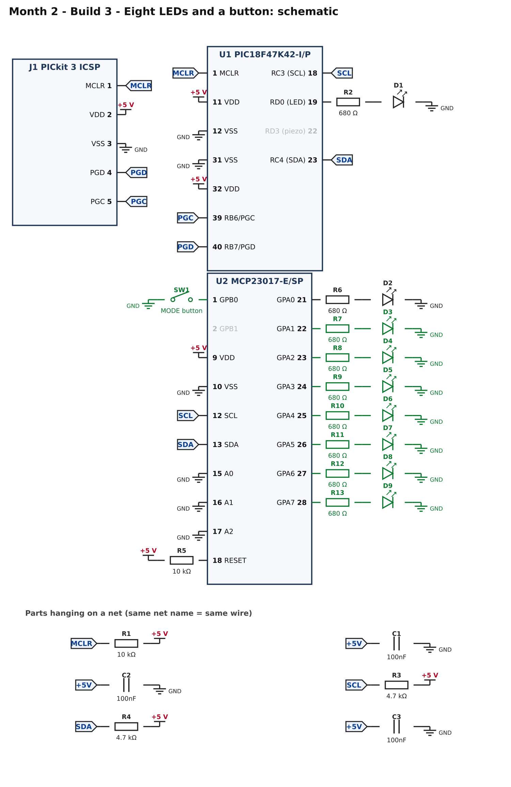
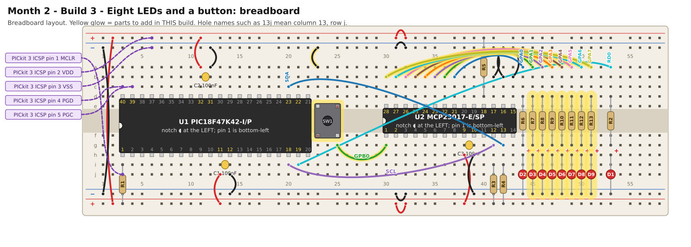

# Month 2 · Build 3 – Eight LEDs and a button

[← Build 2](build-2-hello-expander.md) · [Month 2](README.md) · [Next: Build 4 →](build-4-command-centre.md)

**Goal:** all eight LEDs on the expander, and one button that moves a single lit LED along the row. This is the first time the PIC
**reads** something *through* the expander.

**Status:** logic tested in simulation (one step per press, bounce and long holds handled) · compile and bench test pending

**Before you start:** Build 2 must pass. Power OFF.

## 1. What you are adding



* Seven more LED units (R7–R13, D3–D9) on GPA1 to GPA7.
* **SW1** on GPB0 (pin 1). Like Month 1's button it connects the pin to GND when pressed. The expander has its own pull-ups, which the program switches on (`GPPUB`).

## 2. Build it



<!-- placement:3 -->
| Step | Part               | Where it goes                                                                      | Notes                                                                                                  |
| ---: | ------------------ | ---------------------------------------------------------------------------------- | ------------------------------------------------------------------------------------------------------ |
|    1 | jumper wire        | **36b** → **45a**                                                                  | signal GPA1 (any colour)                                                                               |
|    2 | R7 680 Ω resistor  | **45d** and **45g**                                                                | either way round                                                                                       |
|    3 | D3 red LED         | **long leg** in **45h**, **short leg** in bottom **blue** rail (−), near column 45 | the long leg (+) goes towards the resistor                                                             |
|    4 | jumper wire        | **35b** → **46a**                                                                  | signal GPA2 (any colour)                                                                               |
|    5 | R8 680 Ω resistor  | **46d** and **46g**                                                                | either way round                                                                                       |
|    6 | D4 red LED         | **long leg** in **46h**, **short leg** in bottom **blue** rail (−), near column 46 | the long leg (+) goes towards the resistor                                                             |
|    7 | jumper wire        | **34b** → **47a**                                                                  | signal GPA3 (any colour)                                                                               |
|    8 | R9 680 Ω resistor  | **47d** and **47g**                                                                | either way round                                                                                       |
|    9 | D5 red LED         | **long leg** in **47h**, **short leg** in bottom **blue** rail (−), near column 47 | the long leg (+) goes towards the resistor                                                             |
|   10 | jumper wire        | **33b** → **48a**                                                                  | signal GPA4 (any colour)                                                                               |
|   11 | R10 680 Ω resistor | **48d** and **48g**                                                                | either way round                                                                                       |
|   12 | D6 red LED         | **long leg** in **48h**, **short leg** in bottom **blue** rail (−), near column 48 | the long leg (+) goes towards the resistor                                                             |
|   13 | jumper wire        | **32b** → **49a**                                                                  | signal GPA5 (any colour)                                                                               |
|   14 | R11 680 Ω resistor | **49d** and **49g**                                                                | either way round                                                                                       |
|   15 | D7 red LED         | **long leg** in **49h**, **short leg** in bottom **blue** rail (−), near column 49 | the long leg (+) goes towards the resistor                                                             |
|   16 | jumper wire        | **31b** → **50a**                                                                  | signal GPA6 (any colour)                                                                               |
|   17 | R12 680 Ω resistor | **50d** and **50g**                                                                | either way round                                                                                       |
|   18 | D8 red LED         | **long leg** in **50h**, **short leg** in bottom **blue** rail (−), near column 50 | the long leg (+) goes towards the resistor                                                             |
|   19 | jumper wire        | **30b** → **51a**                                                                  | signal GPA7 (any colour)                                                                               |
|   20 | R13 680 Ω resistor | **51d** and **51g**                                                                | either way round                                                                                       |
|   21 | D9 red LED         | **long leg** in **51h**, **short leg** in bottom **blue** rail (−), near column 51 | the long leg (+) goes towards the resistor                                                             |
|   22 | SW1 push button    | straddling the centre channel with legs in **23e, 25e, 23f, 25f**                  | only the diagonal legs (23e and 25f) are wired; keep strips 25e and 23f empty. Works either way round. |
|   23 | jumper wire        | **23a** → top **blue** rail (−), near column 23                                    | ground (black)                                                                                         |
|   24 | jumper wire        | **25g** → **30g**                                                                  | signal GPB0 (any colour)                                                                               |
<!-- /placement -->

Same circuit as a connection list:

<!-- connections:3 -->
| Starts at            | Then goes through                                            |
| -------------------- | ------------------------------------------------------------ |
| U2 pin **22** (GPA1) | R7 680 Ω → D3 LED (long leg towards the resistor) → **GND**  |
| U2 pin **23** (GPA2) | R8 680 Ω → D4 LED (long leg towards the resistor) → **GND**  |
| U2 pin **24** (GPA3) | R9 680 Ω → D5 LED (long leg towards the resistor) → **GND**  |
| U2 pin **25** (GPA4) | R10 680 Ω → D6 LED (long leg towards the resistor) → **GND** |
| U2 pin **26** (GPA5) | R11 680 Ω → D7 LED (long leg towards the resistor) → **GND** |
| U2 pin **27** (GPA6) | R12 680 Ω → D8 LED (long leg towards the resistor) → **GND** |
| U2 pin **28** (GPA7) | R13 680 Ω → D9 LED (long leg towards the resistor) → **GND** |
| U2 pin **1** (GPB0)  | SW1 button → **GND**                                         |
<!-- /connections -->

## 3. Check before you power it

1. +5 V to GND: no short.
2. Along the LED row, every LED's long leg is on the resistor side (the picture marks the long leg with a red **+**).
3. SW1: pin 1 of the MCP23017 to GND does **not** beep until you press the button, then it does.

## 4. Program it

<!-- code:code/build-3-led-chase/main.c -->
```c
/*
 * Month 2 - Build 3: Eight-LED chase, moved by a button
 *
 * Chip     : PIC18F47K42-I/P (40-pin PDIP) talking to MCP23017 (I2C address 0x20)
 * Compiler : MPLAB XC8
 * Supply   : 5 V
 * Clock    : 64 MHz internal oscillator
 * Button 1 : MCP23017 GPB0 (pin 1) -> button -> GND
 * LEDs     : MCP23017 GPA0..GPA7, each through 680 ohm
 *
 * What it does:
 *   - At start all 8 LEDs light for half a second (lamp test).
 *   - Then one LED is lit. Each press of Button 1 moves it one place along,
 *     and after the last LED it goes back to the first.
 *   - The heartbeat LED (RD0) blinks about once a second to show the chip is alive.
 *   - If the MCP23017 stops answering, the heartbeat LED shows a fault code:
 *       1 blink = write failed, 2 blinks = read failed.
 */

#include <xc.h>

/* ---- Configuration bits: how the chip starts up -------------------------
 * Leave these alone. If the compiler rejects one, see
 * start-here/03-software-setup.md  ("If a #pragma config line is rejected").
 */
#pragma config FEXTOSC  = OFF            /* no external crystal            */
#pragma config RSTOSC   = HFINTOSC_64MHZ /* start on the internal 64 MHz   */
#pragma config CLKOUTEN = OFF
#pragma config CSWEN    = ON
#pragma config FCMEN    = OFF
#pragma config WDTE     = OFF            /* watchdog OFF, or it keeps resetting */
#pragma config LVP      = ON
#pragma config XINST    = OFF

#define _XTAL_FREQ 64000000UL            /* tells __delay_ms() the clock speed */

/* ---- Pins ---------------------------------------------------------------- */
#define LED        0x01      /* RD0 (pin 19): heartbeat / fault LED, on LATD  */
#define SCL        0x08      /* RC3 (pin 18): I2C clock line, on port C       */
#define SDA        0x10      /* RC4 (pin 23): I2C data line, on port C        */

/* ---- The MCP23017 expander ---------------------------------------------- */
#define MCP_WRITE  0x40      /* address 0x20 (A0=A1=A2=GND), shifted left, + write bit 0 */
#define MCP_READ   0x41      /* the same address with the read bit 1                      */

#define IODIRA     0x00      /* 1 = input, 0 = output  (port A)          */
#define IODIRB     0x01      /* 1 = input, 0 = output  (port B)          */
#define GPPUB      0x0D      /* 1 = turn on the internal pull-up (port B) */
#define GPIOB      0x13      /* read the 8 pins of port B                 */
#define OLATA      0x14      /* levels to drive on port A outputs         */

/* ---- I2C "by hand" ------------------------------------------------------
 * I2C uses two wires, SCL (clock) and SDA (data). Each wire is pulled HIGH by
 * its 4.7k resistor. A device never drives a wire HIGH: it either lets go (the
 * resistor makes it HIGH) or pulls it LOW. We do that by switching the pin
 * between "input" (let go) and "output, LOW" (pull down). LATC bits for these
 * pins stay at 0 the whole time; we only flip TRISC.
 */
#define I2C_DELAY()  __delay_us(5)   /* about 100 kHz: slow and forgiving */

static void sdaRelease(void)  { TRISC |= SDA;  }    /* let go: line goes HIGH */
static void sdaLow(void)      { TRISC &= ~SDA; }    /* pull the line LOW      */
static void sclRelease(void)  { TRISC |= SCL;  }
static void sclLow(void)      { TRISC &= ~SCL; }
static unsigned char sdaRead(void) { return (PORTC & SDA) ? 1 : 0; }

static void i2cStart(void)           /* START = SDA falls while SCL is HIGH */
{
    sdaRelease(); sclRelease(); I2C_DELAY();
    sdaLow();                   I2C_DELAY();
    sclLow();                   I2C_DELAY();
}

static void i2cStop(void)            /* STOP = SDA rises while SCL is HIGH  */
{
    sdaLow();                   I2C_DELAY();
    sclRelease();               I2C_DELAY();
    sdaRelease();               I2C_DELAY();
}

/* Send one byte, most significant bit first. Returns 1 if the other chip
 * acknowledged ("got it"), 0 if nobody answered. */
static unsigned char i2cWrite(unsigned char data)
{
    unsigned char n, ack;

    for (n = 0; n < 8; n++)
    {
        if (data & 0x80) sdaRelease(); else sdaLow();
        I2C_DELAY();
        sclRelease();           I2C_DELAY();    /* the chip reads the bit now */
        sclLow();               I2C_DELAY();
        data = (unsigned char)(data << 1);
    }

    sdaRelease();                               /* let the chip answer...     */
    I2C_DELAY();
    sclRelease();               I2C_DELAY();
    ack = (sdaRead() == 0);                     /* ...it pulls SDA LOW = ACK  */
    sclLow();                   I2C_DELAY();
    return ack;
}

/* Receive one byte. sendAck = 1 means "send me another", 0 means "that was the last". */
static unsigned char i2cRead(unsigned char sendAck)
{
    unsigned char n, data = 0;

    sdaRelease();
    for (n = 0; n < 8; n++)
    {
        sclRelease();           I2C_DELAY();
        data = (unsigned char)(data << 1);
        if (sdaRead()) data |= 0x01;
        sclLow();               I2C_DELAY();
    }

    if (sendAck) sdaLow(); else sdaRelease();
    I2C_DELAY();
    sclRelease();               I2C_DELAY();
    sclLow();                   I2C_DELAY();
    sdaRelease();               I2C_DELAY();   /* let the line settle before the next clock pulse */
    return data;
}

/* Write one value into one MCP23017 register. Returns 1 if all 3 bytes were acknowledged. */
static unsigned char mcpWrite(unsigned char reg, unsigned char value)
{
    unsigned char ok;

    i2cStart();
    ok  = i2cWrite(MCP_WRITE);   /* "hello MCP23017, I am going to write" */
    ok &= i2cWrite(reg);         /* which register                         */
    ok &= i2cWrite(value);       /* what to put in it                      */
    i2cStop();
    return ok;
}

/* Read one MCP23017 register into *value. Returns 1 if the chip answered. */
static unsigned char mcpRead(unsigned char reg, unsigned char *value)
{
    unsigned char ok;

    i2cStart();
    ok  = i2cWrite(MCP_WRITE);   /* "I am going to tell you a register number" */
    ok &= i2cWrite(reg);
    i2cStart();                  /* a second START: "now I want to read"       */
    ok &= i2cWrite(MCP_READ);
    *value = i2cRead(0);         /* 0 = "that's all I want"                    */
    i2cStop();
    return ok;
}

/* If something is wrong, flash the heartbeat LED 'code' times, pause, repeat, forever. */
static void fault(unsigned char code)
{
    unsigned char n;

    while (1)
    {
        for (n = 0; n < code; n++)
        {
            LATD |= LED;  __delay_ms(200);
            LATD &= ~LED; __delay_ms(200);
        }
        __delay_ms(1000);
    }
}

static void setup(void)
{
    OSCFRQ = 0x08;               /* make sure the internal clock is 64 MHz */

    ANSELC = 0x00;               /* ports C and D are digital              */
    ANSELD = 0x00;
    LATC   = 0x00;               /* SDA and SCL latch bits stay LOW        */
    LATD   = 0x00;
    TRISC  = 0xFF;               /* all of port C inputs = I2C lines released */
    TRISD  = 0xFE;               /* RD0 is an output (the LED)             */
}

#define BUTTON1    0x01      /* GPB0 */

void main(void)
{
    unsigned char pattern = 0x01;      /* which LED is lit: one bit per LED */
    unsigned char buttons;
    unsigned char pressed, wasPressed = 0;
    unsigned char ticks = 0;
    unsigned char ok;

    setup();

    ok  = mcpWrite(IODIRA, 0x00);      /* port A: all outputs (the LEDs)       */
    ok &= mcpWrite(IODIRB, 0xFF);      /* port B: all inputs (the buttons)     */
    ok &= mcpWrite(GPPUB,  0xFF);      /* port B: internal pull-ups on         */
    if (!ok) fault(1);

    mcpWrite(OLATA, 0xFF);             /* lamp test: every LED on...           */
    __delay_ms(500);
    mcpWrite(OLATA, pattern);          /* ...then just the first one           */

    while (1)
    {
        if (!mcpRead(GPIOB, &buttons)) fault(2);

        pressed = ((buttons & BUTTON1) == 0);       /* 0 = pressed (pulled to GND) */

        if (pressed && !wasPressed)                 /* the moment it goes down     */
        {
            pattern = (unsigned char)(pattern << 1);
            if (pattern == 0) pattern = 0x01;       /* ran off the end: wrap round */
            if (!mcpWrite(OLATA, pattern)) fault(1);
        }
        wasPressed = pressed;

        ticks++;                                    /* heartbeat: toggle every 50 x 10 ms */
        if (ticks >= 50)
        {
            ticks = 0;
            LATD ^= LED;
        }

        __delay_ms(10);                             /* also hides contact bounce   */
    }
}
```
<!-- /code -->

What is new in `main()`:

* `mcpWrite(IODIRA, 0x00)` makes all eight port A pins **outputs**; `IODIRB = 0xFF` makes port B **inputs**; `GPPUB = 0xFF` switches on port B's pull-ups.
* The **lamp test** at start (all LEDs on for half a second) lets you check every LED at once.
* The loop runs every 10 ms: read port B, and act only on the moment the button *goes down* (`pressed && !wasPressed`). That one comparison is what stops one press counting many times. The 10 ms rhythm also hides contact bounce.
* `pattern << 1` moves the lit bit one LED along; after the last LED the value becomes 0, and we wrap back to `0x01`.

## 5. Pass check

* [ ] At power-up all eight LEDs light for half a second, then only the first one stays on.
* [ ] Each press of SW1 moves the light one LED to the right (towards GPA7), and after the last LED it goes back to the first.
* [ ] Holding the button down moves it **once**, not repeatedly.
* [ ] The heartbeat LED keeps blinking about once a second.

## 6. If it does not work

| What you see                          | Most likely cause                      | What to do                                                                                       |
| ------------------------------------- | -------------------------------------- | ------------------------------------------------------------------------------------------------ |
| One LED never lights in the lamp test | that LED unit                          | swap the LED; check its resistor and wire (the wire from GPA*n* lands in column 44 + *n*)        |
| The light jumps two steps per press   | bounce or a wiring touch               | check SW1 is wired on its diagonal legs only                                                     |
| Nothing moves when you press          | button not on GPB0                     | pin 1 of the MCP23017 ↔ **30g** ↔ **25g** ↔ SW1                                                  |
| It moves by itself                    | pull-ups not working, or GPB0 floating | confirm the `GPPUB` line; check the wire to pin 1                                                |
| Heartbeat shows 1 or 2 blinks         | I2C problem                            | see the [fault codes](build-2-hello-expander.md#fault-codes-the-heartbeat-led-is-talking-to-you) |

## 7. Try this

* Make the light run the other way (`>>`). What must the wrap-around test become?
* Make *two* lights chase each other.

[← Build 2](build-2-hello-expander.md) · [Month 2](README.md) · [Next: Build 4 →](build-4-command-centre.md)
