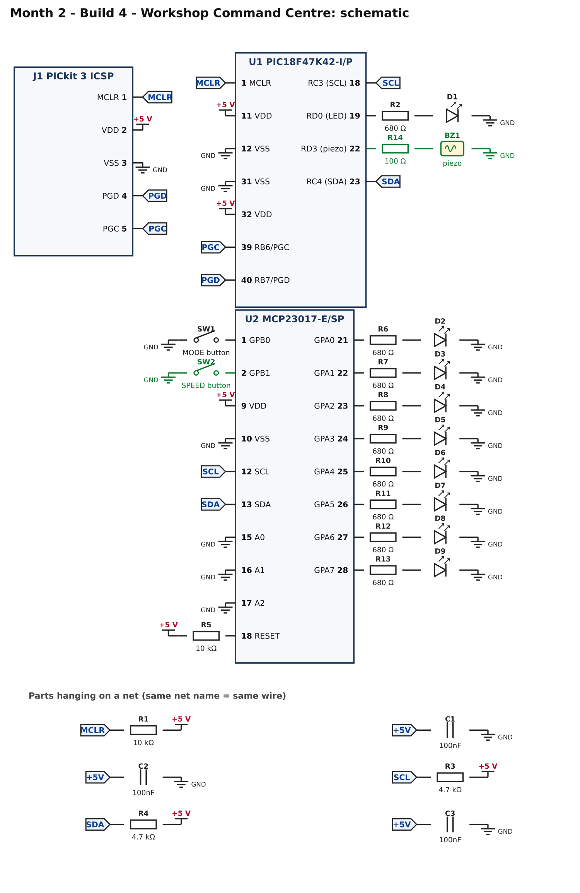
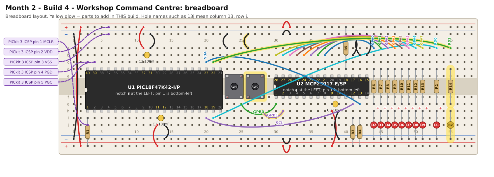

# Month 2 · Build 4 – Workshop Command Centre

[← Build 3](build-3-led-chase.md) · [Month 2](README.md)

**Goal:** the finished panel: three light animations, a speed button, a beep on every press.

**Status:** logic tested in simulation (modes, speeds, beeps, wrap-around) · compile and bench test pending

**Before you start:** Build 3 must pass. Power OFF.

## 1. What you are adding



* **SW2** on GPB1 (pin 2): the SPEED button.
* **R14 (100 Ω) + BZ1**: a piezo disc on RD3. The PIC makes a beep by switching RD3 on and off about 4000 times a second.

Use a **passive** piezo disc (a bare disc, or a buzzer that makes no sound when you just connect it to 5 V). An *active* buzzer, which beeps by itself on DC power, will
only make a constant buzz with this program.

## 2. Build it



<!-- placement:4 -->
| Step | Part               | Where it goes                                                     | Notes                                                                                                  |
| ---: | ------------------ | ----------------------------------------------------------------- | ------------------------------------------------------------------------------------------------------ |
|    1 | SW2 push button    | straddling the centre channel with legs in **26e, 28e, 26f, 28f** | only the diagonal legs (26e and 28f) are wired; keep strips 28e and 26f empty. Works either way round. |
|    2 | jumper wire        | **26a** → top **blue** rail (−), near column 26                   | ground (black)                                                                                         |
|    3 | jumper wire        | **28h** → **31h**                                                 | signal GPB1 (any colour)                                                                               |
|    4 | jumper wire        | **21c** → **55a**                                                 | signal RD3 (any colour)                                                                                |
|    5 | R14 100 Ω resistor | **55d** and **55g**                                               | either way round                                                                                       |
|    6 | BZ1 piezo          | **55h** and bottom **blue** rail (−), near column 55              | a bare piezo disc has no polarity                                                                      |
<!-- /placement -->

Same circuit as a connection list:

<!-- connections:4 -->
| Starts at                   | Then goes through               |
| --------------------------- | ------------------------------- |
| U2 pin **2** (GPB1)         | SW2 button → **GND**            |
| U1 pin **22** (RD3 (piezo)) | R14 100 Ω → BZ1 piezo → **GND** |
<!-- /connections -->

## 3. Check before you power it

1. +5 V to GND: no short.
2. Pin 2 of the MCP23017 to GND beeps only while SW2 is pressed.
3. The piezo disc is wired through R14, **not** straight to the pin.

## 4. Program it

<!-- code:code/build-4-command-centre/main.c -->
```c
/*
 * Month 2 - Build 4: Workshop Command Centre
 *
 * Chip     : PIC18F47K42-I/P (40-pin PDIP) talking to MCP23017 (I2C address 0x20)
 * Compiler : MPLAB XC8
 * Supply   : 5 V
 * Clock    : 64 MHz internal oscillator
 * Button 1 : MCP23017 GPB0 (pin 1) -> button -> GND    MODE
 * Button 2 : MCP23017 GPB1 (pin 2) -> button -> GND    SPEED
 * LEDs     : MCP23017 GPA0..GPA7, each through 680 ohm
 * Piezo    : RD3 (pin 22) -> 100 ohm -> piezo -> GND
 *
 * What it does:
 *   - Lamp test and a beep at start-up.
 *   - The 8 LEDs run an animation by themselves:
 *       mode 0 = a single light running along the row
 *       mode 1 = a bar that fills up, then empties
 *       mode 2 = alternate LEDs flashing (1010... / 0101...)
 *   - Button 1 (MODE) selects the next animation. Button 2 (SPEED) cycles
 *     slow -> medium -> fast. Every press gives a short beep.
 *   - The heartbeat LED (RD0) blinks about once a second.
 *   - If the MCP23017 stops answering: 1 blink = write failed, 2 = read failed.
 */

#include <xc.h>

/* ---- Configuration bits: how the chip starts up -------------------------
 * Leave these alone. If the compiler rejects one, see
 * start-here/03-software-setup.md  ("If a #pragma config line is rejected").
 */
#pragma config FEXTOSC  = OFF            /* no external crystal            */
#pragma config RSTOSC   = HFINTOSC_64MHZ /* start on the internal 64 MHz   */
#pragma config CLKOUTEN = OFF
#pragma config CSWEN    = ON
#pragma config FCMEN    = OFF
#pragma config WDTE     = OFF            /* watchdog OFF, or it keeps resetting */
#pragma config LVP      = ON
#pragma config XINST    = OFF

#define _XTAL_FREQ 64000000UL            /* tells __delay_ms() the clock speed */

/* ---- Pins ---------------------------------------------------------------- */
#define LED        0x01      /* RD0 (pin 19): heartbeat / fault LED, on LATD  */
#define PIEZO      0x08      /* RD3 (pin 22): piezo, on LATD                  */
#define SCL        0x08      /* RC3 (pin 18): I2C clock line, on port C       */
#define SDA        0x10      /* RC4 (pin 23): I2C data line, on port C        */

/* ---- The MCP23017 expander ---------------------------------------------- */
#define MCP_WRITE  0x40      /* address 0x20 (A0=A1=A2=GND), shifted left, + write bit 0 */
#define MCP_READ   0x41      /* the same address with the read bit 1                      */

#define IODIRA     0x00      /* 1 = input, 0 = output  (port A)          */
#define IODIRB     0x01      /* 1 = input, 0 = output  (port B)          */
#define GPPUB      0x0D      /* 1 = turn on the internal pull-up (port B) */
#define GPIOB      0x13      /* read the 8 pins of port B                 */
#define OLATA      0x14      /* levels to drive on port A outputs         */

/* ---- I2C "by hand" ------------------------------------------------------
 * I2C uses two wires, SCL (clock) and SDA (data). Each wire is pulled HIGH by
 * its 4.7k resistor. A device never drives a wire HIGH: it either lets go (the
 * resistor makes it HIGH) or pulls it LOW. We do that by switching the pin
 * between "input" (let go) and "output, LOW" (pull down). LATC bits for these
 * pins stay at 0 the whole time; we only flip TRISC.
 */
#define I2C_DELAY()  __delay_us(5)   /* about 100 kHz: slow and forgiving */

static void sdaRelease(void)  { TRISC |= SDA;  }    /* let go: line goes HIGH */
static void sdaLow(void)      { TRISC &= ~SDA; }    /* pull the line LOW      */
static void sclRelease(void)  { TRISC |= SCL;  }
static void sclLow(void)      { TRISC &= ~SCL; }
static unsigned char sdaRead(void) { return (PORTC & SDA) ? 1 : 0; }

static void i2cStart(void)           /* START = SDA falls while SCL is HIGH */
{
    sdaRelease(); sclRelease(); I2C_DELAY();
    sdaLow();                   I2C_DELAY();
    sclLow();                   I2C_DELAY();
}

static void i2cStop(void)            /* STOP = SDA rises while SCL is HIGH  */
{
    sdaLow();                   I2C_DELAY();
    sclRelease();               I2C_DELAY();
    sdaRelease();               I2C_DELAY();
}

/* Send one byte, most significant bit first. Returns 1 if the other chip
 * acknowledged ("got it"), 0 if nobody answered. */
static unsigned char i2cWrite(unsigned char data)
{
    unsigned char n, ack;

    for (n = 0; n < 8; n++)
    {
        if (data & 0x80) sdaRelease(); else sdaLow();
        I2C_DELAY();
        sclRelease();           I2C_DELAY();    /* the chip reads the bit now */
        sclLow();               I2C_DELAY();
        data = (unsigned char)(data << 1);
    }

    sdaRelease();                               /* let the chip answer...     */
    I2C_DELAY();
    sclRelease();               I2C_DELAY();
    ack = (sdaRead() == 0);                     /* ...it pulls SDA LOW = ACK  */
    sclLow();                   I2C_DELAY();
    return ack;
}

/* Receive one byte. sendAck = 1 means "send me another", 0 means "that was the last". */
static unsigned char i2cRead(unsigned char sendAck)
{
    unsigned char n, data = 0;

    sdaRelease();
    for (n = 0; n < 8; n++)
    {
        sclRelease();           I2C_DELAY();
        data = (unsigned char)(data << 1);
        if (sdaRead()) data |= 0x01;
        sclLow();               I2C_DELAY();
    }

    if (sendAck) sdaLow(); else sdaRelease();
    I2C_DELAY();
    sclRelease();               I2C_DELAY();
    sclLow();                   I2C_DELAY();
    sdaRelease();               I2C_DELAY();   /* let the line settle before the next clock pulse */
    return data;
}

/* Write one value into one MCP23017 register. Returns 1 if all 3 bytes were acknowledged. */
static unsigned char mcpWrite(unsigned char reg, unsigned char value)
{
    unsigned char ok;

    i2cStart();
    ok  = i2cWrite(MCP_WRITE);   /* "hello MCP23017, I am going to write" */
    ok &= i2cWrite(reg);         /* which register                         */
    ok &= i2cWrite(value);       /* what to put in it                      */
    i2cStop();
    return ok;
}

/* Read one MCP23017 register into *value. Returns 1 if the chip answered. */
static unsigned char mcpRead(unsigned char reg, unsigned char *value)
{
    unsigned char ok;

    i2cStart();
    ok  = i2cWrite(MCP_WRITE);   /* "I am going to tell you a register number" */
    ok &= i2cWrite(reg);
    i2cStart();                  /* a second START: "now I want to read"       */
    ok &= i2cWrite(MCP_READ);
    *value = i2cRead(0);         /* 0 = "that's all I want"                    */
    i2cStop();
    return ok;
}

/* If something is wrong, flash the heartbeat LED 'code' times, pause, repeat, forever. */
static void fault(unsigned char code)
{
    unsigned char n;

    while (1)
    {
        for (n = 0; n < code; n++)
        {
            LATD |= LED;  __delay_ms(200);
            LATD &= ~LED; __delay_ms(200);
        }
        __delay_ms(1000);
    }
}

static void setup(void)
{
    OSCFRQ = 0x08;               /* make sure the internal clock is 64 MHz */

    ANSELC = 0x00;               /* ports C and D are digital              */
    ANSELD = 0x00;
    LATC   = 0x00;               /* SDA and SCL latch bits stay LOW        */
    LATD   = 0x00;
    TRISC  = 0xFF;               /* all of port C inputs = I2C lines released */
    TRISD  = 0xF6;               /* RD0 (LED) and RD3 (piezo) are outputs  */
}

#define MODE_BUTTON   0x01   /* GPB0 */
#define SPEED_BUTTON  0x02   /* GPB1 */

/* How many 10 ms ticks between animation steps: 400 ms, 200 ms, 100 ms */
const unsigned char stepTicks[3] = { 40, 20, 10 };

unsigned char mode    = 0;
unsigned char speed   = 0;
unsigned char pattern = 0x01;

/* A short click-beep: toggle the piezo pin about 4000 times a second for 25 ms. */
static void beep(void)
{
    unsigned char n;
    for (n = 0; n < 200; n++)
    {
        LATD ^= PIEZO;
        __delay_us(125);
    }
    LATD &= ~PIEZO;                    /* leave the piezo pin LOW */
}

static void show(void)
{
    if (!mcpWrite(OLATA, pattern)) fault(1);
}

/* Move the animation on by one step. */
static void nextStep(void)
{
    if (mode == 0)                     /* running light */
    {
        pattern = (unsigned char)(pattern << 1);
        if (pattern == 0) pattern = 0x01;
    }
    else if (mode == 1)                /* filling bar */
    {
        if (pattern == 0xFF) pattern = 0x00;
        else pattern = (unsigned char)((pattern << 1) | 0x01);
    }
    else                               /* alternate */
    {
        pattern = (pattern == 0xAA) ? 0x55 : 0xAA;
    }
}

/* Start the current mode from its first picture. */
static void restartMode(void)
{
    if (mode == 0)      pattern = 0x01;
    else if (mode == 1) pattern = 0x01;
    else                pattern = 0xAA;
    show();
}

void main(void)
{
    unsigned char buttons, ok;
    unsigned char modeDown, speedDown;
    unsigned char modeWas = 0, speedWas = 0;
    unsigned char ticks = 0, beatTicks = 0;

    setup();

    ok  = mcpWrite(IODIRA, 0x00);      /* port A: all outputs (the LEDs)    */
    ok &= mcpWrite(IODIRB, 0xFF);      /* port B: all inputs (the buttons)  */
    ok &= mcpWrite(GPPUB,  0xFF);      /* port B: internal pull-ups on      */
    if (!ok) fault(1);

    mcpWrite(OLATA, 0xFF);             /* lamp test */
    beep();
    __delay_ms(400);
    restartMode();

    while (1)
    {
        if (!mcpRead(GPIOB, &buttons)) fault(2);

        modeDown  = ((buttons & MODE_BUTTON)  == 0);
        speedDown = ((buttons & SPEED_BUTTON) == 0);

        if (modeDown && !modeWas)      /* MODE pressed */
        {
            mode++;
            if (mode >= 3) mode = 0;
            restartMode();
            ticks = 0;
            beep();
        }
        if (speedDown && !speedWas)    /* SPEED pressed */
        {
            speed++;
            if (speed >= 3) speed = 0;
            beep();
        }
        modeWas  = modeDown;
        speedWas = speedDown;

        ticks++;
        if (ticks >= stepTicks[speed])
        {
            ticks = 0;
            nextStep();
            show();
        }

        beatTicks++;                   /* heartbeat: toggle every 50 x 10 ms */
        if (beatTicks >= 50)
        {
            beatTicks = 0;
            LATD ^= LED;
        }

        __delay_ms(10);                /* the 10 ms tick; also hides button bounce */
    }
}
```
<!-- /code -->

What is new:

* Three **modes** (`mode` 0, 1, 2) and three **speeds** (`speed` 0, 1, 2). `stepTicks[]` says how many 10 ms ticks to wait between animation steps.
* `nextStep()` has one small block per animation. Adding a fourth animation means adding one more block and changing `3` to `4`.
* `beep()` toggles RD3 200 times, 125 µs apart: a short click of about 4 kHz, near the loudest pitch of a typical piezo disc.
* Timings are *about* right. Each step takes slightly longer than its nominal 400, 200 or 100 ms because every cycle also spends a little time talking over I2C. That is normal.

## 5. Pass check

* [ ] Start-up: all LEDs flash, one beep, then a single light runs along the row (slowly).
* [ ] **MODE** (SW1): next animation: *filling bar*, then *alternating LEDs*, then back to the running light. Each press beeps.
* [ ] **SPEED** (SW2): slow, medium, fast, then back to slow. Each press beeps.
* [ ] The heartbeat LED keeps blinking.

## 6. If it does not work

| What you see                 | Most likely cause                     | What to do                                                                         |
| ---------------------------- | ------------------------------------- | ---------------------------------------------------------------------------------- |
| No beep                      | piezo not wired, or active buzzer     | continuity from RD3 (pin 22) through R14 to the piezo to GND; try a different disc |
| Constant buzz                | active buzzer                         | use a passive disc                                                                 |
| Beep but the animation stops | a loose I2C wire jolted by the buzzer | firm up SDA/SCL; heartbeat will show fault code 1 or 2                             |
| SPEED does nothing           | SW2 not on GPB1                       | pin 2 of the MCP23017 ↔ **31h** ↔ **28h** ↔ SW2                                    |

## 7. Try this

* Add a fourth animation (a "bounce" that runs right then left). You will need one extra variable for the direction.
* Make the beep different for MODE and SPEED (change the `125` and the `200`).
* Make **both buttons pressed together** switch everything off. Where would that test go?

## 8. What you learned

You built a real "peripheral" project: a controller chip, a port expander, I2C, polling with edge detection, and a fault
indicator. In Month 3 the same ideas return with other peripherals, so keep this project's board handy.

[← Build 3](build-3-led-chase.md) · [Month 2](README.md)
