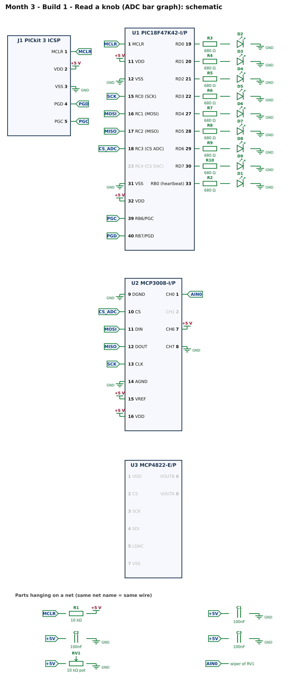
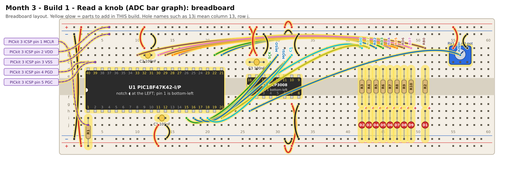

# Month 3 · Build 1 – Read a knob

[← Month 3](README.md) · [Next: Build 2 →](build-2-dac.md)

**Goal:** turn a knob and watch a bar of 8 LEDs follow it. This proves SPI and the ADC work. A built-in self-test tells you what is wrong if they do not.

**Status:** SPI protocol and logic tested against a simulated MCP3008 · compile and bench test pending

**Before you start:** Month 2's board cleared. Power OFF.

## 1. What is SPI? (3 minutes)

SPI uses four wires, and the PIC (the "controller") is in charge:

| Wire     | Direction  | Job                                                        |
| -------- | ---------- | ---------------------------------------------------------- |
| **SCK**  | PIC → chip | the clock: every pulse moves one bit                       |
| **MOSI** | PIC → chip | data **o**ut from the PIC                                  |
| **MISO** | chip → PIC | data **i**n to the PIC                                     |
| **CS**   | PIC → chip | "chip select": a chip listens **only while its CS is LOW** |

Each chip has its own CS wire; the other three wires are shared. There is **no acknowledge** (unlike I2C): if a chip is missing, MISO just reads as a constant 0 or 1.
That is why this build has a **self-test** (section 3).

To read the MCP3008 the PIC sends three bytes and reads three back, 24 clock pulses in all:

```text
byte 1:  0000 0001            the START bit (the last 1)
byte 2:  1 CCC xxxx           1 = "single input", CCC = the channel (0 to 7)
         ... answer starts:   x x x x x N B9 B8      (N = a null bit, then the top 2 bits of the answer)
byte 3:  0000 0000            sent as zeros; the other 8 answer bits (B7..B0) come back
```

Answer = (the two bits B9 and B8) × 256 + byte 3. That is a number from 0 to 1023.

## 2. What you are building



* **U2, the MCP3008:** its **VREF** pin (15) and **VDD** (16) are both on +5 V, so a reading of 1023 means 5 V. **AGND** and **DGND** go to ground.
* **RV1, the knob:** one end to +5 V, the other to ground; the **middle leg (the wiper)** goes to channel 0 (pin 1). Turning it slides the voltage from 0 V to 5 V.
* **CH6 to +5 V and CH7 to GND:** two **test wires**. Their readings are known (about 1023 and about 0), so the program can check the whole SPI path every time it starts.
* **The 8 LEDs on port D** (RD0 to RD7, through 680 Ω resistors), and a **heartbeat LED** on RB0.

## 3. Build it



(Sharper [SVG](images/build-1-breadboard.svg).) Power OFF. The PIC18F47K42 is a *wide* chip: rows **d** and **h**, as in Month 2. The MCP3008 is *skinny*: rows **e** and **f**.

<!-- placement:1 -->
| Step | Part                     | Where it goes                                                                                                           | Notes                                                                                                                                                                      |
| ---: | ------------------------ | ----------------------------------------------------------------------------------------------------------------------- | -------------------------------------------------------------------------------------------------------------------------------------------------------------------------- |
|    1 | U1 PIC18F47K42-I/P       | Pin 1 in hole **3h**, notch to the **left**. Pins 1–20 run along row h (columns 3–22); pins 21–40 run back along row d. | This is a **wide (600 mil)** chip: it will not sit in the centre channel like a skinny chip. Put its two rows of pins in rows **d** and **h** so it straddles the channel. |
|    2 | U2 MCP3008-I/P           | Pin 1 in hole **26f**, notch to the **left**. Pins 1–8 run along row f (columns 26–33); pins 9–16 run back along row e. | Skinny (300 mil) chip: one row of pins each side of the centre channel (rows e and f).                                                                                     |
|    3 | jumper wire              | top **red** rail (+), near column 2 → bottom **red** rail (+), near column 2                                            | +5 V power (red)                                                                                                                                                           |
|    4 | jumper wire              | top **blue** rail (−), near column 1 → bottom **blue** rail (−), near column 1                                          | ground (black)                                                                                                                                                             |
|    5 | jumper wire              | top **red** rail (+), near column 31 → top **red** rail (+), near column 32                                             | +5 V power (red)                                                                                                                                                           |
|    6 | jumper wire              | bottom **red** rail (+), near column 31 → bottom **red** rail (+), near column 32                                       | +5 V power (red)                                                                                                                                                           |
|    7 | jumper wire              | top **blue** rail (−), near column 31 → top **blue** rail (−), near column 32                                           | ground (black)                                                                                                                                                             |
|    8 | jumper wire              | bottom **blue** rail (−), near column 31 → bottom **blue** rail (−), near column 32                                     | ground (black)                                                                                                                                                             |
|    9 | jumper wire              | **13j** → bottom **red** rail (+), near column 13                                                                       | +5 V power (red)                                                                                                                                                           |
|   10 | jumper wire              | **14j** → bottom **blue** rail (−), near column 14                                                                      | ground (black)                                                                                                                                                             |
|   11 | C1 100nF capacitor       | **13i** and **14i**                                                                                                     | ceramic: either way round; keep the legs short                                                                                                                             |
|   12 | jumper wire              | **11a** → top **red** rail (+), near column 11                                                                          | +5 V power (red)                                                                                                                                                           |
|   13 | jumper wire              | **12a** → top **blue** rail (−), near column 12                                                                         | ground (black)                                                                                                                                                             |
|   14 | C2 100nF capacitor       | **11b** and **12b**                                                                                                     | ceramic: either way round; keep the legs short                                                                                                                             |
|   15 | R1 10 kΩ resistor        | **3i** and bottom **red** rail (+), near column 3                                                                       | either way round                                                                                                                                                           |
|   16 | PICkit 3 ICSP lead: MCLR | from PICkit 3 ICSP pin **1** (MCLR) to **3j**                                                                           | female-to-male Dupont lead                                                                                                                                                 |
|   17 | PICkit 3 ICSP lead: VDD  | from PICkit 3 ICSP pin **2** (VDD) to top **red** rail (+), near column 6                                               | female-to-male Dupont lead                                                                                                                                                 |
|   18 | PICkit 3 ICSP lead: VSS  | from PICkit 3 ICSP pin **3** (VSS) to top **blue** rail (−), near column 6                                              | female-to-male Dupont lead                                                                                                                                                 |
|   19 | PICkit 3 ICSP lead: PGD  | from PICkit 3 ICSP pin **4** (PGD) to **3c**                                                                            | female-to-male Dupont lead                                                                                                                                                 |
|   20 | PICkit 3 ICSP lead: PGC  | from PICkit 3 ICSP pin **5** (PGC) to **4c**                                                                            | female-to-male Dupont lead                                                                                                                                                 |
|   21 | jumper wire              | **10b** → **51a**                                                                                                       | signal RB0 (any colour)                                                                                                                                                    |
|   22 | R2 680 Ω resistor        | **51d** and **51g**                                                                                                     | either way round                                                                                                                                                           |
|   23 | D1 red LED               | **long leg** in **51h**, **short leg** in bottom **blue** rail (−), near column 51                                      | the long leg (+) goes towards the resistor                                                                                                                                 |
|   24 | jumper wire              | **21i** → **42a**                                                                                                       | signal RD0 (any colour)                                                                                                                                                    |
|   25 | R3 680 Ω resistor        | **42d** and **42g**                                                                                                     | either way round                                                                                                                                                           |
|   26 | D2 red LED               | **long leg** in **42h**, **short leg** in bottom **blue** rail (−), near column 42                                      | the long leg (+) goes towards the resistor                                                                                                                                 |
|   27 | jumper wire              | **22i** → **43a**                                                                                                       | signal RD1 (any colour)                                                                                                                                                    |
|   28 | R4 680 Ω resistor        | **43d** and **43g**                                                                                                     | either way round                                                                                                                                                           |
|   29 | D3 red LED               | **long leg** in **43h**, **short leg** in bottom **blue** rail (−), near column 43                                      | the long leg (+) goes towards the resistor                                                                                                                                 |
|   30 | jumper wire              | **22b** → **44a**                                                                                                       | signal RD2 (any colour)                                                                                                                                                    |
|   31 | R5 680 Ω resistor        | **44d** and **44g**                                                                                                     | either way round                                                                                                                                                           |
|   32 | D4 red LED               | **long leg** in **44h**, **short leg** in bottom **blue** rail (−), near column 44                                      | the long leg (+) goes towards the resistor                                                                                                                                 |
|   33 | jumper wire              | **21b** → **45a**                                                                                                       | signal RD3 (any colour)                                                                                                                                                    |
|   34 | R6 680 Ω resistor        | **45d** and **45g**                                                                                                     | either way round                                                                                                                                                           |
|   35 | D5 red LED               | **long leg** in **45h**, **short leg** in bottom **blue** rail (−), near column 45                                      | the long leg (+) goes towards the resistor                                                                                                                                 |
|   36 | jumper wire              | **16b** → **46a**                                                                                                       | signal RD4 (any colour)                                                                                                                                                    |
|   37 | R7 680 Ω resistor        | **46d** and **46g**                                                                                                     | either way round                                                                                                                                                           |
|   38 | D6 red LED               | **long leg** in **46h**, **short leg** in bottom **blue** rail (−), near column 46                                      | the long leg (+) goes towards the resistor                                                                                                                                 |
|   39 | jumper wire              | **15b** → **47a**                                                                                                       | signal RD5 (any colour)                                                                                                                                                    |
|   40 | R8 680 Ω resistor        | **47d** and **47g**                                                                                                     | either way round                                                                                                                                                           |
|   41 | D7 red LED               | **long leg** in **47h**, **short leg** in bottom **blue** rail (−), near column 47                                      | the long leg (+) goes towards the resistor                                                                                                                                 |
|   42 | jumper wire              | **14b** → **48a**                                                                                                       | signal RD6 (any colour)                                                                                                                                                    |
|   43 | R9 680 Ω resistor        | **48d** and **48g**                                                                                                     | either way round                                                                                                                                                           |
|   44 | D8 red LED               | **long leg** in **48h**, **short leg** in bottom **blue** rail (−), near column 48                                      | the long leg (+) goes towards the resistor                                                                                                                                 |
|   45 | jumper wire              | **13b** → **49a**                                                                                                       | signal RD7 (any colour)                                                                                                                                                    |
|   46 | R10 680 Ω resistor       | **49d** and **49g**                                                                                                     | either way round                                                                                                                                                           |
|   47 | D9 red LED               | **long leg** in **49h**, **short leg** in bottom **blue** rail (−), near column 49                                      | the long leg (+) goes towards the resistor                                                                                                                                 |
|   48 | jumper wire              | **17i** → **29c**                                                                                                       | signal SCK (any colour)                                                                                                                                                    |
|   49 | jumper wire              | **18i** → **31c**                                                                                                       | signal MOSI (any colour)                                                                                                                                                   |
|   50 | jumper wire              | **30b** → **19i**                                                                                                       | signal MISO (any colour)                                                                                                                                                   |
|   51 | jumper wire              | **32b** → **20i**                                                                                                       | signal CS (any colour)                                                                                                                                                     |
|   52 | jumper wire              | **26b** → top **red** rail (+), near column 26                                                                          | +5 V power (red)                                                                                                                                                           |
|   53 | jumper wire              | **27b** → top **red** rail (+), near column 27                                                                          | +5 V power (red)                                                                                                                                                           |
|   54 | jumper wire              | **28b** → top **blue** rail (−), near column 28                                                                         | ground (black)                                                                                                                                                             |
|   55 | jumper wire              | **33b** → top **blue** rail (−), near column 33                                                                         | ground (black)                                                                                                                                                             |
|   56 | C3 100nF capacitor       | **26c** and **28c**                                                                                                     | ceramic: either way round; keep the legs short                                                                                                                             |
|   57 | jumper wire              | **32g** → bottom **red** rail (+), near column 32                                                                       | +5 V power (red)                                                                                                                                                           |
|   58 | jumper wire              | **33g** → bottom **blue** rail (−), near column 33                                                                      | ground (black)                                                                                                                                                             |
|   59 | RV1 10 kΩ potentiometer  | legs in **55c**, **56c** and **57c**                                                                                    | outer legs = the two ends of the track, middle leg = the wiper (the moving contact)                                                                                        |
|   60 | jumper wire              | **55a** → top **red** rail (+), near column 55                                                                          | +5 V power (red)                                                                                                                                                           |
|   61 | jumper wire              | **57a** → top **blue** rail (−), near column 57                                                                         | ground (black)                                                                                                                                                             |
|   62 | jumper wire              | **56b** → **26h**                                                                                                       | signal AIN0 (any colour)                                                                                                                                                   |
<!-- /placement -->

Same circuit as a connection list:

<!-- connections:1 -->
| Starts at                       | Then goes through                                            |
| ------------------------------- | ------------------------------------------------------------ |
| U1 pin **11** (VDD)             | **+5 V**                                                     |
| U1 pin **32** (VDD)             | **+5 V**                                                     |
| U1 pin **12** (VSS)             | **GND**                                                      |
| U1 pin **31** (VSS)             | **GND**                                                      |
| U1 pin **1** (MCLR)             | net **MCLR**                                                 |
| net **MCLR**                    | R1 10 kΩ → **+5 V**                                          |
| net **+5V**                     | C1 100nF → **GND**                                           |
| net **+5V**                     | C2 100nF → **GND**                                           |
| U1 pin **40** (RB7/PGD)         | net **PGD**                                                  |
| U1 pin **39** (RB6/PGC)         | net **PGC**                                                  |
| J1 pin **1** (MCLR)             | net **MCLR**                                                 |
| J1 pin **2** (VDD)              | **+5 V**                                                     |
| J1 pin **3** (VSS)              | **GND**                                                      |
| J1 pin **4** (PGD)              | net **PGD**                                                  |
| J1 pin **5** (PGC)              | net **PGC**                                                  |
| U1 pin **33** (RB0 (heartbeat)) | R2 680 Ω → D1 LED (long leg towards the resistor) → **GND**  |
| U1 pin **19** (RD0)             | R3 680 Ω → D2 LED (long leg towards the resistor) → **GND**  |
| U1 pin **20** (RD1)             | R4 680 Ω → D3 LED (long leg towards the resistor) → **GND**  |
| U1 pin **21** (RD2)             | R5 680 Ω → D4 LED (long leg towards the resistor) → **GND**  |
| U1 pin **22** (RD3)             | R6 680 Ω → D5 LED (long leg towards the resistor) → **GND**  |
| U1 pin **27** (RD4)             | R7 680 Ω → D6 LED (long leg towards the resistor) → **GND**  |
| U1 pin **28** (RD5)             | R8 680 Ω → D7 LED (long leg towards the resistor) → **GND**  |
| U1 pin **29** (RD6)             | R9 680 Ω → D8 LED (long leg towards the resistor) → **GND**  |
| U1 pin **30** (RD7)             | R10 680 Ω → D9 LED (long leg towards the resistor) → **GND** |
| U1 pin **15** (RC0 (SCK))       | net **SCK**                                                  |
| U1 pin **16** (RC1 (MOSI))      | net **MOSI**                                                 |
| U1 pin **17** (RC2 (MISO))      | net **MISO**                                                 |
| U1 pin **18** (RC3 (CS ADC))    | net **CS_ADC**                                               |
| U2 pin **15** (VREF)            | **+5 V**                                                     |
| U2 pin **16** (VDD)             | **+5 V**                                                     |
| U2 pin **9** (DGND)             | **GND**                                                      |
| U2 pin **14** (AGND)            | **GND**                                                      |
| net **+5V**                     | C3 100nF → **GND**                                           |
| U2 pin **13** (CLK)             | net **SCK**                                                  |
| U2 pin **11** (DIN)             | net **MOSI**                                                 |
| U2 pin **12** (DOUT)            | net **MISO**                                                 |
| U2 pin **10** (CS)              | net **CS_ADC**                                               |
| U2 pin **7** (CH6)              | **+5 V**                                                     |
| U2 pin **8** (CH7)              | **GND**                                                      |
| net **+5V**                     | RV1 10k potentiometer (outer legs) → **GND**                 |
| net **AIN0**                    | RV1 wiper (middle leg)                                       |
| U2 pin **1** (CH0)              | net **AIN0**                                                 |
<!-- /connections -->

## 4. Check before you power it

1. +5 V rail to GND rail: no short.
2. All four PIC power pins (11, 12, 31, 32) as in Month 2.
3. MCP3008: pins **15** and **16** to +5 V; pins **9** and **14** to GND. Pin **7** (CH6) to +5 V, pin **8** (CH7) to GND.
4. Knob: the two outer legs read about the knob's value (for example 10 kΩ) between them, and the middle leg reads between 0 and that value as you turn it.
5. Power on: MCP3008 pin 16 to pin 9 reads about **5 V**; the knob's middle leg sweeps 0 to 5 V as you turn it.

## 5. Program it

Same project settings as Month 2 (device **PIC18F47K42**, see [PIC setup](../start-here/04-pic-setup.md#create-a-project)).

<!-- code:code/build-1-adc-bar-graph/main.c -->
```c
/*
 * Month 3 - Build 1: Read a knob (ADC bar graph)
 *
 * Chip     : PIC18F47K42-I/P with an MCP3008 8-channel 10-bit ADC (SPI)
 * Compiler : MPLAB XC8
 * Supply   : 5 V (the MCP3008 measures against the same 5 V)
 * Clock    : 64 MHz internal oscillator
 *
 * What it does:
 *   1. Self-test: ADC channel 7 is wired to GND and channel 6 to +5 V, so their readings are known.
 *      If they are wrong, the heartbeat LED shows a fault code:
 *        1 blink  = channel 7 (GND) did not read about 0     -> DOUT stuck HIGH, or a wiring fault
 *        2 blinks = channel 6 (+5 V) did not read about full -> DOUT stuck LOW, or MISO not connected
 *   2. Reads the knob (channel 0) 100 times a second and shows it as a bar of 0 to 8 LEDs.
 *   3. The heartbeat LED blinks about once a second.
 */

#include <xc.h>

/* ---- Configuration bits: how the chip starts up -------------------------
 * Leave these alone. If the compiler rejects one, see
 * start-here/04-pic-setup.md  ("If a #pragma config line is rejected").
 */
#pragma config FEXTOSC  = OFF            /* no external crystal            */
#pragma config RSTOSC   = HFINTOSC_64MHZ /* start on the internal 64 MHz   */
#pragma config CLKOUTEN = OFF
#pragma config CSWEN    = ON
#pragma config FCMEN    = OFF
#pragma config WDTE     = OFF            /* watchdog OFF, or it keeps resetting */
#pragma config LVP      = ON
#pragma config XINST    = OFF

#define _XTAL_FREQ 64000000UL            /* tells __delay_ms() the clock speed */

/* ---- Pins ----------------------------------------------------------------
 * The LED bar graph is port D: RD0 (pin 19) ... RD7 (pin 30), one LED each.
 */
#define SCK        0x01      /* RC0 (pin 15): SPI clock, to both chips        */
#define MOSI       0x02      /* RC1 (pin 16): data to the chips               */
#define MISO       0x04      /* RC2 (pin 17): data from the ADC               */
#define CS_ADC     0x08      /* RC3 (pin 18): chip select, MCP3008 (ADC)      */
#define CS_DAC     0x10      /* RC4 (pin 23): chip select, MCP4822 (DAC)      */
#define HEARTBEAT  0x01      /* RB0 (pin 33): heartbeat / fault LED, on LATB  */

/* ---- SPI "by hand" -----------------------------------------------------
 * SPI uses four wires: a clock (SCK), data out (MOSI), data in (MISO) and one
 * chip-select (CS) per chip. A chip listens only while its CS is LOW.
 * To send a byte we put each bit on MOSI (most significant first), raise SCK so
 * the chip reads it, read MISO at the same moment, then lower SCK again.
 * Unlike I2C there is no "acknowledge": a missing chip just looks like a 0 or a 1.
 */
#define SPI_DELAY()  __delay_us(1)     /* about 400 kHz: slow and forgiving */

static unsigned char spiTransfer(unsigned char out)
{
    unsigned char n, in = 0;

    for (n = 0; n < 8; n++)
    {
        if (out & 0x80) LATC |= MOSI; else LATC &= ~MOSI;
        out = (unsigned char)(out << 1);
        SPI_DELAY();
        LATC |= SCK;                   /* clock rises: the chip reads our bit    */
        SPI_DELAY();
        in = (unsigned char)(in << 1);
        if (PORTC & MISO) in |= 0x01;  /* ...and we read the bit it is sending   */
        LATC &= ~SCK;                  /* clock falls                             */
    }
    return in;
}

/* Read one channel (0 to 7) of the MCP3008. Returns 0 (0 V) to 1023 (the 5 V reference). */
static unsigned int adcRead(unsigned char channel)
{
    unsigned char high, low;

    LATC &= ~CS_ADC;                              /* select the ADC              */
    SPI_DELAY();
    spiTransfer(0x01);                            /* the START bit               */
    high = spiTransfer((unsigned char)(0x80 | (channel << 4)));  /* single-ended + channel;
                                                     the top bits of the answer come back */
    low  = spiTransfer(0x00);                     /* the rest of the answer      */
    LATC |= CS_ADC;                               /* deselect                    */
    SPI_DELAY();
    return (unsigned int)(((unsigned int)(high & 0x03) << 8) | low);
}

/* Turn a reading 0..1023 into a bar of 0..8 lit LEDs, as a bit pattern for port D. */
static unsigned char bar(unsigned int reading)
{
    unsigned char lit = (unsigned char)((reading * 9UL) / 1024UL);    /* 0 to 8 */
    return (unsigned char)((1u << lit) - 1u);                         /* 0x00 to 0xFF */
}

/* If something is wrong, flash the heartbeat LED 'code' times, pause, repeat, forever. */
static void fault(unsigned char code)
{
    unsigned char n;

    LATD = 0x00;
    while (1)
    {
        for (n = 0; n < code; n++)
        {
            LATB |= HEARTBEAT;  __delay_ms(200);
            LATB &= ~HEARTBEAT; __delay_ms(200);
        }
        __delay_ms(1000);
    }
}

static void setup(void)
{
    OSCFRQ = 0x08;               /* make sure the internal clock is 64 MHz */

    ANSELB = 0x00; ANSELC = 0x00; ANSELD = 0x00;      /* all digital */
    LATB = 0x00;
    LATC = CS_ADC | CS_DAC;      /* both chip-selects HIGH (chips ignored), clock LOW */
    LATD = 0x00;
    TRISB = 0xFE;                /* RB0 (heartbeat) is an output                 */
    TRISC = 0xE4;                /* RC0, RC1, RC3, RC4 outputs; RC2 (MISO) input */
    TRISD = 0x00;                /* port D: all outputs (the bar graph)          */
}

void main(void)
{
    unsigned char ticks = 0;

    setup();

    if (adcRead(7) > 16)   fault(1);     /* tied to GND: must read about 0     */
    if (adcRead(6) < 1007) fault(2);     /* tied to +5 V: must read about 1023 */

    while (1)
    {
        LATD = bar(adcRead(0));          /* the knob, as a bar graph           */

        ticks++;                         /* heartbeat: toggle every 50 x 10 ms */
        if (ticks >= 50) { ticks = 0; LATB ^= HEARTBEAT; }

        __delay_ms(10);
    }
}
```
<!-- /code -->

What to read first: `main()` at the bottom (twelve lines). Then `spiTransfer()` and `adcRead()` above it.

* `spiTransfer()` sends one byte, bit by bit: put the bit on MOSI, raise SCK (the chip reads it), read MISO, lower SCK.
* `adcRead(channel)` pulls CS low, sends the three bytes above, pulls CS high, and assembles the 10-bit answer.
* `bar()` scales 0 to 1023 into 0 to 8 lit LEDs: `(1 << lit) - 1` gives 1, 3, 7, 15 ... 255 as the number lit goes up.
* The **self-test** reads channel 7 (wired to GND) and channel 6 (wired to +5 V) before doing anything else.

## 6. Pass check

* [ ] The bar graph is **empty** with the knob fully one way and **all 8 LEDs lit** fully the other way (or the reverse, depending on which end is which).
* [ ] Turning the knob smoothly makes the bar grow and shrink one LED at a time.
* [ ] The heartbeat LED (RB0) blinks about once a second.

### Fault codes (the heartbeat LED is talking to you)

| Blinks, pause, repeat | Meaning                                           | Look at                                                                    |
| :-------------------: | ------------------------------------------------- | -------------------------------------------------------------------------- |
|         **1**         | channel 7 (wired to GND) did not read about 0     | MISO (pin 12 → PIC pin 17) stuck high; CH7 wire to GND; the ADC's power    |
|         **2**         | channel 6 (wired to +5 V) did not read about 1023 | MISO not connected or stuck low; CH6 wire to +5 V; **CS** or **CLK** wires |
|    steady 1/second    | all good                                          | this is the pass                                                           |

## 7. If it does not work

| What you see                               | Most likely cause                                            | What to do                                                                                                               |
| ------------------------------------------ | ------------------------------------------------------------ | ------------------------------------------------------------------------------------------------------------------------ |
| Fault code 2                               | a wire in the wrong hole (the four SPI wires are neighbours) | check **CLK, DIN, DOUT, CS** one at a time against the table: CLK → PIC pin 15, DIN → pin 16, DOUT → pin 17, CS → pin 18 |
| Fault code 1                               | DOUT and DIN swapped, so the chip hears nothing              | swap them                                                                                                                |
| Self-test passes but the bar never moves   | the knob's middle leg is not on channel 0                    | continuity from the middle leg to MCP3008 pin 1                                                                          |
| Bar moves but jumps about                  | loose knob legs, or no 100 nF capacitor near the ADC         | press the pot's legs in firmly; fit C3                                                                                   |
| Bar only moves over half the knob's travel | the knob's ends are not on +5 V and GND                      | measure the voltage at the two outer legs                                                                                |

## 8. Try this

* Make the knob's reading flash the heartbeat LED faster as it goes up.
* Change the self-test limit `16` to `0` and see if it still passes. How much does an ADC reading of 0 V jump about? (A real 10-bit ADC is only good to about ±1 or 2 counts.)
* Change `bar()` so it lights **one** LED that moves along the row instead of a growing bar.

[← Month 3](README.md) · [Next: Build 2 →](build-2-dac.md)
