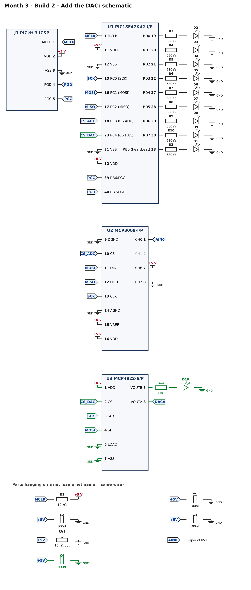
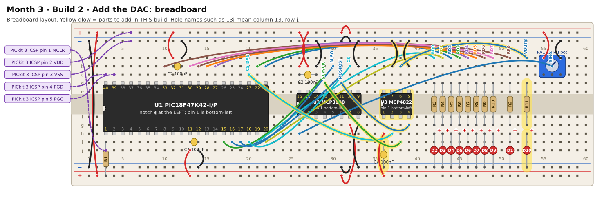

# Month 3 · Build 2 – Add the DAC

[← Build 1](build-1-adc-bar-graph.md) · [Month 3](README.md) · [Next: Build 3 →](build-3-loopback.md)

**Goal:** the chip outputs exact voltages. DAC channel A copies the knob (measure it with a multimeter); channel B draws a slow triangle wave that makes an LED slowly brighten and dim.

**Status:** SPI frames and logic tested against a simulated MCP4822 · compile and bench test pending

**Before you start:** Build 1 must pass. Power OFF.

## 1. What is a DAC? (2 minutes)

The MCP4822 has two outputs, **A** and **B**. You send it a **16-bit word** over SPI:

```text
bit 15    14     13      12      11 ... 0
 A/B      -     gain    on/off   the 12-bit value (0 to 4095)
 0 = A           0 = 2x   1 = on
 1 = B           1 = 1x
```

Its output stage has a built-in 2.048 V reference. With **gain 2x** the output is `value × 4.096 V / 4096`, which is **exactly 1 millivolt per step**:
send 2500 and you get 2.500 V. The largest value, 4095, gives 4.095 V. That is why the program uses gain 2x.

Unlike the ADC (which measures against the 5 V supply), the DAC's voltage is set by its own internal reference, so it stays the same even if your supply wobbles.

## 2. What you are adding



* **U3, the MCP4822:** power (pin 1 = VDD, pin 7 = VSS) with its own 100 nF capacitor (C4). **LDAC** (pin 5) is tied to GND, which means "update the output as soon as CS goes high".
* **Three SPI wires** shared with the ADC (SCK, SDI = MOSI) plus **its own CS** to PIC pin 23.
* **D10 with a 1 kΩ resistor** on output B (pin 6). The LED will slowly brighten and dim as the voltage rises and falls.
* **VOUTA** (pin 8) has no part yet: it is a test point for your multimeter.

## 3. Build it



<!-- placement:2 -->
| Step | Part               | Where it goes                                                                                                          | Notes                                                                                  |
| ---: | ------------------ | ---------------------------------------------------------------------------------------------------------------------- | -------------------------------------------------------------------------------------- |
|    1 | U3 MCP4822-E/P     | Pin 1 in hole **36f**, notch to the **left**. Pins 1–4 run along row f (columns 36–39); pins 5–8 run back along row e. | Skinny (300 mil) chip: one row of pins each side of the centre channel (rows e and f). |
|    2 | jumper wire        | **36h** → bottom **red** rail (+), near column 36                                                                      | +5 V power (red)                                                                       |
|    3 | C4 100nF capacitor | **36i** and bottom **blue** rail (−), near column 36                                                                   | ceramic: either way round; keep the legs short                                         |
|    4 | jumper wire        | **37b** → top **blue** rail (−), near column 37                                                                        | ground (black)                                                                         |
|    5 | jumper wire        | **39b** → top **blue** rail (−), near column 39                                                                        | ground (black)                                                                         |
|    6 | jumper wire        | **37h** → **20c**                                                                                                      | signal CS DAC (any colour)                                                             |
|    7 | jumper wire        | **38i** → **29d**                                                                                                      | signal SCK (any colour)                                                                |
|    8 | jumper wire        | **39g** → **31d**                                                                                                      | signal MOSI (any colour)                                                               |
|    9 | jumper wire        | **38b** → **53a**                                                                                                      | signal VOUTB (any colour)                                                              |
|   10 | R11 1 kΩ resistor  | **53d** and **53g**                                                                                                    | either way round                                                                       |
|   11 | D10 red LED        | **long leg** in **53h**, **short leg** in bottom **blue** rail (−), near column 53                                     | the long leg (+) goes towards the resistor                                             |
<!-- /placement -->

Same circuit as a connection list:

<!-- connections:2 -->
| Starts at                    | Then goes through                                            |
| ---------------------------- | ------------------------------------------------------------ |
| U1 pin **23** (RC4 (CS DAC)) | net **CS_DAC**                                               |
| U3 pin **1** (VDD)           | **+5 V**                                                     |
| U3 pin **7** (VSS)           | **GND**                                                      |
| U3 pin **5** (LDAC)          | **GND**                                                      |
| net **+5V**                  | C4 100nF → **GND**                                           |
| U3 pin **2** (CS)            | net **CS_DAC**                                               |
| U3 pin **3** (SCK)           | net **SCK**                                                  |
| U3 pin **4** (SDI)           | net **MOSI**                                                 |
| U3 pin **6** (VOUTB)         | R11 1 kΩ → D10 LED (long leg towards the resistor) → **GND** |
| U3 pin **8** (VOUTA)         | net **DACA**                                                 |
<!-- /connections -->

## 4. Check before you power it

1. +5 V to GND: no short.
2. MCP4822 pin **1** to +5 V; pins **5** and **7** to GND.
3. SCK, SDI and CS go to the right places: SCK ↔ MCP3008 pin 13, SDI ↔ MCP3008 pin 11 (these are the same nets), CS ↔ PIC pin 23.

## 5. Program it

<!-- code:code/build-2-dac/main.c -->
```c
/*
 * Month 3 - Build 2: Add the DAC
 *
 * Chip     : PIC18F47K42-I/P with an MCP3008 (ADC) and an MCP4822 (2-channel 12-bit DAC)
 * Compiler : MPLAB XC8
 * Supply   : 5 V
 * Clock    : 64 MHz internal oscillator
 *
 * What it does (all with the same self-test and heartbeat as Build 1):
 *   - Reads the knob (ADC channel 0) and shows it as a bar graph.
 *   - DAC channel A copies the knob: measure it with a multimeter and it matches the voltage at the
 *     knob's middle leg (up to 4.095 V, the DAC's limit).
 *   - DAC channel B draws a slow triangle wave, 0 V up to 4.095 V and back, about every 2 seconds,
 *     so the LED on it slowly brightens and dims.
 */

#include <xc.h>

/* ---- Configuration bits: how the chip starts up -------------------------
 * Leave these alone. If the compiler rejects one, see
 * start-here/04-pic-setup.md  ("If a #pragma config line is rejected").
 */
#pragma config FEXTOSC  = OFF            /* no external crystal            */
#pragma config RSTOSC   = HFINTOSC_64MHZ /* start on the internal 64 MHz   */
#pragma config CLKOUTEN = OFF
#pragma config CSWEN    = ON
#pragma config FCMEN    = OFF
#pragma config WDTE     = OFF            /* watchdog OFF, or it keeps resetting */
#pragma config LVP      = ON
#pragma config XINST    = OFF

#define _XTAL_FREQ 64000000UL            /* tells __delay_ms() the clock speed */

/* ---- Pins ----------------------------------------------------------------
 * The LED bar graph is port D: RD0 (pin 19) ... RD7 (pin 30), one LED each.
 */
#define SCK        0x01      /* RC0 (pin 15): SPI clock, to both chips        */
#define MOSI       0x02      /* RC1 (pin 16): data to the chips               */
#define MISO       0x04      /* RC2 (pin 17): data from the ADC               */
#define CS_ADC     0x08      /* RC3 (pin 18): chip select, MCP3008 (ADC)      */
#define CS_DAC     0x10      /* RC4 (pin 23): chip select, MCP4822 (DAC)      */
#define HEARTBEAT  0x01      /* RB0 (pin 33): heartbeat / fault LED, on LATB  */

/* ---- SPI "by hand" -----------------------------------------------------
 * SPI uses four wires: a clock (SCK), data out (MOSI), data in (MISO) and one
 * chip-select (CS) per chip. A chip listens only while its CS is LOW.
 * To send a byte we put each bit on MOSI (most significant first), raise SCK so
 * the chip reads it, read MISO at the same moment, then lower SCK again.
 * Unlike I2C there is no "acknowledge": a missing chip just looks like a 0 or a 1.
 */
#define SPI_DELAY()  __delay_us(1)     /* about 400 kHz: slow and forgiving */

static unsigned char spiTransfer(unsigned char out)
{
    unsigned char n, in = 0;

    for (n = 0; n < 8; n++)
    {
        if (out & 0x80) LATC |= MOSI; else LATC &= ~MOSI;
        out = (unsigned char)(out << 1);
        SPI_DELAY();
        LATC |= SCK;                   /* clock rises: the chip reads our bit    */
        SPI_DELAY();
        in = (unsigned char)(in << 1);
        if (PORTC & MISO) in |= 0x01;  /* ...and we read the bit it is sending   */
        LATC &= ~SCK;                  /* clock falls                             */
    }
    return in;
}

/* Read one channel (0 to 7) of the MCP3008. Returns 0 (0 V) to 1023 (the 5 V reference). */
static unsigned int adcRead(unsigned char channel)
{
    unsigned char high, low;

    LATC &= ~CS_ADC;                              /* select the ADC              */
    SPI_DELAY();
    spiTransfer(0x01);                            /* the START bit               */
    high = spiTransfer((unsigned char)(0x80 | (channel << 4)));  /* single-ended + channel;
                                                     the top bits of the answer come back */
    low  = spiTransfer(0x00);                     /* the rest of the answer      */
    LATC |= CS_ADC;                               /* deselect                    */
    SPI_DELAY();
    return (unsigned int)(((unsigned int)(high & 0x03) << 8) | low);
}

/* Turn a reading 0..1023 into a bar of 0..8 lit LEDs, as a bit pattern for port D. */
static unsigned char bar(unsigned int reading)
{
    unsigned char lit = (unsigned char)((reading * 9UL) / 1024UL);    /* 0 to 8 */
    return (unsigned char)((1u << lit) - 1u);                         /* 0x00 to 0xFF */
}

/* If something is wrong, flash the heartbeat LED 'code' times, pause, repeat, forever. */
static void fault(unsigned char code)
{
    unsigned char n;

    LATD = 0x00;
    while (1)
    {
        for (n = 0; n < code; n++)
        {
            LATB |= HEARTBEAT;  __delay_ms(200);
            LATB &= ~HEARTBEAT; __delay_ms(200);
        }
        __delay_ms(1000);
    }
}

/* Write a value 0..4095 to DAC channel 0 (A) or 1 (B) of the MCP4822.
 * We use its "2x gain" setting, so the output voltage is exactly 1 millivolt per step:
 * a value of 2500 gives 2.500 V (the largest value, 4095, gives 4.095 V).
 * The 16 bits are:  [A/B] [-] [gain: 0 = 2x] [on: 1] [12 bits of value]            */
static void dacWrite(unsigned char channel, unsigned int value)
{
    unsigned int word = (unsigned int)(0x1000 | (value & 0x0FFF));     /* gain 2x, output on */
    if (channel) word |= 0x8000;                                       /* channel B          */

    LATC &= ~CS_DAC;
    SPI_DELAY();
    spiTransfer((unsigned char)(word >> 8));
    spiTransfer((unsigned char)(word & 0xFF));
    LATC |= CS_DAC;                    /* the DAC output updates when CS goes HIGH */
    SPI_DELAY();
}

static void setup(void)
{
    OSCFRQ = 0x08;               /* make sure the internal clock is 64 MHz */

    ANSELB = 0x00; ANSELC = 0x00; ANSELD = 0x00;      /* all digital */
    LATB = 0x00;
    LATC = CS_ADC | CS_DAC;      /* both chip-selects HIGH (chips ignored), clock LOW */
    LATD = 0x00;
    TRISB = 0xFE;                /* RB0 (heartbeat) is an output                 */
    TRISC = 0xE4;                /* RC0, RC1, RC3, RC4 outputs; RC2 (MISO) input */
    TRISD = 0x00;                /* port D: all outputs (the bar graph)          */
}

void main(void)
{
    unsigned char ticks = 0;
    unsigned int  reading, code;
    unsigned int  wave = 0;               /* the triangle wave, 0..4095 */
    unsigned char rising = 1;

    setup();

    if (adcRead(7) > 16)   fault(1);
    if (adcRead(6) < 1007) fault(2);

    while (1)
    {
        reading = adcRead(0);
        LATD = bar(reading);

        code = (unsigned int)((reading * 5000UL) / 1024UL);   /* reading -> millivolts */
        if (code > 4095) code = 4095;                         /* the DAC cannot go higher */
        dacWrite(0, code);                                    /* A follows the knob       */

        if (rising)                                           /* B: triangle wave         */
        {
            wave += 41;
            if (wave >= 4095) { wave = 4095; rising = 0; }
        }
        else
        {
            if (wave <= 41) { wave = 0; rising = 1; }
            else wave -= 41;
        }
        dacWrite(1, wave);

        ticks++;
        if (ticks >= 50) { ticks = 0; LATB ^= HEARTBEAT; }

        __delay_ms(10);
    }
}
```
<!-- /code -->

What is new:

* `dacWrite(channel, value)` builds the 16-bit word and sends it as two bytes, with CS low around them. The output changes when CS goes high.
* `code = reading * 5000 / 1024` converts the knob's reading into millivolts, so DAC A copies the knob's voltage. It is **limited to 4095** because the DAC cannot go higher: above about 4.1 V on the knob, A stays at 4.095 V.
* The triangle wave steps up by 41 millivolts every 10 ms (about a second to the top) and then back down.

## 6. Pass check

* [ ] The bar graph still follows the knob.
* [ ] With the multimeter (DC volts), the voltage at **MCP4822 pin 8 (VOUTA)** matches the voltage at the knob's **middle leg**, within about 30 mV, for knob positions up to about 4 V.
* [ ] Above about 4.1 V on the knob, VOUTA stops at 4.09 V and the bar graph keeps rising.
* [ ] The LED **D10** slowly brightens and dims, about every 2 seconds (it only lights in the upper part of the wave, above about 1.9 V).
* [ ] The heartbeat LED blinks.

## 7. If it does not work

| What you see                                     | Most likely cause                     | What to do                                                                                  |
| ------------------------------------------------ | ------------------------------------- | ------------------------------------------------------------------------------------------- |
| VOUTA always reads 0 V                           | the DAC is not powered or CS is wrong | check pins 1 and 7; CS wire to PIC pin 23; the 16-bit word is only accepted while CS is low |
| VOUTA stuck near 2 V (half of what it should be) | the output is in gain-1x mode         | check `0x1000 \| ...` in `dacWrite` (bit 13 must be 0)                                      |
| VOUTA reads about twice or half the knob         | you compared with the wrong point     | measure the knob's *middle leg*, not an end                                                 |
| D10 never lights                                 | LED backwards or resistor missing     | long leg to the resistor; 1 kΩ in series                                                    |
| The ADC bar graph now misbehaves                 | the DAC's wires disturb SPI           | recheck that the DAC's CS is on pin 23 and not pin 18 (that is the ADC's)                   |

## 8. Try this

* Make DAC B output a **square wave**: switch it between 0 and 3000 every 200 ms. Does the LED flash?
* Make A output the **inverse** of the knob (`4095 - code`).
* Use the multimeter to check the DAC's accuracy at three different values. How many millivolts is it off by?

[← Build 1](build-1-adc-bar-graph.md) · [Month 3](README.md) · [Next: Build 3 →](build-3-loopback.md)
