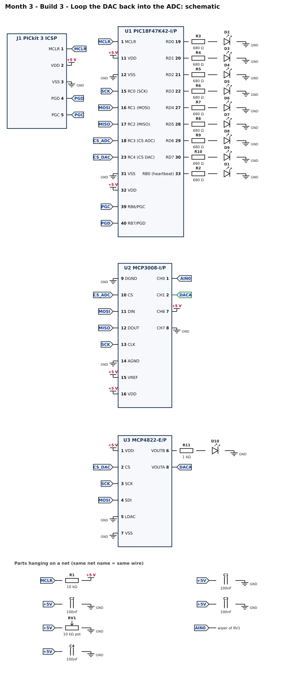
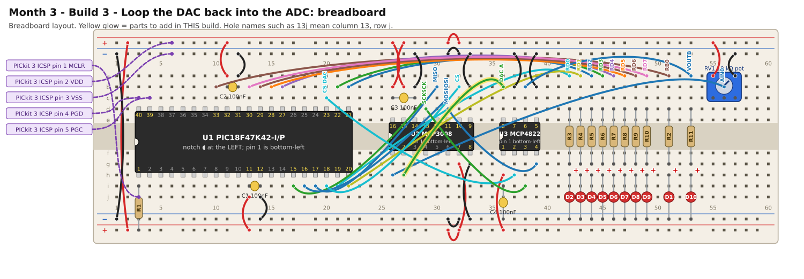

# Month 3 · Build 3 – Loop the DAC back into the ADC

[← Build 2](build-2-dac.md) · [Month 3](README.md)

**Goal:** one extra wire joins the DAC's output to an ADC input, so the two converters check each other. The program tests the loop at start-up and then draws a smooth sweep on the bar graph.

**Status:** logic tested in simulation, including the self-test and its fault code · compile and bench test pending

**Before you start:** Build 2 must pass. Power OFF.

## 1. What you are adding



A single wire from **DAC output A (MCP4822 pin 8)** to **ADC channel 1 (MCP3008 pin 2)**. Now the chip can output a voltage *and* measure it, with no outside help.

## 2. Build it



<!-- placement:3 -->
| Step | Part        | Where it goes     | Notes                     |
| ---: | ----------- | ----------------- | ------------------------- |
|    1 | jumper wire | **36b** → **27h** | signal DAC A (any colour) |
<!-- /placement -->

Same circuit as a connection list:

<!-- connections:3 -->
| Starts at          | Then goes through |
| ------------------ | ----------------- |
| U2 pin **2** (CH1) | net **DACA**      |
<!-- /connections -->

## 3. Check before you power it

1. +5 V to GND: no short.
2. MCP4822 pin 8 and MCP3008 pin 2 beep to each other, and to nothing else.

## 4. Program it

<!-- code:code/build-3-loopback/main.c -->
```c
/*
 * Month 3 - Build 3: Loop the DAC back into the ADC
 *
 * Chip     : PIC18F47K42-I/P with an MCP3008 (ADC) and an MCP4822 (DAC)
 * Compiler : MPLAB XC8
 * Supply   : 5 V
 * Clock    : 64 MHz internal oscillator
 * Extra wire: DAC channel A output -> ADC channel 1 input
 *
 * What it does:
 *   1. Self-test of the ADC (channels 6 and 7) as before.
 *   2. Self-test of the DAC: it outputs 0.5 V, 1.5 V, 2.5 V and 3.5 V, the ADC reads each back through
 *      the loop-back wire, and each reading must be higher than the last. If not:
 *        3 blinks = the DAC-to-ADC loop is not working (DAC, wire, or chip-select)
 *   3. Then the DAC sweeps its output up and down slowly (about every 2 seconds) and the ADC's reading
 *      of it is shown as a bar graph: the bar rises and falls smoothly. The bar reaches 7 of the 8 LEDs,
 *      because the DAC tops out at 4.095 V, which is 82% of the ADC's 5 V range.
 */

#include <xc.h>

/* ---- Configuration bits: how the chip starts up -------------------------
 * Leave these alone. If the compiler rejects one, see
 * start-here/04-pic-setup.md  ("If a #pragma config line is rejected").
 */
#pragma config FEXTOSC  = OFF            /* no external crystal            */
#pragma config RSTOSC   = HFINTOSC_64MHZ /* start on the internal 64 MHz   */
#pragma config CLKOUTEN = OFF
#pragma config CSWEN    = ON
#pragma config FCMEN    = OFF
#pragma config WDTE     = OFF            /* watchdog OFF, or it keeps resetting */
#pragma config LVP      = ON
#pragma config XINST    = OFF

#define _XTAL_FREQ 64000000UL            /* tells __delay_ms() the clock speed */

/* ---- Pins ----------------------------------------------------------------
 * The LED bar graph is port D: RD0 (pin 19) ... RD7 (pin 30), one LED each.
 */
#define SCK        0x01      /* RC0 (pin 15): SPI clock, to both chips        */
#define MOSI       0x02      /* RC1 (pin 16): data to the chips               */
#define MISO       0x04      /* RC2 (pin 17): data from the ADC               */
#define CS_ADC     0x08      /* RC3 (pin 18): chip select, MCP3008 (ADC)      */
#define CS_DAC     0x10      /* RC4 (pin 23): chip select, MCP4822 (DAC)      */
#define HEARTBEAT  0x01      /* RB0 (pin 33): heartbeat / fault LED, on LATB  */

/* ---- SPI "by hand" -----------------------------------------------------
 * SPI uses four wires: a clock (SCK), data out (MOSI), data in (MISO) and one
 * chip-select (CS) per chip. A chip listens only while its CS is LOW.
 * To send a byte we put each bit on MOSI (most significant first), raise SCK so
 * the chip reads it, read MISO at the same moment, then lower SCK again.
 * Unlike I2C there is no "acknowledge": a missing chip just looks like a 0 or a 1.
 */
#define SPI_DELAY()  __delay_us(1)     /* about 400 kHz: slow and forgiving */

static unsigned char spiTransfer(unsigned char out)
{
    unsigned char n, in = 0;

    for (n = 0; n < 8; n++)
    {
        if (out & 0x80) LATC |= MOSI; else LATC &= ~MOSI;
        out = (unsigned char)(out << 1);
        SPI_DELAY();
        LATC |= SCK;                   /* clock rises: the chip reads our bit    */
        SPI_DELAY();
        in = (unsigned char)(in << 1);
        if (PORTC & MISO) in |= 0x01;  /* ...and we read the bit it is sending   */
        LATC &= ~SCK;                  /* clock falls                             */
    }
    return in;
}

/* Read one channel (0 to 7) of the MCP3008. Returns 0 (0 V) to 1023 (the 5 V reference). */
static unsigned int adcRead(unsigned char channel)
{
    unsigned char high, low;

    LATC &= ~CS_ADC;                              /* select the ADC              */
    SPI_DELAY();
    spiTransfer(0x01);                            /* the START bit               */
    high = spiTransfer((unsigned char)(0x80 | (channel << 4)));  /* single-ended + channel;
                                                     the top bits of the answer come back */
    low  = spiTransfer(0x00);                     /* the rest of the answer      */
    LATC |= CS_ADC;                               /* deselect                    */
    SPI_DELAY();
    return (unsigned int)(((unsigned int)(high & 0x03) << 8) | low);
}

/* Turn a reading 0..1023 into a bar of 0..8 lit LEDs, as a bit pattern for port D. */
static unsigned char bar(unsigned int reading)
{
    unsigned char lit = (unsigned char)((reading * 9UL) / 1024UL);    /* 0 to 8 */
    return (unsigned char)((1u << lit) - 1u);                         /* 0x00 to 0xFF */
}

/* If something is wrong, flash the heartbeat LED 'code' times, pause, repeat, forever. */
static void fault(unsigned char code)
{
    unsigned char n;

    LATD = 0x00;
    while (1)
    {
        for (n = 0; n < code; n++)
        {
            LATB |= HEARTBEAT;  __delay_ms(200);
            LATB &= ~HEARTBEAT; __delay_ms(200);
        }
        __delay_ms(1000);
    }
}

/* Write a value 0..4095 to DAC channel 0 (A) or 1 (B) of the MCP4822.
 * We use its "2x gain" setting, so the output voltage is exactly 1 millivolt per step:
 * a value of 2500 gives 2.500 V (the largest value, 4095, gives 4.095 V).
 * The 16 bits are:  [A/B] [-] [gain: 0 = 2x] [on: 1] [12 bits of value]            */
static void dacWrite(unsigned char channel, unsigned int value)
{
    unsigned int word = (unsigned int)(0x1000 | (value & 0x0FFF));     /* gain 2x, output on */
    if (channel) word |= 0x8000;                                       /* channel B          */

    LATC &= ~CS_DAC;
    SPI_DELAY();
    spiTransfer((unsigned char)(word >> 8));
    spiTransfer((unsigned char)(word & 0xFF));
    LATC |= CS_DAC;                    /* the DAC output updates when CS goes HIGH */
    SPI_DELAY();
}

static void setup(void)
{
    OSCFRQ = 0x08;               /* make sure the internal clock is 64 MHz */

    ANSELB = 0x00; ANSELC = 0x00; ANSELD = 0x00;      /* all digital */
    LATB = 0x00;
    LATC = CS_ADC | CS_DAC;      /* both chip-selects HIGH (chips ignored), clock LOW */
    LATD = 0x00;
    TRISB = 0xFE;                /* RB0 (heartbeat) is an output                 */
    TRISC = 0xE4;                /* RC0, RC1, RC3, RC4 outputs; RC2 (MISO) input */
    TRISD = 0x00;                /* port D: all outputs (the bar graph)          */
}

/* Each step up in DAC voltage must read higher on the ADC. A 5 V supply gives roughly
 * 100, 300, 510 and 716 counts for 0.5, 1.5, 2.5 and 3.5 V. We allow plenty of margin
 * because the ADC measures against the supply, which is never exactly 5.000 V. */
static void loopbackTest(void)
{
    static const unsigned int millivolts[4] = { 500, 1500, 2500, 3500 };
    unsigned int reading, previous = 0;
    unsigned char i;

    for (i = 0; i < 4; i++)
    {
        dacWrite(0, millivolts[i]);
        __delay_ms(5);
        reading = adcRead(1);
        if (reading < previous + 60) fault(3);
        previous = reading;
    }
    if (previous < 600 || previous > 850) fault(3);   /* 3.5 V: about 716 counts */
}

void main(void)
{
    unsigned char ticks = 0, rising = 1;
    unsigned int  code = 0;

    setup();

    if (adcRead(7) > 16)   fault(1);
    if (adcRead(6) < 1007) fault(2);
    loopbackTest();

    while (1)
    {
        dacWrite(0, code);                    /* the DAC outputs "code" millivolts...      */
        __delay_ms(2);
        LATD = bar(adcRead(1));               /* ...the ADC measures it, we show the bar   */

        if (rising)
        {
            code += 41;
            if (code >= 4095) { code = 4095; rising = 0; }
        }
        else
        {
            if (code <= 41) { code = 0; rising = 1; }
            else code -= 41;
        }

        ticks++;
        if (ticks >= 50) { ticks = 0; LATB ^= HEARTBEAT; }

        __delay_ms(10);
    }
}
```
<!-- /code -->

What is new:

* **`loopbackTest()`** outputs 0.5 V, 1.5 V, 2.5 V and 3.5 V and reads each one back. Each reading must be higher than the last, and the last must be roughly in the right range. The margins are generous because the ADC measures against your supply, which is never exactly 5.000 V.
* The main loop sweeps DAC A up and down and shows what the **ADC** measures as a bar graph. If both chips are working, the bar rises and falls smoothly.
* The bar only reaches **7 of 8 LEDs**: the DAC tops out at 4.095 V, which is 82% of the ADC's 5 V range.

## 5. Pass check

* [ ] The bar graph sweeps from empty up to 7 LEDs and back, about every 4 seconds.
* [ ] It rises and falls **smoothly**, one LED at a time.
* [ ] The heartbeat LED blinks once a second (no fault code).
* [ ] Pull out the loop-back wire and reset the chip: the heartbeat LED shows **3 blinks**. Put the wire back: it works again.

### Fault codes (all the earlier ones still apply)

| Blinks, pause, repeat | Meaning                                                                      |
| :-------------------: | ---------------------------------------------------------------------------- |
|         **1**         | ADC channel 7 (GND test wire) did not read about 0 (see Build 1)             |
|         **2**         | ADC channel 6 (+5 V test wire) did not read about full-scale (see Build 1)   |
|         **3**         | the DAC → ADC loop failed: the readings did not rise as the DAC voltage rose |

## 6. If it does not work

| What you see                           | Most likely cause                                      | What to do                                                     |
| -------------------------------------- | ------------------------------------------------------ | -------------------------------------------------------------- |
| Fault code 3                           | loop wire missing or in the wrong hole                 | pin 8 of the DAC to pin 2 of the ADC; **not** pin 1 (the knob) |
| Fault code 3, wire is right            | the DAC works but the ADC is reading the wrong channel | the wire must land on channel **1**, not channel 0 or 2        |
| Bar jumps instead of sweeping smoothly | noise on the DAC output                                | keep the loop wire short; check the DAC's 100 nF capacitor     |
| Bar never reaches 7 LEDs               | normal if your supply is above about 5.2 V             | measure the supply voltage                                     |

## 7. Try this

* Replace the loop-back wire with a **voltage divider** (two equal resistors) and see how the bar's range changes.
* Channel 6 is wired to +5 V and always reads about 1023, whatever your supply voltage is. Why? What does that tell you about measuring the supply voltage with this ADC?
* Write a function that returns the DAC's error in millivolts at a given code, using the ADC as the referee. What limits its accuracy?

## 8. What you learned

You built a complete data-conversion loop: a number becomes a voltage, the voltage becomes a number again, and the program checks its own hardware. The same idea (self-test with known values) returns in later months.

[← Build 2](build-2-dac.md) · [Month 3](README.md)
