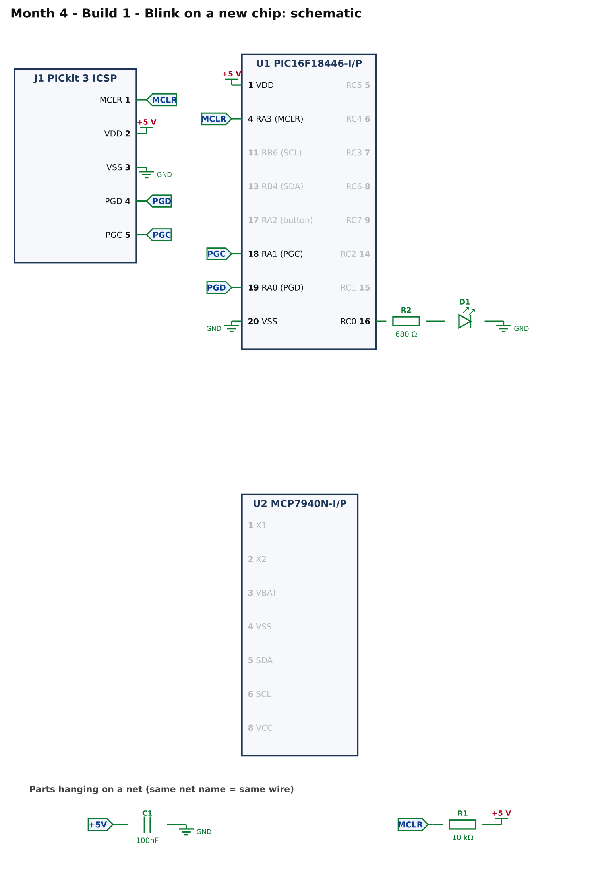
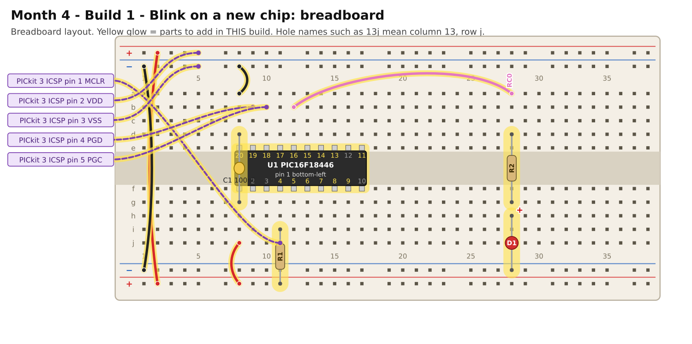

# Month 4 · Build 1 – Blink on a new chip

[← Month 4](README.md) · [Next: Build 2 →](build-2-rtc-hello.md)

**Goal:** the Month 1 blink program, running on the PIC16F18446. The point is **what changes** when you move to another chip of the same family.

**Status:** logic tested in simulation · compile and bench test pending

**Before you start:** the [PIC setup](../start-here/04-pic-setup.md) done. Power OFF.

## 1. What changes, and what does not

|                                                      | PIC16F18857 (Month 1)         | PIC16F18446 (this month)                            |
| ---------------------------------------------------- | ----------------------------- | --------------------------------------------------- |
| Package                                              | 28-pin                        | **20-pin**                                          |
| Supply pins                                          | VDD pin 20; VSS pins 8 and 19 | VDD **pin 1**; VSS **pin 20** (only one ground pin) |
| Reset pin (MCLR)                                     | pin 1                         | **pin 4** (it is port pin RA3)                      |
| Programmer pins                                      | PGC = pin 27, PGD = pin 28    | **PGC = pin 18, PGD = pin 19**                      |
| Pin for the LED on RC0                               | pin 11                        | **pin 16**                                          |
| `#pragma config` block                               | the Month 1 block             | **the same names and values**                       |
| Clock set-up                                         | `RSTOSC = HFINT1` (1 MHz)     | the same                                            |
| Port names and registers (`LATC`, `TRISC`, `ANSELC`) | yes                           | **the same names**                                  |

Most of the program is identical. What changes is **where the pins are**: every wiring detail, because a different package puts the same signal on a different pin.
The lesson for the rest of the course: *the code often ports easily; the wiring never does*. Always rebuild from the new chip's pin table.

> **Careful with oscillator speed numbers.** Both chips have a register called `OSCFRQ` that sets the clock speed, but the *numbers* differ between families.
> For example, on this family `0x07` means 32 MHz, while on the PIC18F47K42 from Month 2 `0x08` means 64 MHz. This month runs at 1 MHz and never writes `OSCFRQ`, but when you do, look the number up in that chip's datasheet.

## 2. What you are building



* **C1 (100 nF):** across the supply pins. This chip has only one pair, so one capacitor.
* **R1 (10 kΩ):** holds MCLR high.
* **D1 + R2:** the LED on RC0.
* **J1:** the five PICkit 3 wires. On this chip they go to RA3 (MCLR), RA0 (PGD) and RA1 (PGC).

## 3. Build it



<!-- placement:1 -->
| Step | Part                     | Where it goes                                                                                                           | Notes                                                                                  |
| ---: | ------------------------ | ----------------------------------------------------------------------------------------------------------------------- | -------------------------------------------------------------------------------------- |
|    1 | U1 PIC16F18446-I/P       | Pin 1 in hole **8f**, notch to the **left**. Pins 1–10 run along row f (columns 8–17); pins 11–20 run back along row e. | Skinny (300 mil) chip: one row of pins each side of the centre channel (rows e and f). |
|    2 | jumper wire              | top **red** rail (+), near column 2 → bottom **red** rail (+), near column 2                                            | +5 V power (red)                                                                       |
|    3 | jumper wire              | top **blue** rail (−), near column 1 → bottom **blue** rail (−), near column 1                                          | ground (black)                                                                         |
|    4 | jumper wire              | **8j** → bottom **red** rail (+), near column 8                                                                         | +5 V power (red)                                                                       |
|    5 | jumper wire              | **8a** → top **blue** rail (−), near column 8                                                                           | ground (black)                                                                         |
|    6 | C1 100nF capacitor       | **8g** and **8d**                                                                                                       | ceramic: either way round; keep the legs short                                         |
|    7 | R1 10 kΩ resistor        | **11i** and bottom **red** rail (+), near column 11                                                                     | either way round                                                                       |
|    8 | PICkit 3 ICSP lead: MCLR | from PICkit 3 ICSP pin **1** (MCLR) to **11j**                                                                          | female-to-male Dupont lead                                                             |
|    9 | PICkit 3 ICSP lead: VDD  | from PICkit 3 ICSP pin **2** (VDD) to top **red** rail (+), near column 5                                               | female-to-male Dupont lead                                                             |
|   10 | PICkit 3 ICSP lead: VSS  | from PICkit 3 ICSP pin **3** (VSS) to top **blue** rail (−), near column 5                                              | female-to-male Dupont lead                                                             |
|   11 | PICkit 3 ICSP lead: PGD  | from PICkit 3 ICSP pin **4** (PGD) to **9b**                                                                            | female-to-male Dupont lead                                                             |
|   12 | PICkit 3 ICSP lead: PGC  | from PICkit 3 ICSP pin **5** (PGC) to **10b**                                                                           | female-to-male Dupont lead                                                             |
|   13 | jumper wire              | **12b** → **28a**                                                                                                       | signal RC0 (any colour)                                                                |
|   14 | R2 680 Ω resistor        | **28d** and **28g**                                                                                                     | either way round                                                                       |
|   15 | D1 red LED               | **long leg** in **28h**, **short leg** in bottom **blue** rail (−), near column 28                                      | the long leg (+) goes towards the resistor                                             |
<!-- /placement -->

Same circuit as a connection list:

<!-- connections:1 -->
| Starts at                 | Then goes through                                           |
| ------------------------- | ----------------------------------------------------------- |
| U1 pin **1** (VDD)        | **+5 V**                                                    |
| U1 pin **20** (VSS)       | **GND**                                                     |
| net **+5V**               | C1 100nF → **GND**                                          |
| U1 pin **4** (RA3 (MCLR)) | net **MCLR**                                                |
| net **MCLR**              | R1 10 kΩ → **+5 V**                                         |
| U1 pin **19** (RA0 (PGD)) | net **PGD**                                                 |
| U1 pin **18** (RA1 (PGC)) | net **PGC**                                                 |
| J1 pin **1** (MCLR)       | net **MCLR**                                                |
| J1 pin **2** (VDD)        | **+5 V**                                                    |
| J1 pin **3** (VSS)        | **GND**                                                     |
| J1 pin **4** (PGD)        | net **PGD**                                                 |
| J1 pin **5** (PGC)        | net **PGC**                                                 |
| U1 pin **16** (RC0)       | R2 680 Ω → D1 LED (long leg towards the resistor) → **GND** |
<!-- /connections -->

## 4. Check before you power it

1. +5 V rail to GND rail: no short.
2. Pin **1** (VDD) beeps to the +5 V rail; pin **20** (VSS) beeps to the GND rail.
3. Pin **4** (MCLR) to the +5 V rail reads about **10 kΩ**.
4. Power on: pin 1 to pin 20 reads **4.8–5.2 V**.

## 5. Program it

Follow the [PIC setup](../start-here/04-pic-setup.md#create-a-project) with device **PIC16F18446**.

<!-- code:code/build-1-blink/main.c -->
```c
/*
 * Month 4 - Build 1: Blink on a new chip
 *
 * Chip     : PIC16F18446-I/P (20-pin PDIP)
 * Compiler : MPLAB XC8
 * Supply   : 5 V
 * Clock    : 1 MHz internal oscillator
 * LED      : RC0 (pin 16) -> 680 ohm -> LED -> GND
 *
 * This is the Month 1 blink program, moved to a different PIC16 chip.
 * Compare it with Month 1's pic-1-blink/main.c: the configuration bits are the same
 * and only the pins and the port set-up differ.
 */

#include <xc.h>

/* ---- Configuration bits: how the chip starts up -------------------------
 * Leave these alone. If the compiler rejects one, see
 * start-here/04-pic-setup.md  ("If a #pragma config line is rejected").
 */
#pragma config FEXTOSC  = OFF    /* no external crystal                   */
#pragma config RSTOSC   = HFINT1 /* start on the internal 1 MHz clock     */
#pragma config CLKOUTEN = OFF
#pragma config CSWEN    = ON
#pragma config FCMEN    = OFF
#pragma config WDTE     = OFF    /* watchdog OFF, or the chip keeps resetting */
#pragma config LVP      = ON
#pragma config CP       = OFF

#define _XTAL_FREQ 1000000UL     /* tells __delay_ms() the clock speed    */

#define LED  0x01                /* RC0 */

void main(void)
{
    ANSELC = 0x00;               /* make all of port C digital            */
    LATC   = 0x00;               /* every output starts LOW (LED off)     */
    TRISC  = 0x00;               /* port C: all outputs                   */

    while (1)
    {
        LATC |= LED;             /* LED on  */
        __delay_ms(500);
        LATC &= ~LED;            /* LED off */
        __delay_ms(500);
    }
}
```
<!-- /code -->

Open your Month 1 `pic-1-blink/main.c` beside this one. The differences are only:

* the device name in the comment,
* `TRISC = 0x00;` instead of `0xFE`. All of port C becomes outputs, because the next builds use all eight LEDs.

## 6. Pass check

* [ ] The LED on RC0 blinks: half a second on, half a second off.
* [ ] Ten blinks take about ten seconds.

## 7. If it does not work

| What you see              | Most likely cause                                                    | What to do                                                                                        |
| ------------------------- | -------------------------------------------------------------------- | ------------------------------------------------------------------------------------------------- |
| "Target device not found" | the programmer leads: this chip uses **different pins** from Month 1 | PGD → pin 19, PGC → pin 18, MCLR → pin 4; PICkit pin 1 on the right lead                          |
| Programs, no blink        | wire to the wrong pin                                                | the LED wire starts at pin **16** (RC0)                                                           |
| Compiler: unknown device  | the device pack is missing                                           | MPLAB X → Tools → Packs: install the PIC16F1xxxx pack; see [setup](../start-here/04-pic-setup.md) |

## 8. Try this

* Port the **Month 1 dice** to this chip yourself. You need seven LEDs: RC0 to RC6 are all available. Which wires move?
* Which pin on this 20-pin chip would you use for the button, and why not RA0, RA1 or RA3?

[← Month 4](README.md) · [Next: Build 2 →](build-2-rtc-hello.md)
