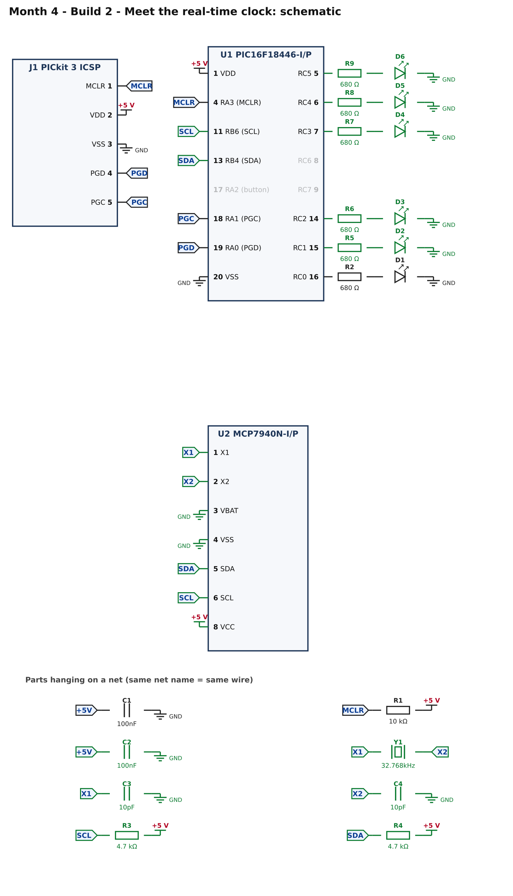
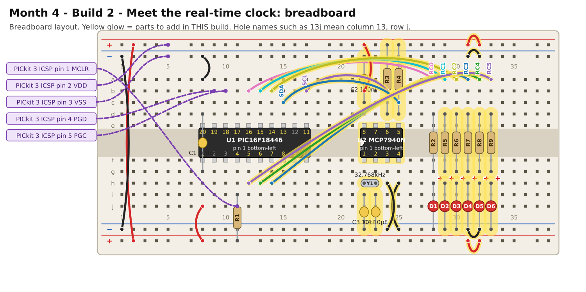

# Month 4 · Build 2 – Meet the real-time clock

[← Build 1](build-1-blink.md) · [Month 4](README.md) · [Next: Build 3 →](build-3-binary-clock.md)

**Goal:** the PIC starts the clock chip, reads the seconds over I2C and shows them in binary on LEDs. If anything is wrong, the LED on RC0 tells you what by blinking a code.

**Status:** I2C conversation, BCD times and oscillator start tested against a simulated MCP7940N · compile and bench test pending

**Before you start:** Build 1 must pass. Power OFF.

## 1. What is a real-time clock?

A **real-time clock (RTC)** chip does one job: it counts seconds, minutes and hours, very accurately, using a **32.768 kHz crystal**. (That frequency is 2 to the power of 15, so dividing it down fifteen times gives exactly one pulse per second.)
The PIC does not count time itself. It asks the clock chip over I2C, exactly as it asked the MCP23017 in Month 2: START, address, register number, read.

Three ideas to know:

* **The clock must be started.** A new chip is stopped. Setting the **ST bit** (bit 7 of the seconds register) starts the crystal oscillator. The chip then reports **OSCRUN = 1** (bit 5 of the weekday register) once the crystal is really running.
* **Times are stored in BCD.** Each decimal digit gets four bits. **59 seconds** is stored as `0101 1001` (0x59), *not* as 59 in plain binary (0x3B). The program converts with `fromBcd()` and `toBcd()`.
* **Without a battery the time is lost at power-off.** This build sets the time from the moment the program was **built** (the compiler fills in `__TIME__`), a few seconds or minutes behind real time. Fit a coin cell (Build 3, "Try this") and the clock keeps going while the board is off. If the clock is already running when the PIC starts, the program leaves it alone.

## 2. What you are adding



* **U2, the MCP7940N:** power (VCC pin 8, VSS pin 4) with C2. The **VBAT** pin (3) is tied to GND because there is no battery yet.
* **Y1, C3, C4:** the 32.768 kHz crystal and its two 10 pF load capacitors, between pins 1 (X1) and 2 (X2), and ground.
* **R3, R4 (4.7 kΩ):** the I2C pull-ups on SCL (pin 6) and SDA (pin 5).
* **Five more LEDs** on RC1 to RC5. Together with RC0 they show the seconds in binary.
* **MFP** (pin 7) is a spare output; leave it unconnected.

The MCP7940N's I2C address is fixed at **0x6F**.

## 3. Build it



**The crystal is delicate.** Do not bend its legs close to the body. Seat it so its legs reach the holes without strain.

<!-- placement:2 -->
| Step | Part                 | Where it goes                                                                                                          | Notes                                                                                  |
| ---: | -------------------- | ---------------------------------------------------------------------------------------------------------------------- | -------------------------------------------------------------------------------------- |
|    1 | U2 MCP7940N-I/P      | Pin 1 in hole **22f**, notch to the **left**. Pins 1–4 run along row f (columns 22–25); pins 5–8 run back along row e. | Skinny (300 mil) chip: one row of pins each side of the centre channel (rows e and f). |
|    2 | jumper wire          | top **red** rail (+), near column 31 → top **red** rail (+), near column 32                                            | +5 V power (red)                                                                       |
|    3 | jumper wire          | bottom **red** rail (+), near column 31 → bottom **red** rail (+), near column 32                                      | +5 V power (red)                                                                       |
|    4 | jumper wire          | top **blue** rail (−), near column 31 → top **blue** rail (−), near column 32                                          | ground (black)                                                                         |
|    5 | jumper wire          | bottom **blue** rail (−), near column 31 → bottom **blue** rail (−), near column 32                                    | ground (black)                                                                         |
|    6 | jumper wire          | **22b** → top **red** rail (+), near column 22                                                                         | +5 V power (red)                                                                       |
|    7 | jumper wire          | **25h** → bottom **blue** rail (−), near column 25                                                                     | ground (black)                                                                         |
|    8 | jumper wire          | **24h** → bottom **blue** rail (−), near column 24                                                                     | ground (black)                                                                         |
|    9 | C2 100nF capacitor   | **22c** and top **blue** rail (−), near column 22                                                                      | ceramic: either way round; keep the legs short                                         |
|   10 | Y1 32.768kHz crystal | **22h** and **23h**                                                                                                    | no polarity; the metal can may be left standing up                                     |
|   11 | C3 10pF capacitor    | **22i** and bottom **blue** rail (−), near column 22                                                                   | ceramic: either way round; keep the legs short                                         |
|   12 | C4 10pF capacitor    | **23i** and bottom **blue** rail (−), near column 23                                                                   | ceramic: either way round; keep the legs short                                         |
|   13 | jumper wire          | **17b** → **24b**                                                                                                      | signal SCL (any colour)                                                                |
|   14 | jumper wire          | **15c** → **25c**                                                                                                      | signal SDA (any colour)                                                                |
|   15 | R3 4.7 kΩ resistor   | **24d** and top **red** rail (+), near column 24                                                                       | either way round                                                                       |
|   16 | R4 4.7 kΩ resistor   | **25d** and top **red** rail (+), near column 25                                                                       | either way round                                                                       |
|   17 | jumper wire          | **13b** → **29a**                                                                                                      | signal RC1 (any colour)                                                                |
|   18 | R5 680 Ω resistor    | **29d** and **29g**                                                                                                    | either way round                                                                       |
|   19 | D2 red LED           | **long leg** in **29h**, **short leg** in bottom **blue** rail (−), near column 29                                     | the long leg (+) goes towards the resistor                                             |
|   20 | jumper wire          | **14b** → **30a**                                                                                                      | signal RC2 (any colour)                                                                |
|   21 | R6 680 Ω resistor    | **30d** and **30g**                                                                                                    | either way round                                                                       |
|   22 | D3 red LED           | **long leg** in **30h**, **short leg** in bottom **blue** rail (−), near column 30                                     | the long leg (+) goes towards the resistor                                             |
|   23 | jumper wire          | **14h** → **31a**                                                                                                      | signal RC3 (any colour)                                                                |
|   24 | R7 680 Ω resistor    | **31d** and **31g**                                                                                                    | either way round                                                                       |
|   25 | D4 red LED           | **long leg** in **31h**, **short leg** in bottom **blue** rail (−), near column 31                                     | the long leg (+) goes towards the resistor                                             |
|   26 | jumper wire          | **13h** → **32a**                                                                                                      | signal RC4 (any colour)                                                                |
|   27 | R8 680 Ω resistor    | **32d** and **32g**                                                                                                    | either way round                                                                       |
|   28 | D5 red LED           | **long leg** in **32h**, **short leg** in bottom **blue** rail (−), near column 32                                     | the long leg (+) goes towards the resistor                                             |
|   29 | jumper wire          | **12h** → **33a**                                                                                                      | signal RC5 (any colour)                                                                |
|   30 | R9 680 Ω resistor    | **33d** and **33g**                                                                                                    | either way round                                                                       |
|   31 | D6 red LED           | **long leg** in **33h**, **short leg** in bottom **blue** rail (−), near column 33                                     | the long leg (+) goes towards the resistor                                             |
<!-- /placement -->

Same circuit as a connection list:

<!-- connections:2 -->
| Starts at                 | Then goes through                                           |
| ------------------------- | ----------------------------------------------------------- |
| U2 pin **8** (VCC)        | **+5 V**                                                    |
| U2 pin **4** (VSS)        | **GND**                                                     |
| U2 pin **3** (VBAT)       | **GND**                                                     |
| net **+5V**               | C2 100nF → **GND**                                          |
| U2 pin **1** (X1)         | net **X1**                                                  |
| U2 pin **2** (X2)         | net **X2**                                                  |
| net **X1**                | Y1 32.768kHz crystal → net **X2**                           |
| net **X1**                | C3 10pF → **GND**                                           |
| net **X2**                | C4 10pF → **GND**                                           |
| U2 pin **6** (SCL)        | net **SCL**                                                 |
| U2 pin **5** (SDA)        | net **SDA**                                                 |
| net **SCL**               | R3 4.7 kΩ → **+5 V**                                        |
| net **SDA**               | R4 4.7 kΩ → **+5 V**                                        |
| U1 pin **11** (RB6 (SCL)) | net **SCL**                                                 |
| U1 pin **13** (RB4 (SDA)) | net **SDA**                                                 |
| U1 pin **15** (RC1)       | R5 680 Ω → D2 LED (long leg towards the resistor) → **GND** |
| U1 pin **14** (RC2)       | R6 680 Ω → D3 LED (long leg towards the resistor) → **GND** |
| U1 pin **7** (RC3)        | R7 680 Ω → D4 LED (long leg towards the resistor) → **GND** |
| U1 pin **6** (RC4)        | R8 680 Ω → D5 LED (long leg towards the resistor) → **GND** |
| U1 pin **5** (RC5)        | R9 680 Ω → D6 LED (long leg towards the resistor) → **GND** |
<!-- /connections -->

## 4. Check before you power it

1. +5 V to GND: no short.
2. MCP7940N pin **8** to +5 V; pin **4** and pin **3** to GND.
3. SCL: pin 6 of the clock to **PIC pin 11**; SDA: pin 5 to **PIC pin 13**. They must **not** beep to each other.
4. Power on: clock pin 8 to pin 4 reads about **5 V**.

## 5. Program it

<!-- code:code/build-2-rtc-hello/main.c -->
```c
/*
 * Month 4 - Build 2: Meet the real-time clock
 *
 * Chip     : PIC16F18446-I/P (20-pin PDIP) talking to an MCP7940N clock chip (I2C address 0x6F)
 * Compiler : MPLAB XC8
 * Supply   : 5 V
 * Clock    : 1 MHz internal oscillator
 *
 * What it does:
 *   1. If the clock chip's crystal is not running yet, sets the time to the moment the program was built
 *      and starts the clock.
 *   2. Shows the clock's SECONDS in binary on LEDs RC0..RC5 (RC0 is the "1s" LED, RC5 the "32s" LED).
 *
 * If something is wrong, the LED on RC0 shows a fault code:
 *   1 blink  = the clock chip does not answer
 *   2 blinks = it answered at first but a later read failed
 *   3 blinks = it answered, but its crystal never started (check the crystal and its two capacitors)
 */

#include <xc.h>

/* ---- Configuration bits: how the chip starts up -------------------------
 * Leave these alone. If the compiler rejects one, see
 * start-here/04-pic-setup.md  ("If a #pragma config line is rejected").
 */
#pragma config FEXTOSC  = OFF    /* no external crystal                   */
#pragma config RSTOSC   = HFINT1 /* start on the internal 1 MHz clock     */
#pragma config CLKOUTEN = OFF
#pragma config CSWEN    = ON
#pragma config FCMEN    = OFF
#pragma config WDTE     = OFF    /* watchdog OFF, or the chip keeps resetting */
#pragma config LVP      = ON
#pragma config CP       = OFF

#define _XTAL_FREQ 1000000UL     /* tells __delay_ms() the clock speed    */

/* ---- Pins ----------------------------------------------------------------
 * LEDs: RC0..RC7 on port C (pins 16, 15, 14, 7, 6, 5, 8, 9).
 * I2C : SDA on RB4 (pin 13), SCL on RB6 (pin 11).
 * Button: RA2 (pin 17), with the chip's pull-up.
 */
#define SDA        0x10      /* RB4 */
#define SCL        0x40      /* RB6 */
#define BUTTON     0x04      /* RA2 */

#define RTC_WRITE  0xDE      /* the clock chip's I2C address 0x6F, shifted left, + write bit 0 */
#define RTC_READ   0xDF      /* the same with the read bit 1                                    */
#define REG_SEC    0x00      /* seconds, and bit 7 = "start the oscillator"                    */
#define REG_MIN    0x01
#define REG_HOUR   0x02
#define REG_WKDAY  0x03      /* bit 5 = OSCRUN: the 32.768 kHz crystal is running              */

/* ---- I2C "by hand" (the same idea as Month 2, on port B) -----------------
 * A device never drives a line HIGH: it lets go (the pull-up makes it HIGH) or pulls it LOW.
 * We switch each pin between "input" (let go) and "output, LOW" (pull down) using TRISB.
 */
#define I2C_DELAY()  __delay_us(5)

static void sdaRelease(void)  { TRISB |= SDA;  }
static void sdaLow(void)      { TRISB &= ~SDA; }
static void sclRelease(void)  { TRISB |= SCL;  }
static void sclLow(void)      { TRISB &= ~SCL; }
static unsigned char sdaRead(void) { return (PORTB & SDA) ? 1 : 0; }

static void i2cStart(void)
{
    sdaRelease(); sclRelease(); I2C_DELAY();
    sdaLow();                   I2C_DELAY();
    sclLow();                   I2C_DELAY();
}

static void i2cStop(void)
{
    sdaLow();                   I2C_DELAY();
    sclRelease();               I2C_DELAY();
    sdaRelease();               I2C_DELAY();
}

/* Send one byte, most significant bit first. Returns 1 if the other chip acknowledged. */
static unsigned char i2cWrite(unsigned char data)
{
    unsigned char n, ack;

    for (n = 0; n < 8; n++)
    {
        if (data & 0x80) sdaRelease(); else sdaLow();
        I2C_DELAY();
        sclRelease();           I2C_DELAY();
        sclLow();               I2C_DELAY();
        data = (unsigned char)(data << 1);
    }
    sdaRelease();
    I2C_DELAY();
    sclRelease();               I2C_DELAY();
    ack = (sdaRead() == 0);
    sclLow();                   I2C_DELAY();
    return ack;
}

/* Receive one byte. sendAck = 1 means "send me another", 0 means "that was the last". */
static unsigned char i2cRead(unsigned char sendAck)
{
    unsigned char n, data = 0;

    sdaRelease();
    for (n = 0; n < 8; n++)
    {
        sclRelease();           I2C_DELAY();
        data = (unsigned char)(data << 1);
        if (sdaRead()) data |= 0x01;
        sclLow();               I2C_DELAY();
    }
    if (sendAck) sdaLow(); else sdaRelease();
    I2C_DELAY();
    sclRelease();               I2C_DELAY();
    sclLow();                   I2C_DELAY();
    sdaRelease();               I2C_DELAY();   /* let the line settle before the next clock pulse */
    return data;
}

static unsigned char rtcWrite(unsigned char reg, unsigned char value)
{
    unsigned char ok;
    i2cStart();
    ok  = i2cWrite(RTC_WRITE);
    ok &= i2cWrite(reg);
    ok &= i2cWrite(value);
    i2cStop();
    return ok;
}

static unsigned char rtcRead(unsigned char reg, unsigned char *value)
{
    unsigned char ok;
    i2cStart();
    ok  = i2cWrite(RTC_WRITE);
    ok &= i2cWrite(reg);
    i2cStart();                  /* a second START: "now I want to read" */
    ok &= i2cWrite(RTC_READ);
    *value = i2cRead(0);
    i2cStop();
    return ok;
}

/* Read seconds, minutes and hours in one go. The chip hands over the next register each time we say "more". */
static unsigned char rtcReadTime(unsigned char *sec, unsigned char *min, unsigned char *hour)
{
    unsigned char ok;
    i2cStart();
    ok  = i2cWrite(RTC_WRITE);
    ok &= i2cWrite(REG_SEC);
    i2cStart();
    ok &= i2cWrite(RTC_READ);
    *sec  = i2cRead(1);          /* 1 = "and the next one please"          */
    *min  = i2cRead(1);
    *hour = i2cRead(0);          /* 0 = "that is all"                      */
    i2cStop();
    *sec  &= 0x7F;               /* drop the "oscillator on" flag          */
    *min  &= 0x7F;
    *hour &= 0x3F;               /* 24-hour mode                           */
    return ok;
}

/* The clock stores each digit pair as BCD ("binary-coded decimal"): 59 is stored as 0x59, not 0x3B. */
static unsigned char fromBcd(unsigned char b) { return (unsigned char)(((b >> 4) * 10) + (b & 0x0F)); }
static unsigned char toBcd(unsigned char v)   { return (unsigned char)(((v / 10) << 4) | (v % 10)); }

/* If something is wrong, flash LED RC0 'code' times, pause, repeat, forever. */
static void fault(unsigned char code)
{
    unsigned char n;
    LATC = 0x00;
    while (1)
    {
        for (n = 0; n < code; n++)
        {
            LATC = 0x01; __delay_ms(200);
            LATC = 0x00; __delay_ms(200);
        }
        __delay_ms(1000);
    }
}

static unsigned char digit(char c) { return (unsigned char)(c - '0'); }

/* The compiler fills in __TIME__ as the text "hh:mm:ss" at the moment you build the program. */
static void rtcSetToBuildTime(void)
{
    unsigned char hours   = (unsigned char)(digit(__TIME__[0]) * 10 + digit(__TIME__[1]));
    unsigned char minutes = (unsigned char)(digit(__TIME__[3]) * 10 + digit(__TIME__[4]));
    unsigned char seconds = (unsigned char)(digit(__TIME__[6]) * 10 + digit(__TIME__[7]));
    unsigned char ok;

    ok  = rtcWrite(REG_HOUR, toBcd(hours));                /* bit 6 = 0 means 24-hour mode  */
    ok &= rtcWrite(REG_MIN,  toBcd(minutes));
    ok &= rtcWrite(REG_SEC,  (unsigned char)(0x80 | toBcd(seconds)));   /* bit 7 = start the clock */
    if (!ok) fault(1);
}

/* Make sure the clock is running. If its crystal is not running yet, set the time and start it. */
static void startClock(void)
{
    unsigned char flags, waited = 0;

    if (!rtcRead(REG_WKDAY, &flags)) fault(1);             /* the clock chip does not answer */
    if (flags & 0x20) return;                              /* already running: leave the time alone */

    rtcSetToBuildTime();
    do
    {
        __delay_ms(10);
        if (!rtcRead(REG_WKDAY, &flags)) fault(1);
        waited++;
    } while (!(flags & 0x20) && waited < 200);             /* give the crystal up to 2 seconds to start */
    if (!(flags & 0x20)) fault(3);                         /* crystal or its capacitors not working    */
}

static void setup(void)
{
    ANSELA = 0x00; ANSELB = 0x00; ANSELC = 0x00;           /* all digital */
    LATB   = 0x00;                                         /* SDA and SCL latch bits stay LOW */
    LATC   = 0x00;
    TRISA  = 0xFF;                                         /* port A inputs (the button)     */
    WPUA   = BUTTON;                                       /* weak pull-up on RA2            */
    TRISB  = 0xFF;                                         /* port B inputs: I2C lines released */
    TRISC  = 0x00;                                         /* port C: all outputs (LEDs)     */
}

void main(void)
{
    unsigned char sec, min, hour;

    setup();
    startClock();

    while (1)
    {
        if (!rtcReadTime(&sec, &min, &hour)) fault(2);
        LATC = fromBcd(sec);                    /* 0..59 fits in 6 bits: LEDs RC0..RC5 */
        __delay_ms(100);
    }
}
```
<!-- /code -->

What to read first: `main()` at the bottom (ten lines), then `startClock()`.

* `startClock()` checks the clock. If its oscillator is **not** running, it sets the time from `__TIME__` and starts the oscillator, then waits up to 2 seconds for it to report OSCRUN.
* `rtcReadTime()` reads seconds, minutes and hours in one I2C conversation: each time the PIC answers "more", the chip sends the next register.
* The I2C routines are the same ones you met in Month 2, moved to port B (SDA on RB4, SCL on RB6).
* `fromBcd()` converts each BCD byte to a plain number, which goes straight onto the LEDs (6 bits hold 0 to 59).

## 6. Pass check

* [ ] The six LEDs RC0 to RC5 count **in binary**, one step per second. RC0 (the "1" LED) flips every second; RC1 (the "2" LED) every 2 seconds, and so on.
* [ ] After 59 the LEDs go back to all-off, and the count starts again.
* [ ] Unplug and re-plug the power: the count restarts from the build time (no battery yet).

A quick check: 37 seconds is `100101` in binary, so RC5, RC2 and RC0 are lit.

### Fault codes (the LED on RC0 is talking to you)

| Blinks, pause, repeat | Meaning                                       | Look at                                                                          |
| :-------------------: | --------------------------------------------- | -------------------------------------------------------------------------------- |
|         **1**         | the clock chip does not answer                | power to U2 (pins 8, 4); SDA/SCL on the right pins; pull-ups R3 and R4           |
|         **2**         | it answered at first, but a later read failed | a loose I2C wire                                                                 |
|         **3**         | it answered, but its crystal never started    | the crystal Y1 and its capacitors C3 and C4; the crystal legs in the right holes |

## 7. If it does not work

| What you see                     | Most likely cause              | What to do                                                                                    |
| -------------------------------- | ------------------------------ | --------------------------------------------------------------------------------------------- |
| Fault 1                          | wiring or power                | the checks above; SCL and SDA are easy to swap (pin 6 is SCL, pin 5 is SDA)                   |
| Fault 3                          | no crystal action              | check Y1 is between pins 1 and 2 and nothing else; press the legs in; try a different crystal |
| Counts, but too fast or too slow | wrong load capacitance         | try different capacitor values (6 to 15 pF); a few seconds a day is normal on a breadboard    |
| The count freezes                | the oscillator stopped         | wiggle the crystal; check C3 and C4 go to ground                                              |
| LEDs show nonsense               | the LEDs are on the wrong pins | RC1 to RC5 are pins 15, 14, 7, 6, 5                                                           |

## 8. Try this

* Make the clock count **minutes** instead of seconds (register `REG_MIN`).
* Make LED RC0 stay lit for exactly half of each second. What would you need to change in how you read the clock?

[← Build 1](build-1-blink.md) · [Month 4](README.md) · [Next: Build 3 →](build-3-binary-clock.md)
