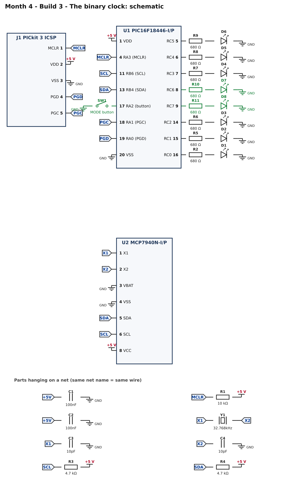
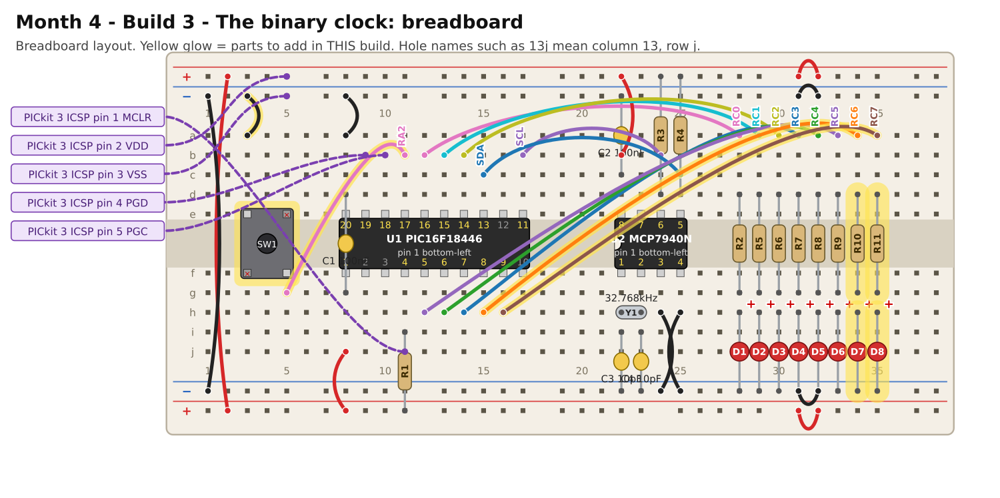

# Month 4 · Build 3 – The binary clock

[← Build 2](build-2-rtc-hello.md) · [Month 4](README.md)

**Goal:** the finished clock. A button chooses whether the LEDs show seconds, minutes or hours, and two mode LEDs say which.

**Status:** logic tested in simulation, including minute and midnight rollover · compile and bench test pending

**Before you start:** Build 2 must pass. Power OFF.

## 1. What you are adding



* **Two mode LEDs** on RC6 and RC7.
* **SW1**, the push button, on **RA2** (pin 17). It uses the chip's own pull-up, like the buttons in Month 1, so pressing it reads as 0.

## 2. Build it



<!-- placement:3 -->
| Step | Part               | Where it goes                                                                      | Notes                                                                                              |
| ---: | ------------------ | ---------------------------------------------------------------------------------- | -------------------------------------------------------------------------------------------------- |
|    1 | jumper wire        | **15h** → **34a**                                                                  | signal RC6 (any colour)                                                                            |
|    2 | R10 680 Ω resistor | **34d** and **34g**                                                                | either way round                                                                                   |
|    3 | D7 red LED         | **long leg** in **34h**, **short leg** in bottom **blue** rail (−), near column 34 | the long leg (+) goes towards the resistor                                                         |
|    4 | jumper wire        | **16h** → **35a**                                                                  | signal RC7 (any colour)                                                                            |
|    5 | R11 680 Ω resistor | **35d** and **35g**                                                                | either way round                                                                                   |
|    6 | D8 red LED         | **long leg** in **35h**, **short leg** in bottom **blue** rail (−), near column 35 | the long leg (+) goes towards the resistor                                                         |
|    7 | SW1 push button    | straddling the centre channel with legs in **3e, 5e, 3f, 5f**                      | only the diagonal legs (3e and 5f) are wired; keep strips 5e and 3f empty. Works either way round. |
|    8 | jumper wire        | **3a** → top **blue** rail (−), near column 3                                      | ground (black)                                                                                     |
|    9 | jumper wire        | **5g** → **11b**                                                                   | signal RA2 (any colour)                                                                            |
<!-- /placement -->

Same circuit as a connection list:

<!-- connections:3 -->
| Starts at                    | Then goes through                                            |
| ---------------------------- | ------------------------------------------------------------ |
| U1 pin **8** (RC6)           | R10 680 Ω → D7 LED (long leg towards the resistor) → **GND** |
| U1 pin **9** (RC7)           | R11 680 Ω → D8 LED (long leg towards the resistor) → **GND** |
| U1 pin **17** (RA2 (button)) | SW1 button → **GND**                                         |
<!-- /connections -->

## 3. Check before you power it

1. +5 V to GND: no short.
2. Pin 17 to GND does **not** beep until you press the button, then it does.

## 4. Program it

<!-- code:code/build-3-binary-clock/main.c -->
```c
/*
 * Month 4 - Build 3: The binary clock
 *
 * Chip     : PIC16F18446-I/P (20-pin PDIP) talking to an MCP7940N clock chip (I2C address 0x6F)
 * Compiler : MPLAB XC8
 * Supply   : 5 V
 * Clock    : 1 MHz internal oscillator
 * Button   : RA2 (pin 17) -> button -> GND
 *
 * What it does:
 *   - Shows the time in binary on LEDs RC0..RC5 (value 0..59, or 0..23 for hours).
 *   - Each press of the button changes what is shown:
 *       seconds (no mode LED)  ->  minutes (RC6 lit)  ->  hours (RC7 lit)  ->  seconds ...
 *   - Faults are shown as in Build 2 (1, 2 or 3 blinks on RC0).
 */

#include <xc.h>

/* ---- Configuration bits: how the chip starts up -------------------------
 * Leave these alone. If the compiler rejects one, see
 * start-here/04-pic-setup.md  ("If a #pragma config line is rejected").
 */
#pragma config FEXTOSC  = OFF    /* no external crystal                   */
#pragma config RSTOSC   = HFINT1 /* start on the internal 1 MHz clock     */
#pragma config CLKOUTEN = OFF
#pragma config CSWEN    = ON
#pragma config FCMEN    = OFF
#pragma config WDTE     = OFF    /* watchdog OFF, or the chip keeps resetting */
#pragma config LVP      = ON
#pragma config CP       = OFF

#define _XTAL_FREQ 1000000UL     /* tells __delay_ms() the clock speed    */

/* ---- Pins ----------------------------------------------------------------
 * LEDs: RC0..RC7 on port C (pins 16, 15, 14, 7, 6, 5, 8, 9).
 * I2C : SDA on RB4 (pin 13), SCL on RB6 (pin 11).
 * Button: RA2 (pin 17), with the chip's pull-up.
 */
#define SDA        0x10      /* RB4 */
#define SCL        0x40      /* RB6 */
#define BUTTON     0x04      /* RA2 */

#define RTC_WRITE  0xDE      /* the clock chip's I2C address 0x6F, shifted left, + write bit 0 */
#define RTC_READ   0xDF      /* the same with the read bit 1                                    */
#define REG_SEC    0x00      /* seconds, and bit 7 = "start the oscillator"                    */
#define REG_MIN    0x01
#define REG_HOUR   0x02
#define REG_WKDAY  0x03      /* bit 5 = OSCRUN: the 32.768 kHz crystal is running              */

/* ---- I2C "by hand" (the same idea as Month 2, on port B) -----------------
 * A device never drives a line HIGH: it lets go (the pull-up makes it HIGH) or pulls it LOW.
 * We switch each pin between "input" (let go) and "output, LOW" (pull down) using TRISB.
 */
#define I2C_DELAY()  __delay_us(5)

static void sdaRelease(void)  { TRISB |= SDA;  }
static void sdaLow(void)      { TRISB &= ~SDA; }
static void sclRelease(void)  { TRISB |= SCL;  }
static void sclLow(void)      { TRISB &= ~SCL; }
static unsigned char sdaRead(void) { return (PORTB & SDA) ? 1 : 0; }

static void i2cStart(void)
{
    sdaRelease(); sclRelease(); I2C_DELAY();
    sdaLow();                   I2C_DELAY();
    sclLow();                   I2C_DELAY();
}

static void i2cStop(void)
{
    sdaLow();                   I2C_DELAY();
    sclRelease();               I2C_DELAY();
    sdaRelease();               I2C_DELAY();
}

/* Send one byte, most significant bit first. Returns 1 if the other chip acknowledged. */
static unsigned char i2cWrite(unsigned char data)
{
    unsigned char n, ack;

    for (n = 0; n < 8; n++)
    {
        if (data & 0x80) sdaRelease(); else sdaLow();
        I2C_DELAY();
        sclRelease();           I2C_DELAY();
        sclLow();               I2C_DELAY();
        data = (unsigned char)(data << 1);
    }
    sdaRelease();
    I2C_DELAY();
    sclRelease();               I2C_DELAY();
    ack = (sdaRead() == 0);
    sclLow();                   I2C_DELAY();
    return ack;
}

/* Receive one byte. sendAck = 1 means "send me another", 0 means "that was the last". */
static unsigned char i2cRead(unsigned char sendAck)
{
    unsigned char n, data = 0;

    sdaRelease();
    for (n = 0; n < 8; n++)
    {
        sclRelease();           I2C_DELAY();
        data = (unsigned char)(data << 1);
        if (sdaRead()) data |= 0x01;
        sclLow();               I2C_DELAY();
    }
    if (sendAck) sdaLow(); else sdaRelease();
    I2C_DELAY();
    sclRelease();               I2C_DELAY();
    sclLow();                   I2C_DELAY();
    sdaRelease();               I2C_DELAY();   /* let the line settle before the next clock pulse */
    return data;
}

static unsigned char rtcWrite(unsigned char reg, unsigned char value)
{
    unsigned char ok;
    i2cStart();
    ok  = i2cWrite(RTC_WRITE);
    ok &= i2cWrite(reg);
    ok &= i2cWrite(value);
    i2cStop();
    return ok;
}

static unsigned char rtcRead(unsigned char reg, unsigned char *value)
{
    unsigned char ok;
    i2cStart();
    ok  = i2cWrite(RTC_WRITE);
    ok &= i2cWrite(reg);
    i2cStart();                  /* a second START: "now I want to read" */
    ok &= i2cWrite(RTC_READ);
    *value = i2cRead(0);
    i2cStop();
    return ok;
}

/* Read seconds, minutes and hours in one go. The chip hands over the next register each time we say "more". */
static unsigned char rtcReadTime(unsigned char *sec, unsigned char *min, unsigned char *hour)
{
    unsigned char ok;
    i2cStart();
    ok  = i2cWrite(RTC_WRITE);
    ok &= i2cWrite(REG_SEC);
    i2cStart();
    ok &= i2cWrite(RTC_READ);
    *sec  = i2cRead(1);          /* 1 = "and the next one please"          */
    *min  = i2cRead(1);
    *hour = i2cRead(0);          /* 0 = "that is all"                      */
    i2cStop();
    *sec  &= 0x7F;               /* drop the "oscillator on" flag          */
    *min  &= 0x7F;
    *hour &= 0x3F;               /* 24-hour mode                           */
    return ok;
}

/* The clock stores each digit pair as BCD ("binary-coded decimal"): 59 is stored as 0x59, not 0x3B. */
static unsigned char fromBcd(unsigned char b) { return (unsigned char)(((b >> 4) * 10) + (b & 0x0F)); }
static unsigned char toBcd(unsigned char v)   { return (unsigned char)(((v / 10) << 4) | (v % 10)); }

/* If something is wrong, flash LED RC0 'code' times, pause, repeat, forever. */
static void fault(unsigned char code)
{
    unsigned char n;
    LATC = 0x00;
    while (1)
    {
        for (n = 0; n < code; n++)
        {
            LATC = 0x01; __delay_ms(200);
            LATC = 0x00; __delay_ms(200);
        }
        __delay_ms(1000);
    }
}

static unsigned char digit(char c) { return (unsigned char)(c - '0'); }

/* The compiler fills in __TIME__ as the text "hh:mm:ss" at the moment you build the program. */
static void rtcSetToBuildTime(void)
{
    unsigned char hours   = (unsigned char)(digit(__TIME__[0]) * 10 + digit(__TIME__[1]));
    unsigned char minutes = (unsigned char)(digit(__TIME__[3]) * 10 + digit(__TIME__[4]));
    unsigned char seconds = (unsigned char)(digit(__TIME__[6]) * 10 + digit(__TIME__[7]));
    unsigned char ok;

    ok  = rtcWrite(REG_HOUR, toBcd(hours));                /* bit 6 = 0 means 24-hour mode  */
    ok &= rtcWrite(REG_MIN,  toBcd(minutes));
    ok &= rtcWrite(REG_SEC,  (unsigned char)(0x80 | toBcd(seconds)));   /* bit 7 = start the clock */
    if (!ok) fault(1);
}

/* Make sure the clock is running. If its crystal is not running yet, set the time and start it. */
static void startClock(void)
{
    unsigned char flags, waited = 0;

    if (!rtcRead(REG_WKDAY, &flags)) fault(1);             /* the clock chip does not answer */
    if (flags & 0x20) return;                              /* already running: leave the time alone */

    rtcSetToBuildTime();
    do
    {
        __delay_ms(10);
        if (!rtcRead(REG_WKDAY, &flags)) fault(1);
        waited++;
    } while (!(flags & 0x20) && waited < 200);             /* give the crystal up to 2 seconds to start */
    if (!(flags & 0x20)) fault(3);                         /* crystal or its capacitors not working    */
}

static void setup(void)
{
    ANSELA = 0x00; ANSELB = 0x00; ANSELC = 0x00;           /* all digital */
    LATB   = 0x00;                                         /* SDA and SCL latch bits stay LOW */
    LATC   = 0x00;
    TRISA  = 0xFF;                                         /* port A inputs (the button)     */
    WPUA   = BUTTON;                                       /* weak pull-up on RA2            */
    TRISB  = 0xFF;                                         /* port B inputs: I2C lines released */
    TRISC  = 0x00;                                         /* port C: all outputs (LEDs)     */
}

void main(void)
{
    unsigned char sec = 0, min = 0, hour = 0;
    unsigned char mode = 0, value, indicator;
    unsigned char down, wasDown = 0, ticks = 0;

    setup();
    startClock();
    if (!rtcReadTime(&sec, &min, &hour)) fault(2);

    while (1)
    {
        down = ((PORTA & BUTTON) == 0);              /* 0 = pressed (pulled to GND)   */
        if (down && !wasDown)                        /* the moment it goes down       */
        {
            mode++;
            if (mode >= 3) mode = 0;
        }
        wasDown = down;

        ticks++;                                     /* read the clock 10 times a second */
        if (ticks >= 10)
        {
            ticks = 0;
            if (!rtcReadTime(&sec, &min, &hour)) fault(2);
        }

        if (mode == 0)      { value = fromBcd(sec);  indicator = 0x00; }
        else if (mode == 1) { value = fromBcd(min);  indicator = 0x40; }   /* RC6 */
        else                { value = fromBcd(hour); indicator = 0x80; }   /* RC7 */
        LATC = (unsigned char)(value | indicator);

        __delay_ms(10);                              /* the 10 ms tick; also hides button bounce */
    }
}
```
<!-- /code -->

What is new:

* Each press moves `mode` on: seconds, minutes, hours, then back to seconds. The button is detected the same way as in Month 2: act only on the moment it goes down.
* The clock is read ten times a second. The display is refreshed every 10 ms, so a button press shows at once.
* `indicator` adds the mode LED: nothing for seconds, **RC6** (bit 6) for minutes, **RC7** (bit 7) for hours.

## 5. Pass check

* [ ] With no mode LED lit, the six LEDs count the **seconds** in binary.
* [ ] Press once: **RC6** lights and the LEDs show the **minutes**.
* [ ] Press again: **RC7** lights and the LEDs show the **hours** (0 to 23).
* [ ] Press again: back to seconds.
* [ ] Compare with a real clock: the seconds step once per second, and the minutes change when the seconds wrap. The time is the program's build time plus the time since you powered up.

Reading the display: with RC7 lit and the six LEDs showing `010111`, the hour is **23** (16 + 4 + 2 + 1).

## 6. If it does not work

| What you see                           | Most likely cause                     | What to do                                                                |
| -------------------------------------- | ------------------------------------- | ------------------------------------------------------------------------- |
| Button does nothing                    | button not on pin 17, or pull-up off  | continuity: pin 17 ↔ **11b** ↔ **5g** ↔ the button; check `WPUA = BUTTON` |
| It jumps two modes per press           | the button is wired to the wrong legs | wire only the diagonal legs                                               |
| Minutes never change                   | the clock stopped                     | go back to Build 2's fault table                                          |
| Fault code 2 appears from time to time | a loose I2C wire                      | press every wire and the clock chip down firmly                           |

## 7. Try this

* **Keep the time over power-off.** Fit a CR2032 cell and holder: positive to the clock's **VBAT** (pin 3, remove the wire to GND), negative to ground. Read the MCP7940N datasheet's battery-backup section first, then **set the VBATEN bit** (bit 3 of the weekday register). With the cell fitted, unplugging the board no longer stops the clock, and the program leaves a running clock alone.
* Add a mode that shows **seconds + 1 minute** as a bar: sixty LEDs would be needed, so how would you compress it?
* Make a **12-hour** display with an AM/PM LED. The clock chip can do this for you (bit 6 of the hours register): find it in the datasheet.

## 8. What you learned

You moved a program between chips of one family and noticed what stays the same (the code) and what changes (the pins). You used a real-time clock through I2C, decoded BCD, and handled a button with edge detection. In Month 5 the I2C routines move to a 16-bit chip.

[← Build 2](build-2-rtc-hello.md) · [Month 4](README.md)
