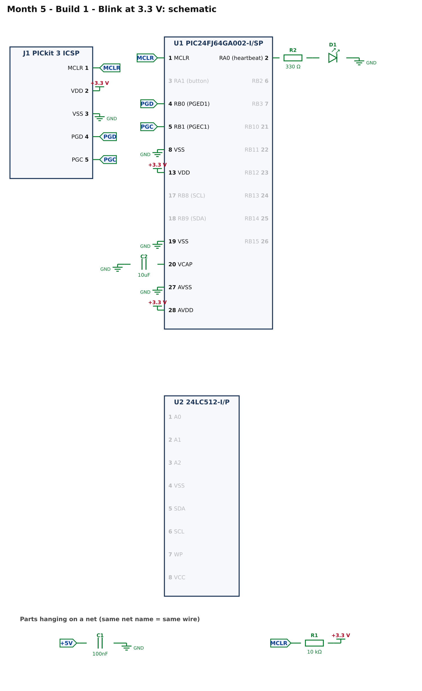
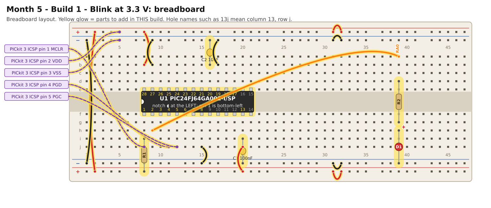

# Month 5 · Build 1 – Blink at 3.3 V

[← Month 5](README.md) · [Next: Build 2 →](build-2-eeprom-hello.md)

**Goal:** the new chip, powered from 3.3 V with its VCAP capacitor, programmed through the PICkit 3 and blinking an LED. This proves the supply, the programmer and the XC16 compiler.

**Status:** logic tested in simulation · compile and bench test pending

**Before you start:** do the **3.3 V rule** on the [month page](README.md#before-you-start-the-33-v-rule) and install XC16. Power OFF.

## 1. What is different about this chip?

|                     | PIC16 / PIC18 (Months 1 to 4)      | PIC24FJ64GA002 (this month)                                                   |
| ------------------- | ---------------------------------- | ----------------------------------------------------------------------------- |
| Data width          | 8-bit                              | **16-bit** (so `int` is 16 bits and registers are 16 bits wide)               |
| Compiler            | XC8                                | **XC16**                                                                      |
| Supply              | 5 V                                | **3.3 V**                                                                     |
| Digital/analog pins | `ANSELx` register: **0 = digital** | `AD1PCFG` register: **1 = digital** (the opposite!)                           |
| Clock               | `OSCFRQ`, `RSTOSC`                 | the internal 8 MHz oscillator; the instruction clock is half of it, **4 MHz** |
| Delay function      | `__delay_ms()` with `_XTAL_FREQ`   | `__delay_ms()` with **`FCY`** and `#include <libpic30.h>`                     |
| Core supply pin     | none                               | **VCAP** (pin 20) needs a 10 µF capacitor                                     |
| Programmer pins     | PGC / PGD on fixed pins            | **PGEC1 = pin 5, PGED1 = pin 4**                                              |
| Power pins          | one or two of each                 | VDD pin 13 and **AVDD pin 28**; VSS pins 8 and 19 and **AVSS pin 27**         |

The two "A" pins (AVDD and AVSS) feed the analog part of the chip. **You must connect them even though this month uses no analog function.**

## 2. What you are building



* **C1 (100 nF):** across the main supply pins.
* **C2 (10 µF):** the **VCAP** capacitor, pin 20 to ground.
* **R1 (10 kΩ):** holds MCLR high.
* **D1 + R2 (330 Ω):** the LED on RA0.
* **J1:** the five PICkit 3 wires, to **MCLR (pin 1), PGED1 (pin 4) and PGEC1 (pin 5)**, and the 3.3 V rail and ground for it to measure.

## 3. Build it



(Sharper [SVG](images/build-1-breadboard.svg).) Power OFF, and **breadboard supply at 3.3 V**.

<!-- placement:1 -->
| Step | Part                     | Where it goes                                                                                                           | Notes                                                                                  |
| ---: | ------------------------ | ----------------------------------------------------------------------------------------------------------------------- | -------------------------------------------------------------------------------------- |
|    1 | U1 PIC24FJ64GA002-I/SP   | Pin 1 in hole **8f**, notch to the **left**. Pins 1–14 run along row f (columns 8–21); pins 15–28 run back along row e. | Skinny (300 mil) chip: one row of pins each side of the centre channel (rows e and f). |
|    2 | jumper wire              | top **red** rail (+), near column 2 → bottom **red** rail (+), near column 2                                            | +3.3 V power (red)                                                                     |
|    3 | jumper wire              | top **blue** rail (−), near column 1 → bottom **blue** rail (−), near column 1                                          | ground (black)                                                                         |
|    4 | jumper wire              | top **red** rail (+), near column 31 → top **red** rail (+), near column 32                                             | +3.3 V power (red)                                                                     |
|    5 | jumper wire              | bottom **red** rail (+), near column 31 → bottom **red** rail (+), near column 32                                       | +3.3 V power (red)                                                                     |
|    6 | jumper wire              | top **blue** rail (−), near column 31 → top **blue** rail (−), near column 32                                           | ground (black)                                                                         |
|    7 | jumper wire              | bottom **blue** rail (−), near column 31 → bottom **blue** rail (−), near column 32                                     | ground (black)                                                                         |
|    8 | jumper wire              | **20j** → bottom **red** rail (+), near column 20                                                                       | +3.3 V power (red)                                                                     |
|    9 | C1 100nF capacitor       | **20i** and bottom **blue** rail (−), near column 20                                                                    | ceramic: either way round; keep the legs short                                         |
|   10 | jumper wire              | **15j** → bottom **blue** rail (−), near column 15                                                                      | ground (black)                                                                         |
|   11 | jumper wire              | **17b** → top **blue** rail (−), near column 17                                                                         | ground (black)                                                                         |
|   12 | C2 10uF capacitor        | **16b** and top **blue** rail (−), near column 16                                                                       | ceramic: either way round; keep the legs short                                         |
|   13 | jumper wire              | **8b** → top **red** rail (+), near column 8                                                                            | +3.3 V power (red)                                                                     |
|   14 | jumper wire              | **9b** → top **blue** rail (−), near column 9                                                                           | ground (black)                                                                         |
|   15 | R1 10 kΩ resistor        | **8i** and bottom **red** rail (+), near column 8                                                                       | either way round                                                                       |
|   16 | PICkit 3 ICSP lead: MCLR | from PICkit 3 ICSP pin **1** (MCLR) to **8j**                                                                           | female-to-male Dupont lead                                                             |
|   17 | PICkit 3 ICSP lead: VDD  | from PICkit 3 ICSP pin **2** (VDD) to top **red** rail (+), near column 5                                               | female-to-male Dupont lead                                                             |
|   18 | PICkit 3 ICSP lead: VSS  | from PICkit 3 ICSP pin **3** (VSS) to top **blue** rail (−), near column 5                                              | female-to-male Dupont lead                                                             |
|   19 | PICkit 3 ICSP lead: PGD  | from PICkit 3 ICSP pin **4** (PGD) to **11j**                                                                           | female-to-male Dupont lead                                                             |
|   20 | PICkit 3 ICSP lead: PGC  | from PICkit 3 ICSP pin **5** (PGC) to **12j**                                                                           | female-to-male Dupont lead                                                             |
|   21 | jumper wire              | **9h** → **39a**                                                                                                        | signal RA0 (any colour)                                                                |
|   22 | R2 330 Ω resistor        | **39d** and **39g**                                                                                                     | either way round                                                                       |
|   23 | D1 red LED               | **long leg** in **39h**, **short leg** in bottom **blue** rail (−), near column 39                                      | the long leg (+) goes towards the resistor                                             |
<!-- /placement -->

Same circuit as a connection list:

<!-- connections:1 -->
| Starts at                      | Then goes through                                           |
| ------------------------------ | ----------------------------------------------------------- |
| U1 pin **13** (VDD)            | **+3.3 V**                                                  |
| U1 pin **28** (AVDD)           | **+3.3 V**                                                  |
| U1 pin **8** (VSS)             | **GND**                                                     |
| U1 pin **19** (VSS)            | **GND**                                                     |
| U1 pin **27** (AVSS)           | **GND**                                                     |
| U1 pin **20** (VCAP)           | C2 10uF → **GND**                                           |
| net **+5V**                    | C1 100nF → **GND**                                          |
| U1 pin **1** (MCLR)            | net **MCLR**                                                |
| net **MCLR**                   | R1 10 kΩ → **+3.3 V**                                       |
| U1 pin **4** (RB0 (PGED1))     | net **PGD**                                                 |
| U1 pin **5** (RB1 (PGEC1))     | net **PGC**                                                 |
| J1 pin **1** (MCLR)            | net **MCLR**                                                |
| J1 pin **2** (VDD)             | **+3.3 V**                                                  |
| J1 pin **3** (VSS)             | **GND**                                                     |
| J1 pin **4** (PGD)             | net **PGD**                                                 |
| J1 pin **5** (PGC)             | net **PGC**                                                 |
| U1 pin **2** (RA0 (heartbeat)) | R2 330 Ω → D1 LED (long leg towards the resistor) → **GND** |
<!-- /connections -->

## 4. Check before you power it

1. 3.3 V rail to GND rail: no short.
2. Pins **13** and **28** beep to the 3.3 V rail; pins **8, 19** and **27** beep to the GND rail.
3. The **VCAP** capacitor really is between pin 20 and ground, and not between pin 20 and the 3.3 V rail.
4. Pin **1** (MCLR) to the 3.3 V rail reads about **10 kΩ**.
5. Power on: pin 13 to pin 8 reads **3.2–3.4 V**.

## 5. Program it

Follow the [PIC setup](../start-here/04-pic-setup.md#pic24-and-dspic-the-xc16-compiler) with device **PIC24FJ64GA002**, compiler **XC16**.

<!-- code:code/build-1-blink/main.c -->
```c
/*
 * Month 5 - Build 1: Blink at 3.3 V
 *
 * Chip     : PIC24FJ64GA002-I/SP (28-pin SPDIP, 16-bit)
 * Compiler : MPLAB XC16
 * Supply   : 3.3 V   (set your breadboard supply to 3.3 V BEFORE connecting the chip)
 * Clock    : internal 8 MHz oscillator (4 MHz instruction clock)
 * LED      : RA0 (pin 2) -> 330 ohm -> LED -> GND
 *
 * What it does: LED on for half a second, off for half a second, forever.
 * Ten blinks should take about ten seconds.
 */

#include <xc.h>

/* ---- Configuration bits: how the chip starts up -------------------------
 * Leave these alone. If the compiler rejects one, see
 * start-here/04-pic-setup.md  ("If a #pragma config line is rejected").
 */
#pragma config JTAGEN   = OFF    /* JTAG off: its pins are free for other uses   */
#pragma config GCP      = OFF    /* no code protection                           */
#pragma config GWRP     = OFF    /* no write protection                          */
#pragma config ICS      = PGx1   /* programmer on PGEC1 / PGED1 (pins 5 and 4)   */
#pragma config FWDTEN   = OFF    /* watchdog OFF, or the chip keeps resetting    */
#pragma config WINDIS   = OFF
#pragma config FWPSA    = PR32
#pragma config WDTPS    = PS1
#pragma config POSCMOD  = NONE   /* no external crystal                          */
#pragma config OSCIOFNC = ON
#pragma config FCKSM    = CSDCMD
#pragma config FNOSC    = FRC    /* start on the internal 8 MHz oscillator       */

#define FCY 4000000UL            /* instruction clock: 8 MHz / 2 = 4 MHz          */
#include <libpic30.h>            /* provides __delay_ms() and __delay_us()        */

#define HEARTBEAT  0x0001    /* RA0 */

int main(void)
{
    CLKDIV  = 0x0000;            /* run the internal oscillator at its full 8 MHz        */
    AD1PCFG = 0xFFFF;            /* every pin digital (a 1 means "digital" on this chip) */
    LATA    = 0x0000;            /* every output starts LOW (LED off)                    */
    TRISA   = 0xFFFE;            /* bit 0 = 0 -> RA0 is an output, the rest inputs       */

    while (1)
    {
        LATA |= HEARTBEAT;       /* LED on  */
        __delay_ms(500);
        LATA &= ~HEARTBEAT;      /* LED off */
        __delay_ms(500);
    }
}
```
<!-- /code -->

How it works:

* `CLKDIV = 0x0000;` makes sure the internal 8 MHz oscillator is not divided down. `FCY` (4 MHz) is the instruction clock that `__delay_ms()` uses.
* `AD1PCFG = 0xFFFF;` makes **every pin digital**: remember that a **1** means digital on this chip.
* `TRISA = 0xFFFE;` makes only bit 0 (RA0) an output; all other bits (and 16-bit-wide registers) stay inputs.
* `int main(void)` returns an `int` on this compiler, unlike the `void main(void)` of XC8.

## 6. Pass check

* [ ] The LED on RA0 blinks: half a second on, half a second off.
* [ ] Ten blinks take about ten seconds.

## 7. If it does not work

| What you see              | Most likely cause                           | What to do                                                                                    |
| ------------------------- | ------------------------------------------- | --------------------------------------------------------------------------------------------- |
| "Target device not found" | the 3.3 V supply, or a programmer lead      | check 3.3 V at pin 13; **PICkit VDD lead to the 3.3 V rail**; PGED1 on pin 4, PGEC1 on pin 5  |
| Programs, no blink        | AVDD or AVSS not connected, or VCAP missing | pins 28 and 27; the 10 µF capacitor on pin 20                                                 |
| Blink is far too slow     | clock set-up                                | check `CLKDIV = 0x0000;` is there                                                             |
| A `#pragma config` error  | spelling differs on your tool version       | [setup → the PIC24 fallback](../start-here/04-pic-setup.md#pic24-and-dspic-the-xc16-compiler) |
| LED is very dim           | resistor too large for 3.3 V                | use 330 Ω                                                                                     |

## 8. Try this

* Port the Month 1 blink in your head: which three lines of this program are different from the PIC16 version, and why?
* Change the blink to run twice as fast. Which number do you change?

[← Month 5](README.md) · [Next: Build 2 →](build-2-eeprom-hello.md)
