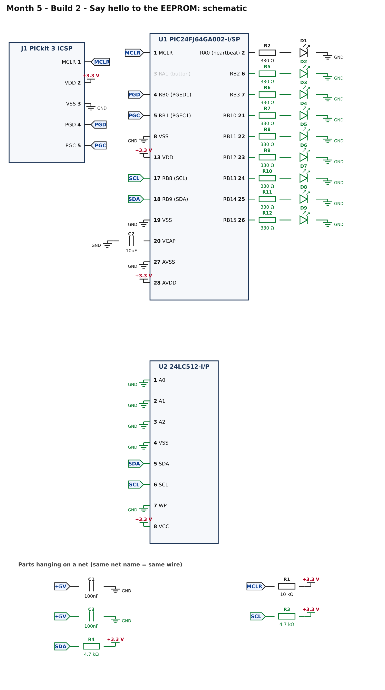
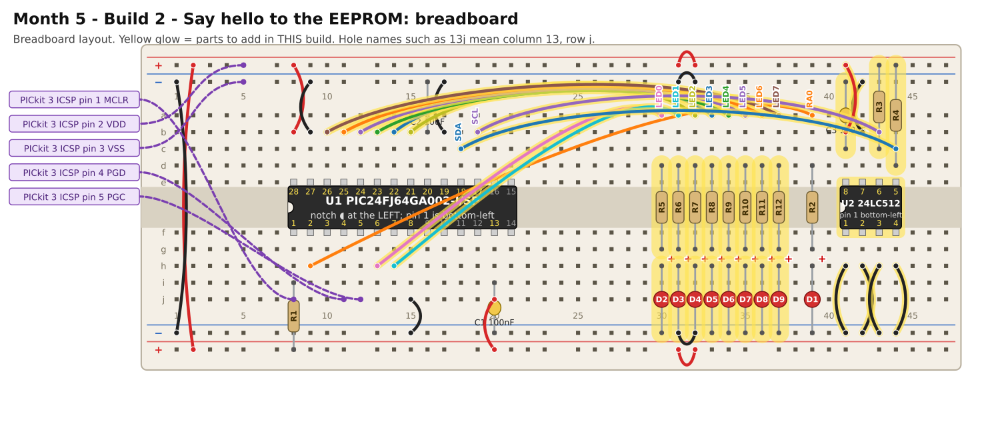

# Month 5 · Build 2 – Say hello to the EEPROM

[← Build 1](build-1-blink.md) · [Month 5](README.md) · [Next: Build 3 →](build-3-boot-counter.md)

**Goal:** the PIC stores a byte in the 24LC512 EEPROM, waits for it to be saved, reads it back, and shows it on eight LEDs. If anything is wrong, the heartbeat LED shows a fault code.

**Status:** I2C conversation, 16-bit addressing and write-cycle timing tested against a simulated 24LC512 · compile and bench test pending

**Before you start:** Build 1 must pass. Power OFF. Supply at **3.3 V**.

## 1. What is an EEPROM?

**EEPROM** memory keeps what you store in it with the power off. The 24LC512 holds 512 kilobits: **64 kilobytes**, 65 536 separate bytes, each with its own **16-bit address** (0 to 65 535). Four ideas to know:

* **A 16-bit address needs two bytes**, so every read and write sends the address as *high byte, then low byte*. Address 0x0123 is sent as `0x01` then `0x23`.
* **Writing takes time.** After a write the chip needs up to **5 milliseconds** to store the data. While it is busy it does **not answer its I2C address**.
* **ACK polling:** to find out when it has finished, keep sending its address until it says "got it". That is `eeWaitReady()`.
* **Pages:** writes happen in pages of **128 bytes**. A write that crosses a page boundary wraps back to the start of the same page. (This build writes one byte, so it is not an issue yet.)

The chip's I2C address is `0x50` plus the three pins A0, A1, A2. All three are wired to GND here, so the address is **0x50**. The **WP** (write protect) pin must be LOW to allow writing.

## 2. What you are adding



* **U2, the 24LC512:** power on pin 8 (3.3 V) with C3, ground on pin 4; **A0, A1, A2 (pins 1, 2, 3) and WP (pin 7) to ground**.
* **R3, R4 (4.7 kΩ):** the I2C pull-ups, **to 3.3 V**, on SCL (pin 6) and SDA (pin 5).
* **Eight LEDs** (330 Ω each) on RB2, RB3 and RB10 to RB15. LED 0 is the first in the row.

## 3. Build it



<!-- placement:2 -->
| Step | Part               | Where it goes                                                                                                          | Notes                                                                                  |
| ---: | ------------------ | ---------------------------------------------------------------------------------------------------------------------- | -------------------------------------------------------------------------------------- |
|    1 | U2 24LC512-I/P     | Pin 1 in hole **41f**, notch to the **left**. Pins 1–4 run along row f (columns 41–44); pins 5–8 run back along row e. | Skinny (300 mil) chip: one row of pins each side of the centre channel (rows e and f). |
|    2 | jumper wire        | **13h** → **30a**                                                                                                      | signal LED0 (any colour)                                                               |
|    3 | R5 330 Ω resistor  | **30d** and **30g**                                                                                                    | either way round                                                                       |
|    4 | D2 red LED         | **long leg** in **30h**, **short leg** in bottom **blue** rail (−), near column 30                                     | the long leg (+) goes towards the resistor                                             |
|    5 | jumper wire        | **14h** → **31a**                                                                                                      | signal LED1 (any colour)                                                               |
|    6 | R6 330 Ω resistor  | **31d** and **31g**                                                                                                    | either way round                                                                       |
|    7 | D3 red LED         | **long leg** in **31h**, **short leg** in bottom **blue** rail (−), near column 31                                     | the long leg (+) goes towards the resistor                                             |
|    8 | jumper wire        | **15b** → **32a**                                                                                                      | signal LED2 (any colour)                                                               |
|    9 | R7 330 Ω resistor  | **32d** and **32g**                                                                                                    | either way round                                                                       |
|   10 | D4 red LED         | **long leg** in **32h**, **short leg** in bottom **blue** rail (−), near column 32                                     | the long leg (+) goes towards the resistor                                             |
|   11 | jumper wire        | **14b** → **33a**                                                                                                      | signal LED3 (any colour)                                                               |
|   12 | R8 330 Ω resistor  | **33d** and **33g**                                                                                                    | either way round                                                                       |
|   13 | D5 red LED         | **long leg** in **33h**, **short leg** in bottom **blue** rail (−), near column 33                                     | the long leg (+) goes towards the resistor                                             |
|   14 | jumper wire        | **13b** → **34a**                                                                                                      | signal LED4 (any colour)                                                               |
|   15 | R9 330 Ω resistor  | **34d** and **34g**                                                                                                    | either way round                                                                       |
|   16 | D6 red LED         | **long leg** in **34h**, **short leg** in bottom **blue** rail (−), near column 34                                     | the long leg (+) goes towards the resistor                                             |
|   17 | jumper wire        | **12b** → **35a**                                                                                                      | signal LED5 (any colour)                                                               |
|   18 | R10 330 Ω resistor | **35d** and **35g**                                                                                                    | either way round                                                                       |
|   19 | D7 red LED         | **long leg** in **35h**, **short leg** in bottom **blue** rail (−), near column 35                                     | the long leg (+) goes towards the resistor                                             |
|   20 | jumper wire        | **11b** → **36a**                                                                                                      | signal LED6 (any colour)                                                               |
|   21 | R11 330 Ω resistor | **36d** and **36g**                                                                                                    | either way round                                                                       |
|   22 | D8 red LED         | **long leg** in **36h**, **short leg** in bottom **blue** rail (−), near column 36                                     | the long leg (+) goes towards the resistor                                             |
|   23 | jumper wire        | **10b** → **37a**                                                                                                      | signal LED7 (any colour)                                                               |
|   24 | R12 330 Ω resistor | **37d** and **37g**                                                                                                    | either way round                                                                       |
|   25 | D9 red LED         | **long leg** in **37h**, **short leg** in bottom **blue** rail (−), near column 37                                     | the long leg (+) goes towards the resistor                                             |
|   26 | jumper wire        | **41h** → bottom **blue** rail (−), near column 41                                                                     | ground (black)                                                                         |
|   27 | jumper wire        | **42h** → bottom **blue** rail (−), near column 42                                                                     | ground (black)                                                                         |
|   28 | jumper wire        | **43h** → bottom **blue** rail (−), near column 43                                                                     | ground (black)                                                                         |
|   29 | jumper wire        | **44h** → bottom **blue** rail (−), near column 44                                                                     | ground (black)                                                                         |
|   30 | jumper wire        | **42b** → top **blue** rail (−), near column 42                                                                        | ground (black)                                                                         |
|   31 | jumper wire        | **41b** → top **red** rail (+), near column 41                                                                         | +3.3 V power (red)                                                                     |
|   32 | C3 100nF capacitor | **41c** and top **blue** rail (−), near column 41                                                                      | ceramic: either way round; keep the legs short                                         |
|   33 | jumper wire        | **19b** → **43b**                                                                                                      | signal SCL (any colour)                                                                |
|   34 | jumper wire        | **18c** → **44c**                                                                                                      | signal SDA (any colour)                                                                |
|   35 | R3 4.7 kΩ resistor | **43c** and top **red** rail (+), near column 43                                                                       | either way round                                                                       |
|   36 | R4 4.7 kΩ resistor | **44d** and top **red** rail (+), near column 44                                                                       | either way round                                                                       |
<!-- /placement -->

Same circuit as a connection list:

<!-- connections:2 -->
| Starts at                 | Then goes through                                            |
| ------------------------- | ------------------------------------------------------------ |
| U2 pin **1** (A0)         | **GND**                                                      |
| U2 pin **2** (A1)         | **GND**                                                      |
| U2 pin **3** (A2)         | **GND**                                                      |
| U2 pin **4** (VSS)        | **GND**                                                      |
| U2 pin **7** (WP)         | **GND**                                                      |
| U2 pin **8** (VCC)        | **+3.3 V**                                                   |
| net **+5V**               | C3 100nF → **GND**                                           |
| U2 pin **5** (SDA)        | net **SDA**                                                  |
| U2 pin **6** (SCL)        | net **SCL**                                                  |
| net **SCL**               | R3 4.7 kΩ → **+3.3 V**                                       |
| net **SDA**               | R4 4.7 kΩ → **+3.3 V**                                       |
| U1 pin **17** (RB8 (SCL)) | net **SCL**                                                  |
| U1 pin **18** (RB9 (SDA)) | net **SDA**                                                  |
| U1 pin **6** (RB2)        | R5 330 Ω → D2 LED (long leg towards the resistor) → **GND**  |
| U1 pin **7** (RB3)        | R6 330 Ω → D3 LED (long leg towards the resistor) → **GND**  |
| U1 pin **21** (RB10)      | R7 330 Ω → D4 LED (long leg towards the resistor) → **GND**  |
| U1 pin **22** (RB11)      | R8 330 Ω → D5 LED (long leg towards the resistor) → **GND**  |
| U1 pin **23** (RB12)      | R9 330 Ω → D6 LED (long leg towards the resistor) → **GND**  |
| U1 pin **24** (RB13)      | R10 330 Ω → D7 LED (long leg towards the resistor) → **GND** |
| U1 pin **25** (RB14)      | R11 330 Ω → D8 LED (long leg towards the resistor) → **GND** |
| U1 pin **26** (RB15)      | R12 330 Ω → D9 LED (long leg towards the resistor) → **GND** |
<!-- /connections -->

## 4. Check before you power it

1. 3.3 V rail to GND rail: no short.
2. 24LC512 pin **8** to 3.3 V; pins **1, 2, 3, 4, 7** all to ground.
3. SCL: pin 6 of the EEPROM to **PIC pin 17**; SDA: pin 5 to **PIC pin 18**. They must **not** beep to each other.
4. Power on: EEPROM pin 8 to pin 4 reads about **3.3 V**.

## 5. Program it

<!-- code:code/build-2-eeprom-hello/main.c -->
```c
/*
 * Month 5 - Build 2: Say hello to the EEPROM
 *
 * Chip     : PIC24FJ64GA002-I/SP talking to a 24LC512 I2C EEPROM (address 0x50)
 * Compiler : MPLAB XC16
 * Supply   : 3.3 V
 * Clock    : internal 8 MHz oscillator
 *
 * What it does:
 *   1. Writes the value 0xA5 (binary 1010 0101) into the EEPROM at address 0x0123 (a 16-bit address:
 *      high byte 0x01, low byte 0x23).
 *   2. Waits for the chip to finish storing it ("ACK polling").
 *   3. Reads it back, and shows it on the eight LEDs.
 *   4. Blinks the heartbeat LED (RA0) once a second if all is well.
 *
 * If something is wrong the heartbeat LED shows a fault code:
 *   1 blink  = the EEPROM did not answer when written to
 *   2 blinks = it did not answer when read from
 *   3 blinks = it answered, but read back the wrong value
 *   4 blinks = it never finished storing the data (still busy after about 15 ms)
 */

#include <xc.h>

/* ---- Configuration bits: how the chip starts up -------------------------
 * Leave these alone. If the compiler rejects one, see
 * start-here/04-pic-setup.md  ("If a #pragma config line is rejected").
 */
#pragma config JTAGEN   = OFF    /* JTAG off: its pins are free for other uses   */
#pragma config GCP      = OFF    /* no code protection                           */
#pragma config GWRP     = OFF    /* no write protection                          */
#pragma config ICS      = PGx1   /* programmer on PGEC1 / PGED1 (pins 5 and 4)   */
#pragma config FWDTEN   = OFF    /* watchdog OFF, or the chip keeps resetting    */
#pragma config WINDIS   = OFF
#pragma config FWPSA    = PR32
#pragma config WDTPS    = PS1
#pragma config POSCMOD  = NONE   /* no external crystal                          */
#pragma config OSCIOFNC = ON
#pragma config FCKSM    = CSDCMD
#pragma config FNOSC    = FRC    /* start on the internal 8 MHz oscillator       */

#define FCY 4000000UL            /* instruction clock: 8 MHz / 2 = 4 MHz          */
#include <libpic30.h>            /* provides __delay_ms() and __delay_us()        */

/* ---- Pins ----------------------------------------------------------------
 * Heartbeat LED : RA0 (pin 2)
 * Button        : RA1 (pin 3), with an external 10k pull-up to 3.3 V
 * I2C           : SCL on RB8 (pin 17), SDA on RB9 (pin 18)
 * Eight LEDs    : RB2, RB3, RB10, RB11, RB12, RB13, RB14, RB15 (bit 0 .. bit 7)
 */
#define HEARTBEAT  0x0001    /* RA0, on LATA                       */
#define BUTTON     0x0002    /* RA1, on PORTA                      */
#define SCL        0x0100    /* RB8                                */
#define SDA        0x0200    /* RB9                                */
#define LED_MASK   0xFC0C    /* the eight LED pins on port B       */

/* Show an 8-bit value on the eight LEDs. Bits 0 and 1 go to RB2 and RB3; bits 2..7 go to RB10..RB15. */
static void showLeds(unsigned char value)
{
    unsigned int bits = (unsigned int)((value & 0x03) << 2) | (unsigned int)((unsigned int)(value >> 2) << 10);
    LATB = (unsigned int)((LATB & ~LED_MASK) | bits);
}

/* ---- I2C "by hand" (the same routines as Months 2 and 4, on port B) ------ */
#define I2C_DELAY()  __delay_us(5)

static void sdaRelease(void)  { TRISB |= SDA;  }
static void sdaLow(void)      { TRISB &= ~SDA; }
static void sclRelease(void)  { TRISB |= SCL;  }
static void sclLow(void)      { TRISB &= ~SCL; }
static unsigned char sdaRead(void) { return (PORTB & SDA) ? 1 : 0; }

static void i2cStart(void)
{
    sdaRelease(); sclRelease(); I2C_DELAY();
    sdaLow();                   I2C_DELAY();
    sclLow();                   I2C_DELAY();
}

static void i2cStop(void)
{
    sdaLow();                   I2C_DELAY();
    sclRelease();               I2C_DELAY();
    sdaRelease();               I2C_DELAY();
}

static unsigned char i2cWrite(unsigned char data)
{
    unsigned char n, ack;

    for (n = 0; n < 8; n++)
    {
        if (data & 0x80) sdaRelease(); else sdaLow();
        I2C_DELAY();
        sclRelease();           I2C_DELAY();
        sclLow();               I2C_DELAY();
        data = (unsigned char)(data << 1);
    }
    sdaRelease();
    I2C_DELAY();
    sclRelease();               I2C_DELAY();
    ack = (sdaRead() == 0);
    sclLow();                   I2C_DELAY();
    return ack;
}

static unsigned char i2cRead(unsigned char sendAck)
{
    unsigned char n, data = 0;

    sdaRelease();
    for (n = 0; n < 8; n++)
    {
        sclRelease();           I2C_DELAY();
        data = (unsigned char)(data << 1);
        if (sdaRead()) data |= 0x01;
        sclLow();               I2C_DELAY();
    }
    if (sendAck) sdaLow(); else sdaRelease();
    I2C_DELAY();
    sclRelease();               I2C_DELAY();
    sclLow();                   I2C_DELAY();
    sdaRelease();               I2C_DELAY();
    return data;
}

/* ---- The 24LC512 EEPROM (I2C address 0x50: its A0, A1, A2 pins are wired to GND) ---- */
#define EE_WRITE  0xA0
#define EE_READ   0xA1

/* Write 'count' bytes starting at a 16-bit address. All bytes must lie in the same 128-byte page.
 * Returns 1 if every byte was acknowledged. The chip then needs up to 5 ms to store them. */
static unsigned char eeWrite(unsigned int address, const unsigned char *data, unsigned char count)
{
    unsigned char ok, i;

    i2cStart();
    ok  = i2cWrite(EE_WRITE);
    ok &= i2cWrite((unsigned char)(address >> 8));       /* the address is 16 bits: high byte first */
    ok &= i2cWrite((unsigned char)(address & 0xFF));
    for (i = 0; i < count; i++) ok &= i2cWrite(data[i]);
    i2cStop();
    return ok;
}

/* While the chip is storing data it does not answer its address. "ACK polling": keep knocking until it answers. */
static unsigned char eeWaitReady(void)
{
    unsigned char tries, ack;

    for (tries = 0; tries < 50; tries++)
    {
        i2cStart();
        ack = i2cWrite(EE_WRITE);
        i2cStop();
        if (ack) return 1;
        __delay_us(200);
    }
    return 0;                                          /* still busy after about 15 ms: something is wrong */
}

/* Read 'count' bytes starting at a 16-bit address. */
static unsigned char eeRead(unsigned int address, unsigned char *data, unsigned char count)
{
    unsigned char ok, i;

    i2cStart();
    ok  = i2cWrite(EE_WRITE);
    ok &= i2cWrite((unsigned char)(address >> 8));
    ok &= i2cWrite((unsigned char)(address & 0xFF));
    i2cStart();                                        /* a second START: "now I want to read" */
    ok &= i2cWrite(EE_READ);
    for (i = 0; i < count; i++) data[i] = i2cRead((unsigned char)(i < count - 1));
    i2cStop();
    return ok;
}

/* If something is wrong, flash the heartbeat LED 'code' times, pause, repeat, forever. */
static void fault(unsigned char code)
{
    unsigned char n;

    showLeds(0x00);
    while (1)
    {
        for (n = 0; n < code; n++)
        {
            LATA |= HEARTBEAT;  __delay_ms(200);
            LATA &= ~HEARTBEAT; __delay_ms(200);
        }
        __delay_ms(1000);
    }
}

static void setup(void)
{
    CLKDIV   = 0x0000;           /* run the internal oscillator at its full 8 MHz        */
    AD1PCFG  = 0xFFFF;           /* every pin digital (a 1 means "digital" on this chip) */
    LATA     = 0x0000;
    LATB     = 0x0000;           /* SDA and SCL latch bits stay LOW                      */
    TRISA    = 0xFFFE;           /* RA0 (heartbeat) is an output, the rest inputs        */
    TRISB    = (unsigned int)~LED_MASK;   /* LED pins are outputs; the I2C pins are released inputs */
}

int main(void)
{
    unsigned char written = 0xA5, back = 0;

    setup();

    if (!eeWrite(0x0123, &written, 1)) fault(1);
    if (!eeWaitReady())                fault(4);
    if (!eeRead(0x0123, &back, 1))     fault(2);
    if (back != written)               fault(3);

    showLeds(back);                    /* the eight LEDs show 1010 0101 */

    while (1)                          /* all good: slow heartbeat */
    {
        LATA ^= HEARTBEAT;
        __delay_ms(500);
    }
}
```
<!-- /code -->

What to read first: `main()` at the bottom. Then the EEPROM routines `eeWrite()`, `eeWaitReady()` and `eeRead()`.

* The I2C routines are the same ones you know (Months 2 and 4), on port B bits 8 and 9.
* `eeWrite()` sends the device address, the **16-bit memory address** (high byte, low byte), then the data.
* `eeRead()` sends the address, then a second START and the read address, and reads bytes back. The last byte is answered with "no more".
* `showLeds()` spreads the 8-bit value across the eight LED pins, which are not in a neat row on port B.
* The address used is `0x0123`, not 0, so a mix-up between the high and low bytes would show up immediately.

## 6. Pass check

* [ ] The eight LEDs show **1010 0101** (0xA5): LED 0 lit, LED 1 off, LED 2 lit, LED 3 off, LED 4 off, LED 5 lit, LED 6 off, LED 7 lit.
* [ ] The heartbeat LED (RA0) blinks about once a second.

### Fault codes (the heartbeat LED is talking to you)

| Blinks, pause, repeat | Meaning                                   | Look at                                                                                          |
| :-------------------: | ----------------------------------------- | ------------------------------------------------------------------------------------------------ |
|         **1**         | the EEPROM did not answer when written to | power, SDA and SCL on the right pins, pull-ups R3 and R4 to **3.3 V**, WP and A0 to A2 to ground |
|         **2**         | it did not answer when read               | a loose wire                                                                                     |
|         **3**         | it answered, but returned the wrong value | SDA touching something; loose contact                                                            |
|         **4**         | it never finished storing                 | WP not grounded (writes refused), or a bad connection                                            |
|    steady 1/second    | all good                                  | this is the pass                                                                                 |

## 7. If it does not work

| What you see                       | Most likely cause            | What to do                                                                         |
| ---------------------------------- | ---------------------------- | ---------------------------------------------------------------------------------- |
| Fault 1                            | wiring                       | **SCL is pin 6, SDA is pin 5**: easy to swap; pull-ups really go to the 3.3 V rail |
| Fault 4                            | write-protect pin floating   | pin 7 to ground                                                                    |
| LEDs show a different pattern      | LED wires in the wrong order | LED 0 to 7 are on pins 6, 7, 21, 22, 23, 24, 25, 26 in that order                  |
| Nothing at all, even the heartbeat | the chip is not running      | back to Build 1                                                                    |

## 8. Try this

* Store a different value and see it appear. Does it survive pulling the power and putting it back? (Not yet: this program stores *and* reads in one run. Build 3 fixes that.)
* **Break it on purpose:** disconnect the WP wire from ground and see which fault code you get.
* Write 8 different bytes starting at address 0x0100. How would you check them all?

[← Build 1](build-1-blink.md) · [Month 5](README.md) · [Next: Build 3 →](build-3-boot-counter.md)
