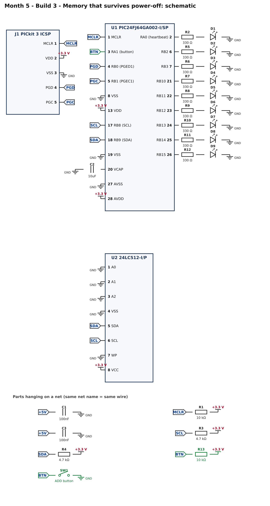
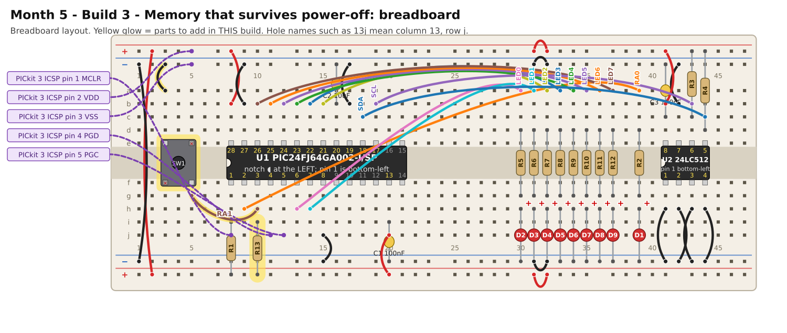

# Month 5 · Build 3 – Memory that survives power-off

[← Build 2](build-2-eeprom-hello.md) · [Month 5](README.md)

**Goal:** a counter kept in the EEPROM. It goes up by one every time the board is switched on and every time you press the button, and the eight LEDs show it in binary. Unplug the power and plug it in again: the number is still there.

**Status:** logic tested in simulation over several simulated power cycles · compile and bench test pending

**Before you start:** Build 2 must pass. Power OFF. Supply at **3.3 V**.

## 1. What you are adding



* **SW1**, the push button, on **RA1** (pin 3), with **R13 (10 kΩ) pulling it up to 3.3 V**. Pressing the button pulls RA1 to ground (reads 0). This chip's pull-ups work differently from the PIC16/18, so a simple external resistor is used here.

## 2. Build it



<!-- placement:3 -->
| Step | Part               | Where it goes                                                 | Notes                                                                                              |
| ---: | ------------------ | ------------------------------------------------------------- | -------------------------------------------------------------------------------------------------- |
|    1 | SW1 push button    | straddling the centre channel with legs in **3e, 5e, 3f, 5f** | only the diagonal legs (3e and 5f) are wired; keep strips 5e and 3f empty. Works either way round. |
|    2 | jumper wire        | **3a** → top **blue** rail (−), near column 3                 | ground (black)                                                                                     |
|    3 | jumper wire        | **5g** → **10h**                                              | signal RA1 (any colour)                                                                            |
|    4 | R13 10 kΩ resistor | **10i** and bottom **red** rail (+), near column 10           | either way round                                                                                   |
<!-- /placement -->

Same circuit as a connection list:

<!-- connections:3 -->
| Starts at                   | Then goes through      |
| --------------------------- | ---------------------- |
| U1 pin **3** (RA1 (button)) | net **BTN**            |
| net **BTN**                 | R13 10 kΩ → **+3.3 V** |
| net **BTN**                 | SW1 button → **GND**   |
<!-- /connections -->

## 3. Check before you power it

1. 3.3 V to GND: no short.
2. Pin 3 to ground does **not** beep until you press the button, then it does.
3. Pin 3 to the 3.3 V rail reads about **10 kΩ**.

## 4. Program it

<!-- code:code/build-3-boot-counter/main.c -->
```c
/*
 * Month 5 - Build 3: Memory that survives power-off
 *
 * Chip     : PIC24FJ64GA002-I/SP talking to a 24LC512 I2C EEPROM (address 0x50)
 * Compiler : MPLAB XC16
 * Supply   : 3.3 V
 * Clock    : internal 8 MHz oscillator
 * Button   : RA1 (pin 3) -> button -> GND (with a 10k pull-up to 3.3 V)
 *
 * What it does:
 *   - Keeps a 16-bit counter in the EEPROM (addresses 0 and 1).
 *   - Every time the board is powered up, the counter goes up by one.
 *   - Every press of the button also adds one.
 *   - The eight LEDs show the counter's low 8 bits in binary. Unplug the power, plug it in again:
 *     the number is still there, and one higher.
 *   - Fault codes on the heartbeat LED (RA0): 1 = write failed, 2 = read failed,
 *     3 = read back the wrong value, 4 = EEPROM never finished storing.
 */

#include <xc.h>

/* ---- Configuration bits: how the chip starts up -------------------------
 * Leave these alone. If the compiler rejects one, see
 * start-here/04-pic-setup.md  ("If a #pragma config line is rejected").
 */
#pragma config JTAGEN   = OFF    /* JTAG off: its pins are free for other uses   */
#pragma config GCP      = OFF    /* no code protection                           */
#pragma config GWRP     = OFF    /* no write protection                          */
#pragma config ICS      = PGx1   /* programmer on PGEC1 / PGED1 (pins 5 and 4)   */
#pragma config FWDTEN   = OFF    /* watchdog OFF, or the chip keeps resetting    */
#pragma config WINDIS   = OFF
#pragma config FWPSA    = PR32
#pragma config WDTPS    = PS1
#pragma config POSCMOD  = NONE   /* no external crystal                          */
#pragma config OSCIOFNC = ON
#pragma config FCKSM    = CSDCMD
#pragma config FNOSC    = FRC    /* start on the internal 8 MHz oscillator       */

#define FCY 4000000UL            /* instruction clock: 8 MHz / 2 = 4 MHz          */
#include <libpic30.h>            /* provides __delay_ms() and __delay_us()        */

/* ---- Pins ----------------------------------------------------------------
 * Heartbeat LED : RA0 (pin 2)
 * Button        : RA1 (pin 3), with an external 10k pull-up to 3.3 V
 * I2C           : SCL on RB8 (pin 17), SDA on RB9 (pin 18)
 * Eight LEDs    : RB2, RB3, RB10, RB11, RB12, RB13, RB14, RB15 (bit 0 .. bit 7)
 */
#define HEARTBEAT  0x0001    /* RA0, on LATA                       */
#define BUTTON     0x0002    /* RA1, on PORTA                      */
#define SCL        0x0100    /* RB8                                */
#define SDA        0x0200    /* RB9                                */
#define LED_MASK   0xFC0C    /* the eight LED pins on port B       */

/* Show an 8-bit value on the eight LEDs. Bits 0 and 1 go to RB2 and RB3; bits 2..7 go to RB10..RB15. */
static void showLeds(unsigned char value)
{
    unsigned int bits = (unsigned int)((value & 0x03) << 2) | (unsigned int)((unsigned int)(value >> 2) << 10);
    LATB = (unsigned int)((LATB & ~LED_MASK) | bits);
}

/* ---- I2C "by hand" (the same routines as Months 2 and 4, on port B) ------ */
#define I2C_DELAY()  __delay_us(5)

static void sdaRelease(void)  { TRISB |= SDA;  }
static void sdaLow(void)      { TRISB &= ~SDA; }
static void sclRelease(void)  { TRISB |= SCL;  }
static void sclLow(void)      { TRISB &= ~SCL; }
static unsigned char sdaRead(void) { return (PORTB & SDA) ? 1 : 0; }

static void i2cStart(void)
{
    sdaRelease(); sclRelease(); I2C_DELAY();
    sdaLow();                   I2C_DELAY();
    sclLow();                   I2C_DELAY();
}

static void i2cStop(void)
{
    sdaLow();                   I2C_DELAY();
    sclRelease();               I2C_DELAY();
    sdaRelease();               I2C_DELAY();
}

static unsigned char i2cWrite(unsigned char data)
{
    unsigned char n, ack;

    for (n = 0; n < 8; n++)
    {
        if (data & 0x80) sdaRelease(); else sdaLow();
        I2C_DELAY();
        sclRelease();           I2C_DELAY();
        sclLow();               I2C_DELAY();
        data = (unsigned char)(data << 1);
    }
    sdaRelease();
    I2C_DELAY();
    sclRelease();               I2C_DELAY();
    ack = (sdaRead() == 0);
    sclLow();                   I2C_DELAY();
    return ack;
}

static unsigned char i2cRead(unsigned char sendAck)
{
    unsigned char n, data = 0;

    sdaRelease();
    for (n = 0; n < 8; n++)
    {
        sclRelease();           I2C_DELAY();
        data = (unsigned char)(data << 1);
        if (sdaRead()) data |= 0x01;
        sclLow();               I2C_DELAY();
    }
    if (sendAck) sdaLow(); else sdaRelease();
    I2C_DELAY();
    sclRelease();               I2C_DELAY();
    sclLow();                   I2C_DELAY();
    sdaRelease();               I2C_DELAY();
    return data;
}

/* ---- The 24LC512 EEPROM (I2C address 0x50: its A0, A1, A2 pins are wired to GND) ---- */
#define EE_WRITE  0xA0
#define EE_READ   0xA1

/* Write 'count' bytes starting at a 16-bit address. All bytes must lie in the same 128-byte page.
 * Returns 1 if every byte was acknowledged. The chip then needs up to 5 ms to store them. */
static unsigned char eeWrite(unsigned int address, const unsigned char *data, unsigned char count)
{
    unsigned char ok, i;

    i2cStart();
    ok  = i2cWrite(EE_WRITE);
    ok &= i2cWrite((unsigned char)(address >> 8));       /* the address is 16 bits: high byte first */
    ok &= i2cWrite((unsigned char)(address & 0xFF));
    for (i = 0; i < count; i++) ok &= i2cWrite(data[i]);
    i2cStop();
    return ok;
}

/* While the chip is storing data it does not answer its address. "ACK polling": keep knocking until it answers. */
static unsigned char eeWaitReady(void)
{
    unsigned char tries, ack;

    for (tries = 0; tries < 50; tries++)
    {
        i2cStart();
        ack = i2cWrite(EE_WRITE);
        i2cStop();
        if (ack) return 1;
        __delay_us(200);
    }
    return 0;                                          /* still busy after about 15 ms: something is wrong */
}

/* Read 'count' bytes starting at a 16-bit address. */
static unsigned char eeRead(unsigned int address, unsigned char *data, unsigned char count)
{
    unsigned char ok, i;

    i2cStart();
    ok  = i2cWrite(EE_WRITE);
    ok &= i2cWrite((unsigned char)(address >> 8));
    ok &= i2cWrite((unsigned char)(address & 0xFF));
    i2cStart();                                        /* a second START: "now I want to read" */
    ok &= i2cWrite(EE_READ);
    for (i = 0; i < count; i++) data[i] = i2cRead((unsigned char)(i < count - 1));
    i2cStop();
    return ok;
}

/* If something is wrong, flash the heartbeat LED 'code' times, pause, repeat, forever. */
static void fault(unsigned char code)
{
    unsigned char n;

    showLeds(0x00);
    while (1)
    {
        for (n = 0; n < code; n++)
        {
            LATA |= HEARTBEAT;  __delay_ms(200);
            LATA &= ~HEARTBEAT; __delay_ms(200);
        }
        __delay_ms(1000);
    }
}

static void setup(void)
{
    CLKDIV   = 0x0000;           /* run the internal oscillator at its full 8 MHz        */
    AD1PCFG  = 0xFFFF;           /* every pin digital (a 1 means "digital" on this chip) */
    LATA     = 0x0000;
    LATB     = 0x0000;           /* SDA and SCL latch bits stay LOW                      */
    TRISA    = 0xFFFE;           /* RA0 (heartbeat) is an output, the rest inputs        */
    TRISB    = (unsigned int)~LED_MASK;   /* LED pins are outputs; the I2C pins are released inputs */
}

/* Store the counter in the EEPROM (low byte first), wait for the chip to finish, then read it back to check. */
static void saveCounter(unsigned int counter)
{
    unsigned char bytes[2], check[2];

    bytes[0] = (unsigned char)(counter & 0xFF);
    bytes[1] = (unsigned char)(counter >> 8);

    if (!eeWrite(0x0000, bytes, 2)) fault(1);          /* both bytes are in the same page, so one write is enough */
    if (!eeWaitReady())             fault(4);
    if (!eeRead(0x0000, check, 2))  fault(2);
    if (check[0] != bytes[0] || check[1] != bytes[1]) fault(3);
}

int main(void)
{
    unsigned char bytes[2];
    unsigned int  counter;
    unsigned char down, wasDown = 0, ticks = 0;

    setup();

    if (!eeRead(0x0000, bytes, 2)) fault(2);
    counter = (unsigned int)(bytes[0] | ((unsigned int)bytes[1] << 8));
    if (counter == 0xFFFF) counter = 0;                /* a brand-new EEPROM reads all 1s: start from zero */

    counter++;                                         /* one more power-up */
    saveCounter(counter);
    showLeds((unsigned char)counter);

    while (1)
    {
        down = ((PORTA & BUTTON) == 0);                /* 0 = pressed (pulled to GND)   */
        if (down && !wasDown)                          /* the moment it goes down       */
        {
            counter++;
            saveCounter(counter);
            showLeds((unsigned char)counter);
        }
        wasDown = down;

        ticks++;                                       /* heartbeat: toggle every 50 x 10 ms */
        if (ticks >= 50) { ticks = 0; LATA ^= HEARTBEAT; }

        __delay_ms(10);
    }
}
```
<!-- /code -->

What is new:

* The counter is **16 bits**, stored in two EEPROM bytes at addresses 0 and 1, low byte first. Only its **low 8 bits** show on the LEDs.
* A **brand-new EEPROM reads all 1s**, so 0xFFFF means "never used": the program starts from 0.
* `saveCounter()` writes both bytes in one **page write**, waits for the chip (ACK polling), and **reads them back to verify**. The save is checked every time.
* The button is detected the same way as before: act only on the moment it goes down.
* **The EEPROM wears out.** It is rated for about a million writes per byte. This program writes only when something happens (a power-up or a press), never in a fast loop. Keep it that way.

## 5. Pass check

* [ ] First start: the LEDs show **1**: LED 0 lit. (On a brand-new chip.)
* [ ] Press the button: the number goes up by one each press. A long press counts once.
* [ ] **Switch the power off, then on again:** the number is still there, plus one.
* [ ] After 256 counts the LEDs wrap to all-off, but the real counter keeps going in the EEPROM's second byte.
* [ ] The heartbeat LED blinks.

## 6. If it does not work

| What you see                        | Most likely cause                 | What to do                                                                                     |
| ----------------------------------- | --------------------------------- | ---------------------------------------------------------------------------------------------- |
| The count resets to 1 every start   | the writes are not being stored   | the WP pin must be grounded; check the fault codes                                             |
| A fault code appears                | the same causes as Build 2        | see the [fault codes](build-2-eeprom-hello.md#fault-codes-the-heartbeat-led-is-talking-to-you) |
| Button does nothing                 | the pull-up or the button wiring  | pin 3 reads 3.3 V when not pressed; 0 V when pressed                                           |
| The count jumps by two              | contact bounce                    | the 10 ms loop hides it; check the button's legs                                               |
| Counts strangely after many presses | the chip's 16-bit counter wrapped | expected after 65 535                                                                          |

## 7. Try this

* Add a **press-and-hold to reset**: hold the button for 3 seconds to set the counter to 0.
* Store **two** counters (power-ups and button presses) in different addresses. Which address would you pick, and why not 0 and 1 again?
* Write 8 bytes starting at address **0x007C** (near the end of a 128-byte page) and read them back. Where do the last ones end up? This is the page wrap from Build 2.

## 8. What you learned

You used a 16-bit microcontroller at 3.3 V and a persistent memory, including its write delay, and made a device that remembers. The I2C routines are now the same on three different chip families.

[← Build 2](build-2-eeprom-hello.md) · [Month 5](README.md)
