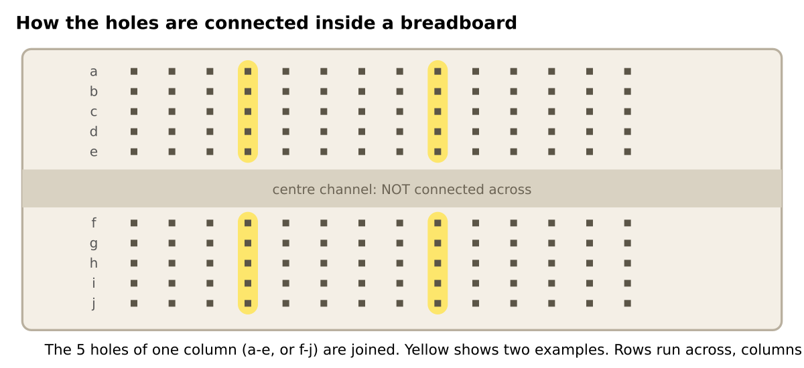
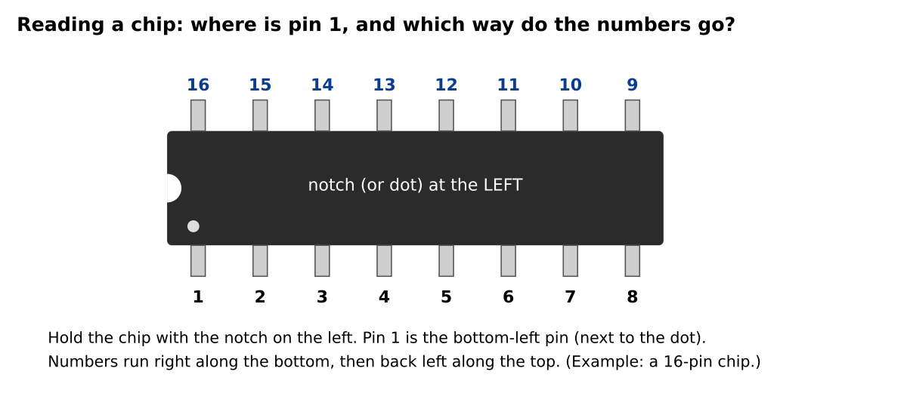

# Electronics and breadboard basics

Everything you need for months 1 and 2, in about 10 minutes. Skip what you already know.

## How the holes are connected

* A full-size breadboard has **63 numbered columns**. In each column the five holes **a–e** are joined together, and separately the five holes **f–j** are joined together.
* The **centre channel** separates the two halves. Holes on opposite sides are *not* connected.
* The **power rails** are the long lines at the top and bottom, marked red (+) and blue (−). Every hole along a rail is joined.
  Many boards have a **break in the middle** of each rail. If yours does, join the two halves with a short jumper wire.
* In this course a hole is named by its **column and row**: **16b** is column 16, row b. A rail hole is named, for example, "top red rail near column 11".

## Reading a chip

* Notch (or dot) on the **left**: pin 1 is the **bottom-left** pin. Numbers run along the bottom to the right, then back along the top to the left.
* The pictures in this course always draw chips this way.
* **Skinny chips** (28-pin SPDIP: PIC16F18857, MCP23017, ATmega328P) straddle the centre channel, with one row of pins on each side (rows e and f).
* **Wide chips** (40-pin PDIP: PIC18F47K42) are twice as far across (0.6 inch). They also straddle the channel, but the pins go in rows **d** and **h**, and the body hides rows e, f, g.
* **Straighten the legs first.** New chips come with legs splayed outwards. Press one row of pins against a flat table, then the other, until they are square.
* **Push the chip in evenly**, with your thumbs on both ends. A chip that is only half in causes the strangest faults.

## Power, ground and why every chip has a capacitor

* **+5 V** is the supply. **GND** (ground, 0 V) is the return. Every chip needs both, and **chips with more than one VDD or VSS pin need all of them connected** (the PIC18F47K42 has two of each).
* A **100 nF ceramic capacitor** between a chip's VDD and VSS pins, as close as possible, absorbs the tiny power spikes the chip makes when it switches. Leave it out and the chip may work for ten minutes, then misbehave.
* **Never** connect +5 V to GND directly (a "short"). That is why every build page asks you to check for one before powering on.

## LEDs and resistors

* An **LED** only works one way round. The **longer leg is the anode (+)**; the shorter leg (and the flat edge of the plastic) is the cathode (−).
* An LED must always have a **resistor in series**. With 5 V and a 680 Ω resistor the current is about 4 mA, which makes a clear glow and is gentle on the chip.
* Resistor values are printed as coloured bands. If you cannot read them, measure with the multimeter (take the resistor out of the circuit first).

| Value  | Colour bands (4-band) | Used for                   |
| ------ | --------------------- | -------------------------- |
| 100 Ω  | brown, black, brown   | the piezo (limits current) |
| 680 Ω  | blue, grey, brown     | LEDs                       |
| 4.7 kΩ | yellow, violet, red   | I2C pull-ups               |
| 10 kΩ  | brown, black, orange  | reset and RESET pull-ups   |

## Push buttons

A 6 mm tact switch has four legs, joined in pairs inside. Pressing it connects the two pairs. To be safe whichever way round it sits, this course wires **only the two diagonal legs** and leaves the other two unconnected.

## Using the multimeter

| Setting               | Use                                     | Example                               |
| --------------------- | --------------------------------------- | ------------------------------------- |
| **Continuity** (beep) | are two points connected? Power **off** | rail to chip pin                      |
| **Ohms (Ω)**          | how much resistance? Power **off**      | the 10 kΩ pull-up reads about 10 kΩ   |
| **DC volts (V⎓)**     | what is the voltage? Power **on**       | 5 V between a chip's VDD and VSS pins |

Always measure **power off** for continuity and resistance. Never use the continuity setting on a powered circuit.

## Reading the course diagrams

* **Schematic:** the idea of the circuit. Lines are wires. Arrow-shaped flags with a name are **net flags**: same name, same wire. Parts drawn in **green** are the new ones in this build.
* **Breadboard layout:** exactly where to plug each part. Parts with a **yellow glow** are the new ones. Curved lines are jumper wires. Dashed purple lines are the PICkit 3 leads.
* **The hole-by-hole table** under each breadboard picture is the instruction you actually follow. The picture is there to help you see it.
* Every breadboard layout in this course is **machine-checked against its schematic**: if a hole-by-hole table asked you to wire something differently from the schematic, the pictures would not have been produced.

## Static and care

* Touch something metal (a radiator) before you handle the chips. Do not rub them on carpet.
* Power **off** whenever you add or move a part.
* If a chip gets **hot to the touch**, power off at once: it is in backwards or something is shorted.

Next: [Troubleshooting](06-troubleshooting.md) or go straight to [Month 1](../month-01-electronic-dice/README.md).
